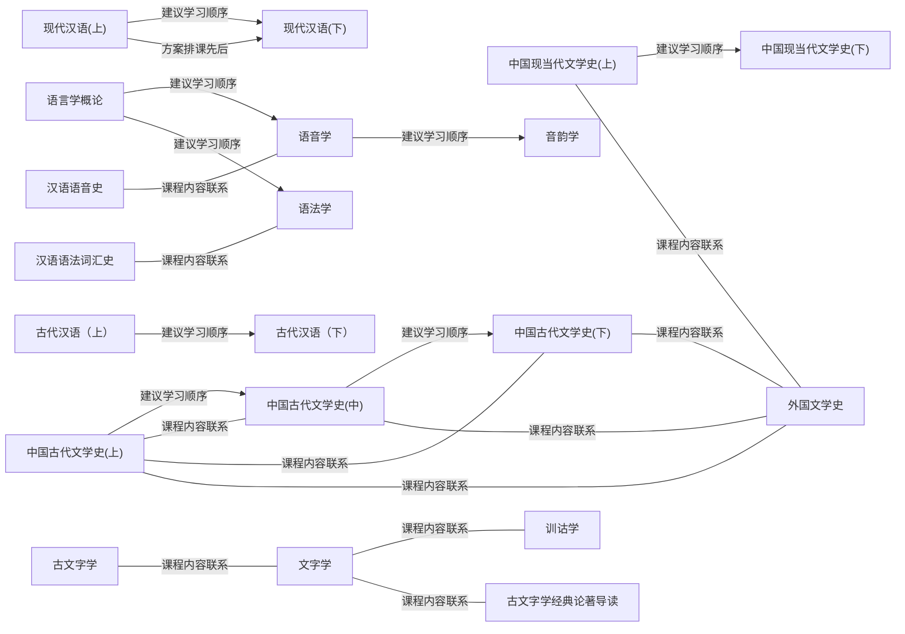

# 中国语言文学类（古文字学）专业教学培养方案（强基班适用）

2024 年汇编印刷页 80–83。原表记录 57 个可配对的课程代码。

[本节原页](plan-80.pdf#page=1) · [逐行数据](plan-80.json) · [院系目录](README.md)

## 课程导读

想了解古文字与文献的课程安排，可以在原表中找到《古文字学》（`CHIN130153`）、《甲骨学概论》（`CHIN130255`）、《商周金文概论》（`CHIN130256`）。 [原书 PDF 第 96 页](plan-80.pdf#page=3)

图中连接《古文字学》（`CHIN130153`）和《文字学》（`CHIN130185`），两门课都从课程题名标出的“文字学”切入，可沿这一主题对照阅读。 [原书 PDF 第 95 页](plan-80.pdf#page=2) · [原书 PDF 第 96 页](plan-80.pdf#page=3)

## 课程关系图

图中展示最多 20 条关系。下表列出本节全部关系。建议学习顺序供规划课程使用，正式选课资格以教务规定为准。

| 课程 | 关联课程 | 关系 | 依据 |
| --- | --- | --- | --- |
| 现代汉语(上)（CHIN130002） | 现代汉语(下)（CHIN130003） | 建议学习顺序 | 同节课程题名标明连续分册或序号。 |
| 中国现当代文学史(上)（CHIN130004） | 中国现当代文学史(下)（CHIN130005） | 建议学习顺序 | 同节课程题名标明连续分册或序号。 |
| 中国古代文学史(上)（CHIN130006） | 中国古代文学史(中)（CHIN130007） | 建议学习顺序 | 同节课程题名标明连续分册或序号。 |
| 中国古代文学史(中)（CHIN130007） | 中国古代文学史(下)（CHIN130008） | 建议学习顺序 | 同节课程题名标明连续分册或序号。 |
| 语言学概论（CHIN130011） | 语音学（CHIN130187） | 建议学习顺序 | 一般语言学概念有助于进一步认识语音系统。 |
| 语言学概论（CHIN130011） | 语法学（CHIN130239） | 建议学习顺序 | 语言结构与语法单位的概念可供语法分析使用。 |
| 语音学（CHIN130187） | 音韵学（CHIN130133） | 建议学习顺序 | 语音描述方法有助于理解历史音系。 |
| 古代汉语（上）（CHIN130226） | 古代汉语（下）（CHIN130227） | 建议学习顺序 | 同节课程题名标明连续分册或序号。 |
| 中国现当代文学史(上)（CHIN130004） | 外国文学史（CHIN130009） | 课程内容联系 | 本方案两门课程的题名均含“文学史”，可据此对照这一主题。 |
| 中国古代文学史(上)（CHIN130006） | 中国古代文学史(中)（CHIN130007） | 课程内容联系 | 本方案两门课程的题名均含“古代文学”，可据此对照这一主题。 |
| 中国古代文学史(上)（CHIN130006） | 中国古代文学史(下)（CHIN130008） | 课程内容联系 | 本方案两门课程的题名均含“古代文学”，可据此对照这一主题。 |
| 中国古代文学史(上)（CHIN130006） | 外国文学史（CHIN130009） | 课程内容联系 | 本方案两门课程的题名均含“文学史”，可据此对照这一主题。 |
| 中国古代文学史(中)（CHIN130007） | 外国文学史（CHIN130009） | 课程内容联系 | 本方案两门课程的题名均含“文学史”，可据此对照这一主题。 |
| 中国古代文学史(下)（CHIN130008） | 外国文学史（CHIN130009） | 课程内容联系 | 本方案两门课程的题名均含“文学史”，可据此对照这一主题。 |
| 古文字学（CHIN130153） | 文字学（CHIN130185） | 课程内容联系 | 本方案两门课程的题名均含“文字学”，可据此对照这一主题。 |
| 汉语语法词汇史（CHIN130177） | 语法学（CHIN130239） | 课程内容联系 | 本方案两门课程的题名均含“语法”，可据此对照这一主题。 |
| 汉语语音史（CHIN130178） | 语音学（CHIN130187） | 课程内容联系 | 本方案两门课程的题名均含“语音”，可据此对照这一主题。 |
| 文字学（CHIN130185） | 训诂学（CHIN130186） | 课程内容联系 | 文字形体与字词解释在古典文献阅读中联系紧密。 |
| 文字学（CHIN130185） | 古文字学经典论著导读（CHIN130261） | 课程内容联系 | 本方案两门课程的题名均含“文字学”，可据此对照这一主题。 |
| 现代汉语(上)（CHIN130002） | 现代汉语(下)（CHIN130003） | 方案排课先后 | 本节原表所列全部明确学期均早于后者。 |
| 中国现当代文学史(上)（CHIN130004） | 中国现当代文学史(下)（CHIN130005） | 方案排课先后 | 本节原表所列全部明确学期均早于后者。 |
| 中国古代文学史(上)（CHIN130006） | 中国古代文学史(中)（CHIN130007） | 方案排课先后 | 本节原表所列全部明确学期均早于后者。 |
| 中国古代文学史(中)（CHIN130007） | 中国古代文学史(下)（CHIN130008） | 方案排课先后 | 本节原表所列全部明确学期均早于后者。 |
| 语言学概论（CHIN130011） | 语音学（CHIN130187） | 方案排课先后 | 本节原表所列全部明确学期均早于后者。 |
| 语言学概论（CHIN130011） | 语法学（CHIN130239） | 方案排课先后 | 本节原表所列全部明确学期均早于后者。 |
| 语音学（CHIN130187） | 音韵学（CHIN130133） | 方案排课先后 | 本节原表所列全部明确学期均早于后者。 |
| 古代汉语（上）（CHIN130226） | 古代汉语（下）（CHIN130227） | 方案排课先后 | 本节原表所列全部明确学期均早于后者。 |

## 课程

| 课程代码 | 名称 | 开课学期原文 | 来源（PDF 页） |
| --- | --- | --- | --- |
| CHIN130002 | 现代汉语(上) | 1 | 95 |
| CHIN130003 | 现代汉语(下) | 2 | 95 |
| CHIN130004 | 中国现当代文学史(上) | 3 | 95 |
| CHIN130005 | 中国现当代文学史(下) | 4 | 95 |
| CHIN130006 | 中国古代文学史(上) | 1 | 95 |
| CHIN130007 | 中国古代文学史(中) | 2 | 95 |
| CHIN130008 | 中国古代文学史(下) | 3 | 95 |
| CHIN130009 | 外国文学史 | 5 | 95 |
| CHIN130010 | 文学概论 | 5 | 95 |
| CHIN130011 | 语言学概论 | 3 | 95 |
| CHIN130012 | 比较文学导论 | 6 | 95 |
| CHIN130013 | 中国文学批评史 | 7 | 95 |
| CHIN130014 | 诗骚精读 | 3 | 96 |
| CHIN130018 | 《四库提要》精读 | 6 | 96 |
| CHIN130020 | 专业英语(汉语言文学) | 7 | 95 |
| CHIN130023 | 毕业论文 | 8 | 96 |
| CHIN130024 | 《普通语言学教程》精读 | 5 | 96 |
| CHIN130026 | 《说文解字》精读 | 6 | 96 |
| CHIN130031 | 专业英语(汉语言) | 7 | 95 |
| CHIN130130 | 庄子精读 | 4 | 96 |
| CHIN130133 | 音韵学 | 5 | 95 |
| CHIN130134 | 近代汉语 | 春 | 96 |
| CHIN130138 | 语义学 | 春 | 96 |
| CHIN130143 | 汉语史 | 春 | 96 |
| CHIN130153 | 古文字学 | 5 | 96 |
| CHIN130156 | 《语言论》精读 | 6 | 96 |
| CHIN130159 | 汉语词汇学 | 春 | 96 |
| CHIN130160 | 汉语方言学 | 6 | 95 |
| CHIN130177 | 汉语语法词汇史 | 春，秋 | 96 |
| CHIN130178 | 汉语语音史 | 春 | 96 |
| CHIN130185 | 文字学 | 5 | 95 |
| CHIN130186 | 训诂学 | 6 | 95 |
| CHIN130187 | 语音学 | 4 | 95 |
| CHIN130206 | 学年论文 | 6 | 96 |
| CHIN130212 | 论语精读 | 4 | 96 |
| CHIN130213 | 语言类型学 | 春，秋 | 96 |
| CHIN130219 | 历史比较语言学 | 春，秋 | 96 |
| CHIN130221 | 古典文献学基础 | 5 | 95 |
| CHIN130226 | 古代汉语（上） | 3 | 95 |
| CHIN130227 | 古代汉语（下） | 4 | 95 |
| CHIN130229 | 学术前沿专题 | 春，秋 | 96 |
| CHIN130233 | 古籍校释实践 | 春，秋 | 96 |
| CHIN130239 | 语法学 | 5 | 95 |
| CHIN130240 | 修辞学 | 6 | 95 |
| CHIN130241 | 语言学史 | 7 | 95 |
| CHIN130255 | 甲骨学概论 | 春，秋 | 96 |
| CHIN130256 | 商周金文概论 | 春，秋 | 96 |
| CHIN130257 | 战国文字概论 | 春，秋 | 96 |
| CHIN130258 | 秦汉文字概论 | 春，秋 | 96 |
| CHIN130259 | 出土文献与传世典籍 | 春，秋 | 96 |
| CHIN130260 | 敦煌学概论 | 春，秋 | 96 |
| CHIN130261 | 古文字学经典论著导读 | 春，秋 | 96 |
| CHIN130262 | 古文字工具书与数字化资源 | 春，秋 | 97 |
| CHIN130263 | 古汉语语文基础 | 春，秋 | 97 |
| CHIN130264 | 汉语上古音基础 | 春，秋 | 97 |
| CHIN130267 | 社会实践 | 6 | 95 |
| CHIN130275 | 汉字源流与中国传统文化 | 春，秋 | 97 |
