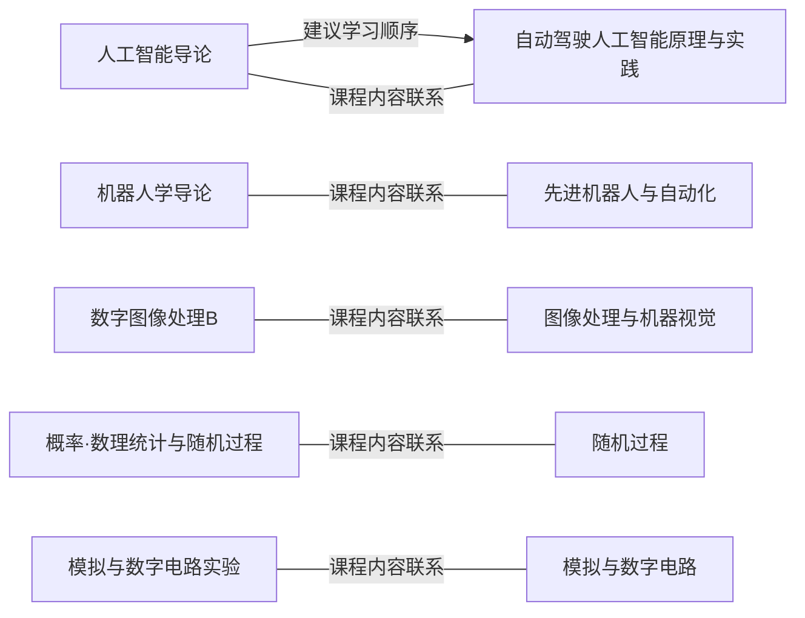

# 智能科学与技术（智能信息处理方向、智能系统与接口方向）专业“2+X”教学培养方案

2024 年汇编印刷页 838–840。原表记录 36 个可配对的课程代码。

[本节原页](plan-838.pdf#page=1) · [逐行数据](plan-838.json) · [院系目录](README.md)

## 课程关系图

图中展示最多 20 条关系。下表列出本节全部关系。建议学习顺序供规划课程使用，正式选课资格以教务规定为准。

| 课程 | 关联课程 | 关系 | 依据 |
| --- | --- | --- | --- |
| 人工智能导论（INFO130358） | 自动驾驶人工智能原理与实践（AIT410017） | 建议学习顺序 | “人工智能导论”题名标明基础层次，前置阅读可帮助了解“自动驾驶人工智能原理与实践”中的人工智能主题。 |
| 机器人学导论（AIS410007） | 先进机器人与自动化（INFO130398） | 课程内容联系 | 本方案两门课程的题名均含“机器人”，可据此对照这一主题。 |
| 自动驾驶人工智能原理与实践（AIT410017） | 人工智能导论（INFO130358） | 课程内容联系 | 本方案两门课程的题名均含“人工智能”，可据此对照这一主题。 |
| 数字图像处理B（INFO130135） | 图像处理与机器视觉（INFO130428） | 课程内容联系 | 本方案两门课程的题名均含“图像处理”，可据此对照这一主题。 |
| 概率、数理统计与随机过程（INFO130302） | 随机过程（INFO130399） | 课程内容联系 | 本方案两门课程的题名均含“随机过程”，可据此对照这一主题。 |
| 模拟与数字电路实验（INFO130348） | 模拟与数字电路（INFO130369） | 课程内容联系 | 同节同题名的课程与实验、实习或实践。 |

## 课程

| 课程代码 | 名称 | 开课学期原文 | 来源（PDF 页） |
| --- | --- | --- | --- |
| AIS310018 | 脑科学导论 | 3 | 852 |
| AIS410007 | 机器人学导论 | 5 | 853 |
| AIT310027 | AI增强仿真学：理论与实践 | 秋 | 854 |
| AIT410017 | 自动驾驶人工智能原理与实践 | 春 | 854 |
| COMP130141 | 自然语言处理 | 6 | 853 |
| INFO130015 | 生产实习 | 7 | 853 |
| INFO130016 | 毕业论文 | 8 | 853 |
| INFO130020 | 生物医学工程学基础 | 春 | 853 |
| INFO130073 | 多媒体技术 | 秋 | 853 |
| INFO130079 | 科技英语 | 秋 | 853 |
| INFO130080 | 可编程器件与硬件描述语言 | 秋 | 853 |
| INFO130090 | 医学成像技术 | 秋 | 853 |
| INFO130092 | 医学信号处理 | 春 | 853 |
| INFO130135 | 数字图像处理B | 秋 | 853 |
| INFO130138 | 信号检测与估计基础 | 春，秋 | 853 |
| INFO130302 | 概率、数理统计与随机过程 | 3 | 852 |
| INFO130305 | 数据结构与算法设计 | 3 | 852 |
| INFO130306 | 信号与系统 | 4 | 852 |
| INFO130310 | 自动控制原理 | 5 | 853 |
| INFO130311 | 计算机原理与体系结构 | 4 | 852 |
| INFO130342 | 机器学习 | 秋 | 853 |
| INFO130348 | 模拟与数字电路实验 | 春 | 853 |
| INFO130357 | 智能科学的数学基础 | 4 | 852 |
| INFO130358 | 人工智能导论 | 4 | 852 |
| INFO130359 | 统计学习 | 5 | 852 |
| INFO130360 | 智能系统设计 | 7 | 853 |
| INFO130361 | 群体智能 | 秋 | 853 |
| INFO130369 | 模拟与数字电路 | 3 | 852 |
| INFO130370 | 机械设计 | 6 | 853 |
| INFO130373 | 数据库与数据仓库 | 5 | 853 |
| INFO130374 | 智能SoC设计 | 秋 | 853 |
| INFO130398 | 先进机器人与自动化 | 春 | 854 |
| INFO130399 | 随机过程 | 秋 | 854 |
| INFO130428 | 图像处理与机器视觉 | 6 | 853 |
| INFO130429 | 计算神经学 | 秋 | 854 |
| SOCI130032 | 认知心理学 | 秋 | 854 |
