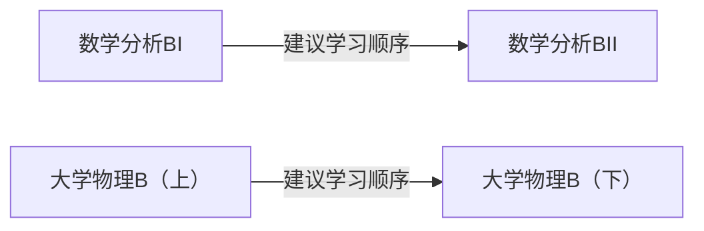

# 智能科学与技术（智能信息处理方向、智能系统与接口方向）专业“2+X”修读建议

2024 年汇编印刷页 841–842。原表记录 25 个可配对的课程代码。

[本节原页](plan-838.pdf#page=4) · [逐行数据](plan-838.json) · [院系目录](README.md)

## 课程关系图

图中展示最多 20 条关系。下表列出本节全部关系。建议学习顺序供规划课程使用，正式选课资格以教务规定为准。

| 课程 | 关联课程 | 关系 | 依据 |
| --- | --- | --- | --- |
| 数学分析BI（MATH120016） | 数学分析BII（MATH120017） | 建议学习顺序 | 同节课程题名标明连续分册或序号。 |
| 大学物理B（上）（PHYS120013） | 大学物理B（下）（PHYS120014） | 建议学习顺序 | 同节课程题名标明连续分册或序号。 |

## 课程

| 课程代码 | 名称 | 开课学期原文 | 来源（PDF 页） |
| --- | --- | --- | --- |
| AIS310018 | 脑科学导论 |  | 855 |
| COMP120004 | 线性代数 |  | 855 |
| COMP120006 | 程序设计 |  | 855 |
| INFO130015 | 生产实习 |  | 856 |
| INFO130016 | 毕业论文 |  | 856 |
| INFO130302 | 概率、数理统计与随机过程 |  | 855 |
| INFO130305 | 数据结构与算法设计 |  | 855 |
| INFO130306 | 信号与系统 |  | 856 |
| INFO130311 | 计算机原理与体系结构 |  | 856 |
| INFO130357 | 智能科学的数学基础 |  | 856 |
| INFO130358 | 人工智能导论 |  | 856 |
| INFO130359 | 统计学习 |  | 856 |
| INFO130369 | 模拟与数字电路 |  | 855 |
| INFO130428 | 图像处理与机器视觉 |  | 856 |
| MATH120016 | 数学分析BI |  | 855 |
| MATH120017 | 数学分析BII |  | 855 |
| MICR120001 | 电路基础 |  | 855 |
| PHYS120013 | 大学物理B（上） |  | 855 |
| PHYS120014 | 大学物理B（下） |  | 855 |
| PHYS120015 | 基础物理实验 |  | 855 |
| PTSS110082 | 毛泽东思想和中国特色社会主义理论体系概论 |  | 855 |
| PTSS110087 | 马克思主义基本原理 |  | 855 |
| PTSS110088 | 中国近现代史纲要 |  | 855 |
| PTSS110089 | 思想道德与法治 |  | 855 |
| PTSS110090 | 习近平新时代中国特色社会主义思想概论 |  | 855 |
