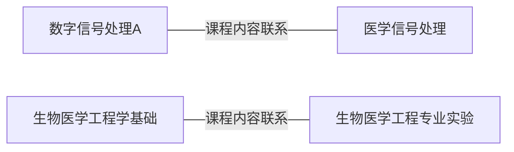

# 生物医学工程专业“2+X”教学培养方案

2024 年汇编印刷页 857–859。原表记录 44 个可配对的课程代码。

[本节原页](plan-857.pdf#page=1) · [逐行数据](plan-857.json) · [院系目录](README.md)

## 课程导读

想了解生物医学与工程的课程安排，可以在原表中找到《生物医学工程学基础》（`INFO130020`）、《医学信号处理》（`INFO130092`）、《生物医学工程专业实验》（`INFO130390`）。 [原书 PDF 第 871 页](plan-857.pdf#page=1) · [原书 PDF 第 872 页](plan-857.pdf#page=2)

图中连接《生物医学工程学基础》（`INFO130020`）和《生物医学工程专业实验》（`INFO130390`），两门课都从课程题名标出的“生物医学工程”切入，可沿这一主题对照阅读。 [原书 PDF 第 871 页](plan-857.pdf#page=1) · [原书 PDF 第 872 页](plan-857.pdf#page=2)

## 课程关系图

图中展示最多 20 条关系。下表列出本节全部关系。建议学习顺序供规划课程使用，正式选课资格以教务规定为准。

| 课程 | 关联课程 | 关系 | 依据 |
| --- | --- | --- | --- |
| 数字信号处理A（INFO130010） | 医学信号处理（INFO130092） | 课程内容联系 | 本方案两门课程的题名均含“信号处理”，可据此对照这一主题。 |
| 生物医学工程学基础（INFO130020） | 生物医学工程专业实验（INFO130390） | 课程内容联系 | 本方案两门课程的题名均含“生物医学工程”，可据此对照这一主题。 |

## 课程

| 课程代码 | 名称 | 开课学期原文 | 来源（PDF 页） |
| --- | --- | --- | --- |
| AIT310027 | AI增强仿真学：理论与实践 | 秋 | 873 |
| AIT410017 | 自动驾驶人工智能原理与实践 | 春 | 873 |
| AIT531030 | 医学超声技术 | 春 | 873 |
| INFO130001 | 概率、数理统计与随机过程 | 3 | 871 |
| INFO130002 | 工程数学 | 3 | 871 |
| INFO130009 | 信号与通信系统 | 4 | 871 |
| INFO130010 | 数字信号处理A | 5 | 871 |
| INFO130015 | 生产实习 | 6，7 | 872 |
| INFO130016 | 毕业论文 | 8 | 872 |
| INFO130017 | 工程生理学基础 | 6 | 872 |
| INFO130020 | 生物医学工程学基础 | 5 | 871 |
| INFO130029 | 高频电子线路B | 4 | 871 |
| INFO130038 | 计算机体系结构 | 6 | 872 |
| INFO130071 | 电工实验 | 秋 | 872 |
| INFO130072 | 电子系统设计 | 秋 | 872 |
| INFO130073 | 多媒体技术 | 秋 | 872 |
| INFO130077 | 计算机网络 | 秋 | 872 |
| INFO130078 | 近代医学概论 | 春 | 872 |
| INFO130079 | 科技英语 | 春，秋 | 872 |
| INFO130080 | 可编程器件与硬件描述语言 | 秋 | 872 |
| INFO130082 | 数据采集和处理系统 | 春 | 872 |
| INFO130087 | 心脏电生理与起搏 | 春 | 872 |
| INFO130090 | 医学成像技术 | 秋 | 872 |
| INFO130091 | 医学传感器 | 5 | 872 |
| INFO130092 | 医学信号处理 | 6 | 872 |
| INFO130131 | 光通信网络基础 | 秋 | 872 |
| INFO130135 | 数字图像处理B | 秋 | 872 |
| INFO130137 | 卫星与移动通信B | 秋 | 872 |
| INFO130189 | 网络科学导论 | 春 | 872 |
| INFO130227 | 电磁生物效应及医学应用 | 秋 | 872 |
| INFO130234 | 工程图学及应用 | 春 | 872 |
| INFO130240 | 通信编码原理与技术 | 春 | 873 |
| INFO130327 | 数据结构 | 春 | 873 |
| INFO130329 | 信息论基础 | 4 | 871 |
| INFO130331 | 数字逻辑基础 | 3 | 871 |
| INFO130342 | 机器学习 | 秋 | 873 |
| INFO130347 | 模拟电子学基础 | 3 | 871 |
| INFO130348 | 模拟与数字电路实验 | 4 | 871 |
| INFO130353 | 信号与系统实验 | 5 | 871 |
| INFO130355 | 高频电路实验 | 6 | 872 |
| INFO130361 | 群体智能 | 秋 | 873 |
| INFO130368 | 微机原理与接口实验 | 5 | 871 |
| INFO130390 | 生物医学工程专业实验 | 7 | 872 |
| INFO130407 | 医学电子创新设计与实验 | 秋 | 873 |
