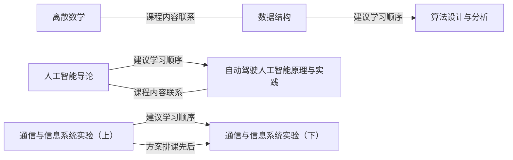

# 通信工程专业“2+X”教学培养方案

2024 年汇编印刷页 862–864。原表记录 47 个可配对的课程代码。

[本节原页](plan-862.pdf#page=1) · [逐行数据](plan-862.json) · [院系目录](README.md)

## 课程导读

想了解通信与信号的课程安排，可以在原表中找到《信号与通信系统》（`INFO130009`）、《计算机通信与网络》（`INFO130031`）、《通信原理B》（`INFO130354`）。 [原书 PDF 第 876 页](plan-862.pdf#page=1) · [原书 PDF 第 877 页](plan-862.pdf#page=2)

《通信与信息系统实验（上）》（`INFO130402`）和《通信与信息系统实验（下）》（`INFO130403`）是同一系列，图中的箭头按题名标出的分册顺序排列。原表分别排在第 6 学期和第 7 学期。 [原书 PDF 第 877 页](plan-862.pdf#page=2)

## 课程关系图

图中展示最多 20 条关系。下表列出本节全部关系。建议学习顺序供规划课程使用，正式选课资格以教务规定为准。

| 课程 | 关联课程 | 关系 | 依据 |
| --- | --- | --- | --- |
| 数据结构（INFO130327） | 算法设计与分析（INFO130057） | 建议学习顺序 | 数据组织与基本操作为算法设计提供基础。 |
| 人工智能导论（INFO130358） | 自动驾驶人工智能原理与实践（AIT410017） | 建议学习顺序 | “人工智能导论”题名标明基础层次，前置阅读可帮助了解“自动驾驶人工智能原理与实践”中的人工智能主题。 |
| 通信与信息系统实验（上）（INFO130402） | 通信与信息系统实验（下）（INFO130403） | 建议学习顺序 | 同节课程题名标明连续分册或序号。 |
| 自动驾驶人工智能原理与实践（AIT410017） | 人工智能导论（INFO130358） | 课程内容联系 | 本方案两门课程的题名均含“人工智能”，可据此对照这一主题。 |
| 离散数学（INFO130120） | 数据结构（INFO130327） | 课程内容联系 | 图、树与离散结构 |
| 通信与信息系统实验（上）（INFO130402） | 通信与信息系统实验（下）（INFO130403） | 方案排课先后 | 本节原表所列全部明确学期均早于后者。 |

## 课程

| 课程代码 | 名称 | 开课学期原文 | 来源（PDF 页） |
| --- | --- | --- | --- |
| AIT310027 | AI增强仿真学：理论与实践 | 秋 | 878 |
| AIT410017 | 自动驾驶人工智能原理与实践 | 春 | 878 |
| INFO130001 | 概率、数理统计与随机过程 | 3 | 876 |
| INFO130002 | 工程数学 | 3 | 876 |
| INFO130009 | 信号与通信系统 | 4 | 876 |
| INFO130010 | 数字信号处理A | 5 | 876 |
| INFO130015 | 生产实习 | 7 | 877 |
| INFO130016 | 毕业论文 | 8 | 877 |
| INFO130029 | 高频电子线路B | 4 | 876 |
| INFO130030 | 电磁场与微波技术 | 4 | 877 |
| INFO130031 | 计算机通信与网络 | 6 | 877 |
| INFO130033 | 电信网络基础 | 秋 | 878 |
| INFO130038 | 计算机体系结构 | 春 | 877 |
| INFO130057 | 算法设计与分析 | 春 | 877 |
| INFO130079 | 科技英语 | 秋 | 877 |
| INFO130120 | 离散数学 | 春 | 877 |
| INFO130122 | 网络协议与网络安全基础 | 秋 | 878 |
| INFO130131 | 光通信网络基础 | 秋 | 878 |
| INFO130132 | 计算机仿真与模拟 | 秋 | 877 |
| INFO130135 | 数字图像处理B | 秋 | 877 |
| INFO130137 | 卫星与移动通信B | 秋 | 878 |
| INFO130138 | 信号检测与估计基础 | 7 | 877 |
| INFO130141 | 遥感原理与技术 | 秋 | 877 |
| INFO130236 | 前沿讲座 | 春 | 877 |
| INFO130240 | 通信编码原理与技术 | 春 | 878 |
| INFO130282 | 微波工程基础 | 春 | 877 |
| INFO130283 | 天线原理 | 秋 | 877 |
| INFO130326 | 智能硬件创新方法概论与基础实践 | 秋 | 877 |
| INFO130327 | 数据结构 | 春 | 877 |
| INFO130329 | 信息论基础 | 4 | 876 |
| INFO130331 | 数字逻辑基础 | 3 | 876 |
| INFO130336 | 无线通信 | 秋 | 878 |
| INFO130342 | 机器学习 | 秋 | 877 |
| INFO130347 | 模拟电子学基础 | 3 | 876 |
| INFO130348 | 模拟与数字电路实验 | 4 | 876 |
| INFO130353 | 信号与系统实验 | 5 | 876 |
| INFO130354 | 通信原理B | 5 | 876 |
| INFO130358 | 人工智能导论 | 春 | 877 |
| INFO130362 | 科学计算 | 秋 | 878 |
| INFO130363 | 智能信息处理与系统 | 春 | 878 |
| INFO130364 | 空天信息导论 | 春 | 878 |
| INFO130365 | 智能通信导论 | 春 | 878 |
| INFO130368 | 微机原理与接口实验 | 5 | 876 |
| INFO130401 | 光纤通信原理 | 6 | 877 |
| INFO130402 | 通信与信息系统实验（上） | 6 | 877 |
| INFO130403 | 通信与信息系统实验（下） | 7 | 877 |
| INFO130404 | 智能光电子导论 | 春 | 878 |
