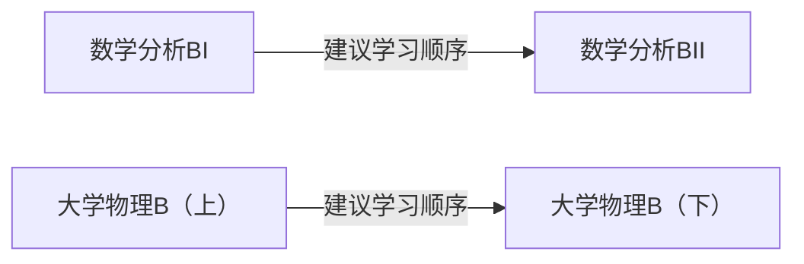

# 通信工程专业“2+X”修读建议

2024 年汇编印刷页 865–866。原表记录 27 个可配对的课程代码。

[本节原页](plan-862.pdf#page=4) · [逐行数据](plan-862.json) · [院系目录](README.md)

## 课程导读

想了解通信与信号的课程安排，可以在原表中找到《信号与通信系统》（`INFO130009`）、《通信原理B》（`INFO130354`）、《数字信号处理A》（`INFO130010`）。 [原书 PDF 第 880 页](plan-862.pdf#page=5)

《数学分析BI》（`MATH120016`）和《数学分析BII》（`MATH120017`）是同一系列，图中的箭头按题名标出的分册顺序排列。 [原书 PDF 第 879 页](plan-862.pdf#page=4)

## 课程关系图

图中展示最多 20 条关系。下表列出本节全部关系。建议学习顺序供规划课程使用，正式选课资格以教务规定为准。

| 课程 | 关联课程 | 关系 | 依据 |
| --- | --- | --- | --- |
| 数学分析BI（MATH120016） | 数学分析BII（MATH120017） | 建议学习顺序 | 同节课程题名标明连续分册或序号。 |
| 大学物理B（上）（PHYS120013） | 大学物理B（下）（PHYS120014） | 建议学习顺序 | 同节课程题名标明连续分册或序号。 |

## 课程

| 课程代码 | 名称 | 开课学期原文 | 来源（PDF 页） |
| --- | --- | --- | --- |
| COMP120004 | 线性代数 |  | 879 |
| COMP120006 | 程序设计 |  | 879 |
| INFO120011 | 电子系统导论 |  | 879 |
| INFO130001 | 概率、数理统计与随机过程 |  | 879 |
| INFO130002 | 工程数学 |  | 879 |
| INFO130009 | 信号与通信系统 |  | 880 |
| INFO130010 | 数字信号处理A |  | 880 |
| INFO130015 | 生产实习 |  | 880 |
| INFO130016 | 毕业论文 |  | 880 |
| INFO130029 | 高频电子线路B |  | 880 |
| INFO130329 | 信息论基础 |  | 880 |
| INFO130331 | 数字逻辑基础 |  | 879 |
| INFO130347 | 模拟电子学基础 |  | 879 |
| INFO130348 | 模拟与数字电路实验 |  | 880 |
| INFO130353 | 信号与系统实验 |  | 880 |
| INFO130354 | 通信原理B |  | 880 |
| INFO130368 | 微机原理与接口实验 |  | 880 |
| MATH120016 | 数学分析BI |  | 879 |
| MATH120017 | 数学分析BII |  | 879 |
| PHYS120013 | 大学物理B（上） |  | 879 |
| PHYS120014 | 大学物理B（下） |  | 879 |
| PHYS120015 | 基础物理实验 |  | 879 |
| PTSS110082 | 毛泽东思想和中国特色社会主义理论体系概论 |  | 879 |
| PTSS110087 | 马克思主义基本原理 |  | 879 |
| PTSS110088 | 中国近现代史纲要 |  | 879 |
| PTSS110089 | 思想道德与法治 |  | 879 |
| PTSS110090 | 习近平新时代中国特色社会主义思想概论 |  | 879 |
