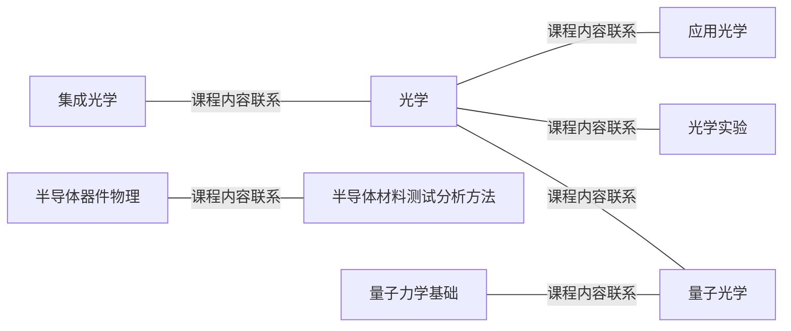

# 光电信息科学与工程专业“2+X”教学培养方案

2024 年汇编印刷页 867–870。原表记录 54 个可配对的课程代码。

[本节原页](plan-867.pdf#page=1) · [逐行数据](plan-867.json) · [院系目录](README.md)

## 课程关系图

图中展示最多 20 条关系。下表列出本节全部关系。建议学习顺序供规划课程使用，正式选课资格以教务规定为准。

| 课程 | 关联课程 | 关系 | 依据 |
| --- | --- | --- | --- |
| 集成光学（INFO130146） | 光学（INFO130237） | 课程内容联系 | 本方案两门课程的题名均含“光学”，可据此对照这一主题。 |
| 光学（INFO130237） | 应用光学（INFO130287） | 课程内容联系 | 本方案两门课程的题名均含“光学”，可据此对照这一主题。 |
| 光学（INFO130237） | 光学实验（INFO130384） | 课程内容联系 | 同节同题名的课程与实验、实习或实践。 |
| 光学（INFO130237） | 量子光学（INFO130388） | 课程内容联系 | 本方案两门课程的题名均含“光学”，可据此对照这一主题。 |
| 半导体器件物理（INFO130385） | 半导体材料测试分析方法（INFO130396） | 课程内容联系 | 本方案两门课程的题名均含“半导体”，可据此对照这一主题。 |
| 量子力学基础（INFO130387） | 量子光学（INFO130388） | 课程内容联系 | 本方案两门课程的题名均含“量子”，可据此对照这一主题。 |

## 课程

| 课程代码 | 名称 | 开课学期原文 | 来源（PDF 页） |
| --- | --- | --- | --- |
| AIT310027 | AI增强仿真学：理论与实践 | 秋 | 883 |
| AIT410017 | 自动驾驶人工智能原理与实践 | 春 | 883 |
| INFO130002 | 工程数学 | 3 | 881 |
| INFO130015 | 生产实习 | 7 | 881 |
| INFO130016 | 毕业论文 | 8 | 881 |
| INFO130044 | 激光原理与技术 | 5 | 882 |
| INFO130045 | 光纤通信原理与技术 | 6 | 882 |
| INFO130046 | 光子学器件与工艺 | 秋 | 882 |
| INFO130047 | 专业实验 | 7 | 882 |
| INFO130135 | 数字图像处理B | 春 | 882, 883 |
| INFO130143 | 固体光学性质 | 春 | 882 |
| INFO130144 | 光谱技术与应用 | 春 | 882, 883 |
| INFO130145 | 光生物医学 | 秋 | 882 |
| INFO130146 | 集成光学 | 秋 | 882, 883 |
| INFO130149 | 液晶原理与应用 | 春 | 882, 883 |
| INFO130150 | 应用非线性光学 | 春 | 882 |
| INFO130234 | 工程图学及应用 | 春 | 882 |
| INFO130237 | 光学 | 3 | 881 |
| INFO130250 | 光电测试技术 | 5 | 881 |
| INFO130251 | 专业英语 | 春 | 883 |
| INFO130253 | 电力电子学 | 春 | 883 |
| INFO130255 | 发光材料及其应用 | 春 | 883 |
| INFO130256 | 照明人体工效学 | 春 | 883 |
| INFO130261 | 激光工程 | 秋 | 882 |
| INFO130267 | 真空与薄膜技术基础 | 秋 | 883 |
| INFO130275 | 光学检测技术 | 春 | 882 |
| INFO130277 | 光传感技术 | 秋 | 882 |
| INFO130280 | 光学薄膜设计导论 | 秋 | 882 |
| INFO130287 | 应用光学 | 4 | 881 |
| INFO130294 | 数字控制理论与应用 | 春 | 883 |
| INFO130295 | 光源原理 | 5 | 882 |
| INFO130298 | 传感器与信号处理 | 春 | 883 |
| INFO130299 | 照明设计 | 秋 | 883 |
| INFO130300 | LED器件及应用技术 | 春 | 882, 883 |
| INFO130328 | 现代光子学 | 春 | 883 |
| INFO130331 | 数字逻辑基础 | 3 | 881 |
| INFO130345 | 现代信息光学 | 6 | 882 |
| INFO130347 | 模拟电子学基础 | 3 | 881 |
| INFO130348 | 模拟与数字电路实验 | 4 | 881 |
| INFO130368 | 微机原理与接口实验 | 5 | 881 |
| INFO130383 | 固体物理导论 | 4 | 881 |
| INFO130384 | 光学实验 | 5 | 881 |
| INFO130385 | 半导体器件物理 | 5、秋 | 882, 883 |
| INFO130386 | 偏振器件原理与应用 | 春 | 882, 883 |
| INFO130387 | 量子力学基础 | 春 | 882 |
| INFO130388 | 量子光学 | 秋 | 882 |
| INFO130389 | 智能光电系统导论 | 春 | 882 |
| INFO130391 | 颜色信息科学 | 5 | 882 |
| INFO130392 | 光电显示技术基础 | 6 | 882 |
| INFO130393 | 智能光电驱动技术 | 6 | 882 |
| INFO130396 | 半导体材料测试分析方法 | 春 | 883 |
| INFO130397 | 应用光学系统设计 | 秋 | 883 |
| INFO130400 | 电磁场与电磁波A | 4 | 881 |
| INFO130405 | 激光雷达技术及应用 | 春 | 883 |
