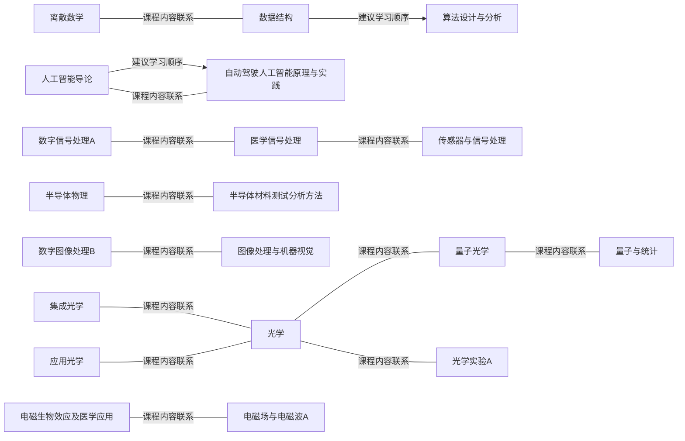

# 电子信息科学与技术（光子计划院士班）专业“2+X”教学培养方案

2024 年汇编印刷页 878–884。原表记录 109 个可配对的课程代码。

[本节原页](plan-878.pdf#page=1) · [逐行数据](plan-878.json) · [院系目录](README.md)

## 课程导读

想了解电子线路与信号的课程安排，可以在原表中找到《高频电子线路B》（`INFO130029`）、《信号与通信系统》（`INFO130009`）、《数字逻辑基础》（`INFO130331`）。 [原书 PDF 第 892 页](plan-878.pdf#page=1) · [原书 PDF 第 893 页](plan-878.pdf#page=2)

图中连接《数字信号处理A》（`INFO130010`）和《医学信号处理》（`INFO130092`），两门课都从课程题名标出的“信号处理”切入，可沿这一主题对照阅读。 [原书 PDF 第 893 页](plan-878.pdf#page=2) · [原书 PDF 第 895 页](plan-878.pdf#page=4)

## 课程关系图

图中展示最多 20 条关系。下表列出本节全部关系。建议学习顺序供规划课程使用，正式选课资格以教务规定为准。

| 课程 | 关联课程 | 关系 | 依据 |
| --- | --- | --- | --- |
| 数据结构（INFO130327） | 算法设计与分析（INFO130057） | 建议学习顺序 | 数据组织与基本操作为算法设计提供基础。 |
| 人工智能导论（INFO130358） | 自动驾驶人工智能原理与实践（AIT410017） | 建议学习顺序 | “人工智能导论”题名标明基础层次，前置阅读可帮助了解“自动驾驶人工智能原理与实践”中的人工智能主题。 |
| 自动驾驶人工智能原理与实践（AIT410017） | 人工智能导论（INFO130358） | 课程内容联系 | 本方案两门课程的题名均含“人工智能”，可据此对照这一主题。 |
| 数字信号处理A（INFO130010） | 医学信号处理（INFO130092） | 课程内容联系 | 本方案两门课程的题名均含“信号处理”，可据此对照这一主题。 |
| 半导体物理（INFO130022） | 半导体材料测试分析方法（INFO130396） | 课程内容联系 | 本方案两门课程的题名均含“半导体”，可据此对照这一主题。 |
| 医学信号处理（INFO130092） | 传感器与信号处理（INFO130298） | 课程内容联系 | 本方案两门课程的题名均含“信号处理”，可据此对照这一主题。 |
| 离散数学（INFO130120） | 数据结构（INFO130327） | 课程内容联系 | 图、树与离散结构 |
| 数字图像处理B（INFO130135） | 图像处理与机器视觉（INFO130428） | 课程内容联系 | 本方案两门课程的题名均含“图像处理”，可据此对照这一主题。 |
| 集成光学（INFO130146） | 光学（INFO130366） | 课程内容联系 | 本方案两门课程的题名均含“光学”，可据此对照这一主题。 |
| 电磁生物效应及医学应用（INFO130227） | 电磁场与电磁波A（INFO130400） | 课程内容联系 | 本方案两门课程的题名均含“电磁”，可据此对照这一主题。 |
| 应用光学（INFO130287） | 光学（INFO130366） | 课程内容联系 | 本方案两门课程的题名均含“光学”，可据此对照这一主题。 |
| 光学（INFO130366） | 量子光学（INFO130388） | 课程内容联系 | 本方案两门课程的题名均含“光学”，可据此对照这一主题。 |
| 光学（INFO130366） | 光学实验A（INFO130409） | 课程内容联系 | 本方案两门课程的题名均含“光学”，可据此对照这一主题。 |
| 量子光学（INFO130388） | 量子与统计（INFO130412） | 课程内容联系 | 本方案两门课程的题名均含“量子”，可据此对照这一主题。 |

## 课程

| 课程代码 | 名称 | 开课学期原文 | 来源（PDF 页） |
| --- | --- | --- | --- |
| AIT310027 | AI增强仿真学：理论与实践 | 秋 | 897 |
| AIT410017 | 自动驾驶人工智能原理与实践 | 春 | 897 |
| INFO130001 | 概率、数理统计与随机过程 | 3 | 892 |
| INFO130002 | 工程数学 | 3 | 892 |
| INFO130009 | 信号与通信系统 | 4 | 893 |
| INFO130010 | 数字信号处理A | 5 | 893 |
| INFO130014 | 自动控制原理 | 5 | 894 |
| INFO130015 | 生产实习 | 6,7 | 893 |
| INFO130016 | 毕业论文 | 8 | 893 |
| INFO130017 | 工程生理学基础 | 6 | 895 |
| INFO130022 | 半导体物理 | 5 | 893 |
| INFO130029 | 高频电子线路B | 4 | 892 |
| INFO130033 | 电信网络基础 | 春，秋 | 895 |
| INFO130038 | 计算机体系结构 | 6 | 893 |
| INFO130044 | 激光原理与技术 | 5 | 896 |
| INFO130045 | 光纤通信原理与技术 | 6 | 894 |
| INFO130046 | 光子学器件与工艺 | 春，秋 | 896 |
| INFO130057 | 算法设计与分析 | 春，秋 | 897 |
| INFO130071 | 电工实验 | 春，秋 | 894 |
| INFO130072 | 电子系统设计 | 7 | 894, 895 |
| INFO130073 | 多媒体技术 | 春，秋 | 894 |
| INFO130077 | 计算机网络 | 春，秋 | 894 |
| INFO130078 | 近代医学概论 | 春，秋 | 895 |
| INFO130079 | 科技英语 | 春，秋 | 894, 895, 896 |
| INFO130080 | 可编程器件与硬件描述语言 | 5、春，秋 | 894, 895 |
| INFO130082 | 数据采集和处理系统 | 春，秋 | 894, 896 |
| INFO130087 | 心脏电生理与起搏 | 春，秋 | 895 |
| INFO130089 | 医学超声技术 | 春，秋 | 895 |
| INFO130090 | 医学成像技术 | 春，秋 | 894, 895 |
| INFO130091 | 医学传感器 | 5 | 895 |
| INFO130092 | 医学信号处理 | 6 | 895 |
| INFO130120 | 离散数学 | 春，秋 | 897 |
| INFO130122 | 网络协议与网络安全基础 | 春，秋 | 895 |
| INFO130131 | 光通信网络基础 | 春，秋 | 895 |
| INFO130132 | 计算机仿真与模拟 | 春，秋 | 897 |
| INFO130135 | 数字图像处理B | 春，秋 | 894, 895 |
| INFO130137 | 卫星与移动通信B | 春，秋 | 895 |
| INFO130141 | 遥感原理与技术 | 春，秋 | 895 |
| INFO130144 | 光谱技术与应用 | 春，秋 | 896 |
| INFO130145 | 光生物医学 | 春，秋 | 896 |
| INFO130146 | 集成光学 | 春，秋 | 896 |
| INFO130149 | 液晶原理与应用 | 春，秋 | 896 |
| INFO130150 | 应用非线性光学 | 春，秋 | 896 |
| INFO130189 | 网络科学导论 | 春，秋 | 894 |
| INFO130227 | 电磁生物效应及医学应用 | 春，秋 | 895 |
| INFO130234 | 工程图学及应用 | 春，秋 | 894, 896 |
| INFO130240 | 通信编码原理与技术 | 春，秋 | 895 |
| INFO130253 | 电力电子学 | 春，秋 | 894 |
| INFO130255 | 发光材料及其应用 | 春，秋 | 896 |
| INFO130256 | 照明人体工效学 | 春，秋 | 897 |
| INFO130261 | 激光工程 | 春，秋 | 896 |
| INFO130275 | 光学检测技术 | 春，秋 | 896 |
| INFO130277 | 光传感技术 | 春，秋 | 896 |
| INFO130280 | 光学薄膜设计导论 | 春，秋 | 896 |
| INFO130282 | 微波工程基础 | 春，秋 | 895 |
| INFO130283 | 天线原理 | 春，秋 | 895 |
| INFO130287 | 应用光学 | 6 | 893 |
| INFO130289 | 电气工程基础 | 春，秋 | 894 |
| INFO130294 | 数字控制理论与应用 | 春，秋 | 897 |
| INFO130295 | 光源原理 | 5 | 896 |
| INFO130298 | 传感器与信号处理 | 春，秋 | 897 |
| INFO130299 | 照明设计 | 春，秋 | 897 |
| INFO130300 | LED器件及应用技 术 | 春，秋 | 896 |
| INFO130326 | 智能硬件创新方法概论与基础实践 | 春，秋 | 897 |
| INFO130327 | 数据结构 | 6 | 893 |
| INFO130328 | 现代光子学 | 春，秋 | 896 |
| INFO130329 | 信息论基础 | 4 | 893 |
| INFO130331 | 数字逻辑基础 | 3 | 892 |
| INFO130336 | 无线通信 | 春，秋 | 895 |
| INFO130342 | 机器学习 | 5、春，秋 | 895, 897 |
| INFO130345 | 现代信息光学 | 6 | 896 |
| INFO130346 | 脑科学导论 | 春，秋 | 897 |
| INFO130347 | 模拟电子学基础 | 3 | 892 |
| INFO130348 | 模拟与数字电路实验 | 4 | 892 |
| INFO130353 | 信号与系统实验 | 5 | 893 |
| INFO130354 | 通信原理B | 5 | 894 |
| INFO130355 | 高频电路实验 | 6 | 894 |
| INFO130358 | 人工智能导论 | 春，秋 | 897 |
| INFO130359 | 统计学习 | 春，秋 | 897 |
| INFO130360 | 智能系统设计 | 春，秋 | 897 |
| INFO130361 | 群体智能 | 春，秋 | 897 |
| INFO130362 | 科学计算 | 春，秋 | 897 |
| INFO130363 | 智能信息处理与系统 | 春，秋 | 897 |
| INFO130364 | 空天信息导论 | 春，秋 | 895 |
| INFO130365 | 智能通信导论 | 春，秋 | 895 |
| INFO130366 | 光学 | 4 | 893 |
| INFO130368 | 微机原理与接口实验 | 5 | 894, 895, 896 |
| INFO130371 | 机器人学导论 | 春，秋 | 897 |
| INFO130386 | 偏振器件原理与应用 | 春，秋 | 896 |
| INFO130388 | 量子光学 | 春，秋 | 896 |
| INFO130389 | 智能光电系统导论 | 春，秋 | 896 |
| INFO130392 | 光电显示技术基础 | 6 | 894 |
| INFO130393 | 智能光电驱动技术 | 春，秋 | 896 |
| INFO130396 | 半导体材料测试分析方法 | 春，秋 | 896 |
| INFO130397 | 应用光学系统设计 | 春，秋 | 897 |
| INFO130400 | 电磁场与电磁波A | 4 | 893 |
| INFO130401 | 光纤通信原理 | 6 | 895 |
| INFO130404 | 智能光电子导论 | 春，秋 | 896 |
| INFO130405 | 激光雷达技术及应用 | 春，秋 | 896 |
| INFO130407 | 医学电子创新设计与实验 | 春，秋 | 896 |
| INFO130408 | 信息科技前沿讲座 | 3 | 892 |
| INFO130409 | 光学实验A | 5 | 893 |
| INFO130410 | 光电信号检测原理与技术 | 5 | 893 |
| INFO130411 | 通信与网络 | 6 | 893 |
| INFO130412 | 量子与统计 | 6 | 894 |
| INFO130413 | 光电综合实验 | 7 | 894 |
| INFO130414 | 微波光子技术基础 | 春，秋 | 894, 895, 896 |
| INFO130415 | 光电混合计算 | 春，秋 | 894, 895, 896 |
| INFO130428 | 图像处理与机器视觉 | 春，秋 | 897 |
