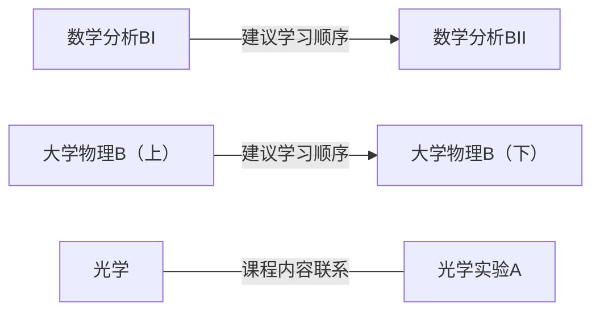

# 电子信息科学与技术（光子计划院士班）专业“2+X”修读建议

2024 年汇编印刷页 885–886。原表记录 30 个可配对的课程代码。

[本节原页](plan-878.pdf#page=8) · [逐行数据](plan-878.json) · [院系目录](README.md)

## 课程导读

想了解电子线路与信号的课程安排，可以在原表中找到《高频电子线路B》（`INFO130029`）、《信号与通信系统》（`INFO130009`）、《数字逻辑基础》（`INFO130331`）。 [原书 PDF 第 899 页](plan-878.pdf#page=8) · [原书 PDF 第 900 页](plan-878.pdf#page=9)

图中连接《光学》（`INFO130366`）和《光学实验A》（`INFO130409`），两门课都从课程题名标出的“光学”切入，可沿这一主题对照阅读。 [原书 PDF 第 900 页](plan-878.pdf#page=9)

## 课程关系图

图中展示最多 20 条关系。下表列出本节全部关系。建议学习顺序供规划课程使用，正式选课资格以教务规定为准。

| 课程 | 关联课程 | 关系 | 依据 |
| --- | --- | --- | --- |
| 数学分析BI（MATH120016） | 数学分析BII（MATH120017） | 建议学习顺序 | 同节课程题名标明连续分册或序号。 |
| 大学物理B（上）（PHYS120013） | 大学物理B（下）（PHYS120014） | 建议学习顺序 | 同节课程题名标明连续分册或序号。 |
| 光学（INFO130366） | 光学实验A（INFO130409） | 课程内容联系 | 本方案两门课程的题名均含“光学”，可据此对照这一主题。 |

## 课程

| 课程代码 | 名称 | 开课学期原文 | 来源（PDF 页） |
| --- | --- | --- | --- |
| COMP120004 | 线性代数 |  | 899 |
| COMP120006 | 程序设计 |  | 899 |
| INFO120011 | 电子系统导论 |  | 899 |
| INFO130001 | 概率、数理统计与随机过程 |  | 899 |
| INFO130002 | 工程数学 |  | 899 |
| INFO130009 | 信号与通信系统 |  | 900 |
| INFO130010 | 数字信号处理A |  | 900 |
| INFO130015 | 生产实习 |  | 900 |
| INFO130016 | 毕业论文 |  | 900 |
| INFO130029 | 高频电子线路B |  | 900 |
| INFO130327 | 数据结构 |  | 900 |
| INFO130329 | 信息论基础 |  | 900 |
| INFO130331 | 数字逻辑基础 |  | 899 |
| INFO130347 | 模拟电子学基础 |  | 900 |
| INFO130348 | 模拟与数字电路实验 |  | 900 |
| INFO130353 | 信号与系统实验 |  | 900 |
| INFO130366 | 光学 |  | 900 |
| INFO130400 | 电磁场与电磁波A |  | 900 |
| INFO130408 | 信息科技前沿讲座 |  | 900 |
| INFO130409 | 光学实验A |  | 900 |
| MATH120016 | 数学分析BI |  | 899 |
| MATH120017 | 数学分析BII |  | 899 |
| PHYS120013 | 大学物理B（上） |  | 899 |
| PHYS120014 | 大学物理B（下） |  | 899 |
| PHYS120015 | 基础物理实验 |  | 899 |
| PTSS110082 | 毛泽东思想和中国特色社会主义理论体系概论 |  | 899 |
| PTSS110087 | 马克思主义基本原理 |  | 899 |
| PTSS110088 | 中国近现代史纲要 |  | 899 |
| PTSS110089 | 思想道德与法治 |  | 899 |
| PTSS110090 | 习近平新时代中国特色社会主义思想概论 |  | 899 |
