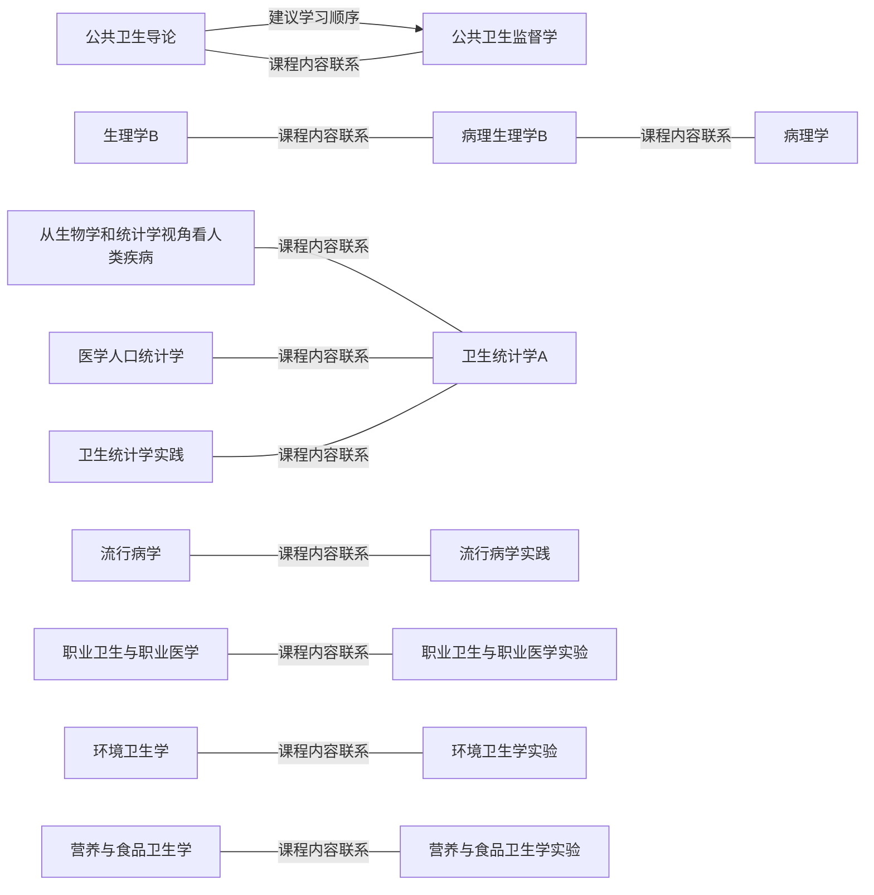

# 预防医学专业“2+X”教学培养方案

2024 年汇编印刷页 1000–1003。原表记录 65 个可配对的课程代码。

[本节原页](plan-1000.pdf#page=1) · [逐行数据](plan-1000.json) · [院系目录](README.md)

## 课程关系图

图中展示最多 20 条关系。下表列出本节全部关系。建议学习顺序供规划课程使用，正式选课资格以教务规定为准。

| 课程 | 关联课程 | 关系 | 依据 |
| --- | --- | --- | --- |
| 公共卫生导论（PHPM130084） | 公共卫生监督学（PHPM130029） | 建议学习顺序 | “公共卫生导论”题名标明基础层次，前置阅读可帮助了解“公共卫生监督学”中的公共卫生主题。 |
| 生理学B（MED130005） | 病理生理学B（MED130013） | 课程内容联系 | 本方案两门课程的题名均含“生理学”，可据此对照这一主题。 |
| 病理生理学B（MED130013） | 病理学（MED130267） | 课程内容联系 | 本方案两门课程的题名均含“病理”，可据此对照这一主题。 |
| 从生物学和统计学视角看人类疾病（MED130266） | 卫生统计学A（PHPM130066） | 课程内容联系 | 本方案两门课程的题名均含“统计学”，可据此对照这一主题。 |
| 医学人口统计学（PHPM130028） | 卫生统计学A（PHPM130066） | 课程内容联系 | 本方案两门课程的题名均含“统计学”，可据此对照这一主题。 |
| 公共卫生监督学（PHPM130029） | 公共卫生导论（PHPM130084） | 课程内容联系 | 本方案两门课程的题名均含“公共卫生”，可据此对照这一主题。 |
| 卫生统计学实践（PHPM130065） | 卫生统计学A（PHPM130066） | 课程内容联系 | 本方案两门课程的题名均含“统计学”，可据此对照这一主题。 |
| 流行病学（PHPM130068） | 流行病学实践（PHPM130069） | 课程内容联系 | 同节同题名的课程与实验、实习或实践。 |
| 职业卫生与职业医学（PHPM130070） | 职业卫生与职业医学实验（PHPM130071） | 课程内容联系 | 同节同题名的课程与实验、实习或实践。 |
| 环境卫生学（PHPM130072） | 环境卫生学实验（PHPM130073） | 课程内容联系 | 同节同题名的课程与实验、实习或实践。 |
| 营养与食品卫生学（PHPM130074） | 营养与食品卫生学实验（PHPM130075） | 课程内容联系 | 同节同题名的课程与实验、实习或实践。 |

## 课程

| 课程代码 | 名称 | 开课学期原文 | 来源（PDF 页） |
| --- | --- | --- | --- |
| MED130002 | 系统解剖学B | 3 | 1014 |
| MED130003 | 组织胚胎学B | 3 | 1014 |
| MED130005 | 生理学B | 4 | 1014 |
| MED130006 | 免疫学C | 4 | 1014 |
| MED130012 | 寄生虫学C | 5 | 1014 |
| MED130013 | 病理生理学B | 5 | 1014 |
| MED130014 | 药理学C | 5 | 1014 |
| MED130015 | 功能学科综合实验 | 5 | 1014 |
| MED130049 | 诊断学B | 5 | 1015 |
| MED130050 | 影像诊断学C | 6 | 1015 |
| MED130056 | 内科学C | 6 | 1015 |
| MED130057 | 外科学C | 6 | 1015 |
| MED130058 | 妇产科学C | 6 | 1015 |
| MED130059 | 儿科学C | 6 | 1016 |
| MED130087 | 医学文献检索与利用B | 春 | 1016 |
| MED130109 | 传染病学B | 6 | 1015 |
| MED130184 | 医学细胞与遗传学 | 3 | 1014 |
| MED130242 | 生物化学 | 3 | 1014 |
| MED130266 | 从生物学和统计学视角看人类疾病 | 暑期 | 1016 |
| MED130267 | 病理学 | 5 | 1014 |
| MED130283 | 人体的社交网络：共生微生物 | 暑期 | 1016 |
| MED130343 | 医学微生物学C | 4 | 1014 |
| PHPM130002 | 基础毒理 | 8 | 1015 |
| PHPM130003 | 社会医学 | 3 | 1015 |
| PHPM130004 | 健康教育学 | 8 | 1015 |
| PHPM130006 | 卫生化学 | 4 | 1015 |
| PHPM130007 | 卫生事业管理学 | 8 | 1015 |
| PHPM130008 | 卫生微生物 | 8 | 1016 |
| PHPM130009 | 卫生法学 | 4 | 1015 |
| PHPM130014 | 儿少卫生学 | 8 | 1015 |
| PHPM130016 | 环境医学综合实验 | 9 | 1016 |
| PHPM130019 | 毕业论文 | 10 | 1015 |
| PHPM130020 | 健康心理学 | 春,秋 | 1016 |
| PHPM130021 | 医院获得性感染 | 春,秋 | 1016 |
| PHPM130022 | 管理与沟通技巧 | 春 | 1016 |
| PHPM130023 | 妇幼卫生学概论 | 春,秋 | 1016 |
| PHPM130028 | 医学人口统计学 | 春 | 1016 |
| PHPM130029 | 公共卫生监督学 | 春,秋 | 1016 |
| PHPM130033 | 卫生人力规划 | 秋 | 1016 |
| PHPM130034 | 仪器分析的应用 | 春,秋 | 1016 |
| PHPM130064 | 全球卫生导论 | 秋 | 1016 |
| PHPM130065 | 卫生统计学实践 | 5 | 1015 |
| PHPM130066 | 卫生统计学A | 5 | 1015 |
| PHPM130068 | 流行病学 | 8 | 1015 |
| PHPM130069 | 流行病学实践 | 8 | 1015 |
| PHPM130070 | 职业卫生与职业医学 | 8 | 1015 |
| PHPM130071 | 职业卫生与职业医学实验 | 9 | 1015 |
| PHPM130072 | 环境卫生学 | 8 | 1015 |
| PHPM130073 | 环境卫生学实验 | 9 | 1015 |
| PHPM130074 | 营养与食品卫生学 | 8 | 1015 |
| PHPM130075 | 营养与食品卫生学实验 | 9 | 1015 |
| PHPM130079 | 放射卫生学与放射防护 | 春,秋 | 1016 |
| PHPM130084 | 公共卫生导论 | 2 | 1015 |
| PHPM130085 | 卫生经济评价方法 | 秋 | 1016 |
| PHPM130087 | 学术前沿专题 | 春,秋 | 1016 |
| PHPM130089 | 色谱分析新技术 | 秋 | 1016 |
| PHPM130095 | 医学生职业生涯规划 | 春,秋 | 1016 |
| PHPM130104 | 临床实习 | 7 | 1016 |
| PHPM130105 | 生产实习 | 9 | 1015 |
| PHPM130110 | 卫生经济学概论 | 秋 | 1016 |
| PHPM130113 | 食品免疫学 | 春 | 1016 |
| PHPM130114 | 卫生管理预测与决策分析 | 秋 | 1016 |
| PHPM130115 | 科学写作：聚焦群医学 | 秋 | 1016 |
| PHPM130116 | 行为经济学与公众健康 | 秋 | 1016 |
| PHPM130123 | 健康公平 | 秋 | 1016 |
