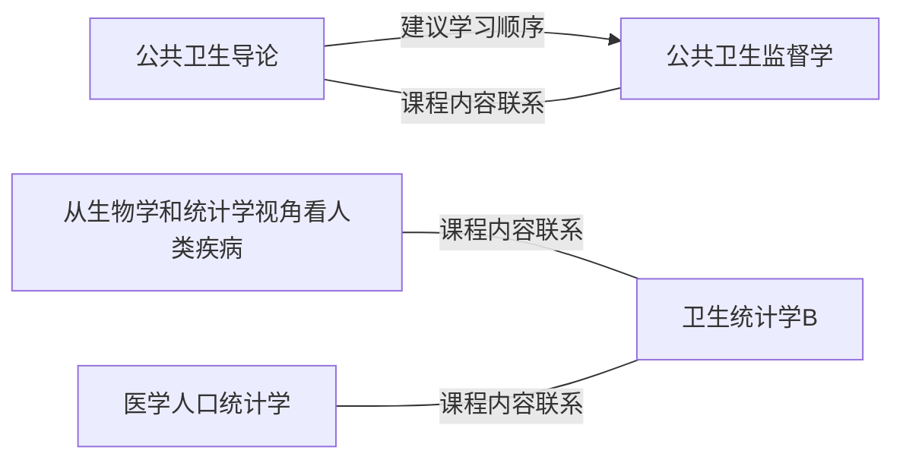

# 公共事业管理专业“2+X”教学培养方案

2024 年汇编印刷页 1007–1009。原表记录 43 个可配对的课程代码。

[本节原页](plan-1007.pdf#page=1) · [逐行数据](plan-1007.json) · [院系目录](README.md)

## 课程导读

想了解卫生服务与公共管理的课程安排，可以在原表中找到《卫生事业管理学》（`PHPM130041`）、《卫生经济学》（`PHPM130043`）、《公共卫生导论》（`PHPM130084`）。 [原书 PDF 第 1021 页](plan-1007.pdf#page=1)

图中连接《公共卫生监督学》（`PHPM130029`）和《公共卫生导论》（`PHPM130084`），两门课都从课程题名标出的“公共卫生”切入，可沿这一主题对照阅读。 [原书 PDF 第 1021 页](plan-1007.pdf#page=1) · [原书 PDF 第 1022 页](plan-1007.pdf#page=2)

## 课程关系图

图中展示最多 20 条关系。下表列出本节全部关系。建议学习顺序供规划课程使用，正式选课资格以教务规定为准。

| 课程 | 关联课程 | 关系 | 依据 |
| --- | --- | --- | --- |
| 公共卫生导论（PHPM130084） | 公共卫生监督学（PHPM130029） | 建议学习顺序 | “公共卫生导论”题名标明基础层次，前置阅读可帮助了解“公共卫生监督学”中的公共卫生主题。 |
| 从生物学和统计学视角看人类疾病（MED130266） | 卫生统计学B（PHPM130039） | 课程内容联系 | 本方案两门课程的题名均含“统计学”，可据此对照这一主题。 |
| 医学人口统计学（PHPM130028） | 卫生统计学B（PHPM130039） | 课程内容联系 | 本方案两门课程的题名均含“统计学”，可据此对照这一主题。 |
| 公共卫生监督学（PHPM130029） | 公共卫生导论（PHPM130084） | 课程内容联系 | 本方案两门课程的题名均含“公共卫生”，可据此对照这一主题。 |

## 课程

| 课程代码 | 名称 | 开课学期原文 | 来源（PDF 页） |
| --- | --- | --- | --- |
| MANA130001 | 概率论与数理统计 | 3 | 1021 |
| MANA130004 | 财务管理 | 3 | 1021 |
| MANA130007 | 管理信息系统 | 3 | 1021 |
| MANA130401 | 经济学原理 | 1 | 1021 |
| MED130087 | 医学文献检索与利用B | 春 | 1022 |
| MED130110 | 正常人体形态与功能学IB | 5 | 1022 |
| MED130111 | 正常人体形态与功能学ⅡB | 5 | 1022 |
| MED130112 | 正常人体形态与功能学ⅢB | 5 | 1022 |
| MED130113 | 正常人体形态与功能学ⅣB | 5 | 1022 |
| MED130192 | 诊断学C | 6 | 1022 |
| MED130195 | 疾病机制 | 6 | 1022 |
| MED130266 | 从生物学和统计学视角看人类疾病 | 暑期 | 1022 |
| PHPM130019 | 毕业论文 | 8 | 1022 |
| PHPM130020 | 健康心理学 | 春，秋 | 1022 |
| PHPM130022 | 管理与沟通技巧 | 春 | 1022 |
| PHPM130023 | 妇幼卫生学概论 | 春，秋 | 1022 |
| PHPM130028 | 医学人口统计学 | 春 | 1023 |
| PHPM130029 | 公共卫生监督学 | 春，秋 | 1022 |
| PHPM130033 | 卫生人力规划 | 秋 | 1022 |
| PHPM130037 | 流行病学 | 5 | 1021 |
| PHPM130038 | 卫生服务研究 | 6 | 1022 |
| PHPM130039 | 卫生统计学B | 5 | 1022 |
| PHPM130041 | 卫生事业管理学 | 6 | 1021 |
| PHPM130042 | 医院管理学 | 6 | 1022 |
| PHPM130043 | 卫生经济学 | 4 | 1021 |
| PHPM130044 | 预防医学导论 | 5 | 1021 |
| PHPM130045 | 卫生法与卫生监督 | 4 | 1021 |
| PHPM130047 | 卫生管理研究设计 | 6 | 1022 |
| PHPM130048 | 医疗保险 | 7 | 1022 |
| PHPM130061 | 卫生管理运筹学 | 4 | 1021 |
| PHPM130062 | 生产见习 | 7 | 1022 |
| PHPM130064 | 全球卫生导论 | 秋 | 1023 |
| PHPM130084 | 公共卫生导论 | 2 | 1021 |
| PHPM130085 | 卫生经济评价方法 | 秋 | 1023 |
| PHPM130087 | 学术前沿专题 | 春，秋 | 1023 |
| PHPM130091 | 卫生政策研究理论 | 7 | 1022 |
| PHPM130095 | 医学生职业生涯规划 | 春，秋 | 1022 |
| PHPM130101 | 组织行为学：卫生视角 | 4 | 1021 |
| PHPM130106 | 卫生技术评估导论 | 秋 | 1023 |
| PHPM130114 | 卫生管理预测与决策分析 | 秋 | 1023 |
| PHPM130115 | 科学写作：聚焦群医学 | 秋 | 1023 |
| PHPM130116 | 行为经济学与公众健康 | 秋 | 1023 |
| PHPM130123 | 健康公平 | 秋 | 1023 |
