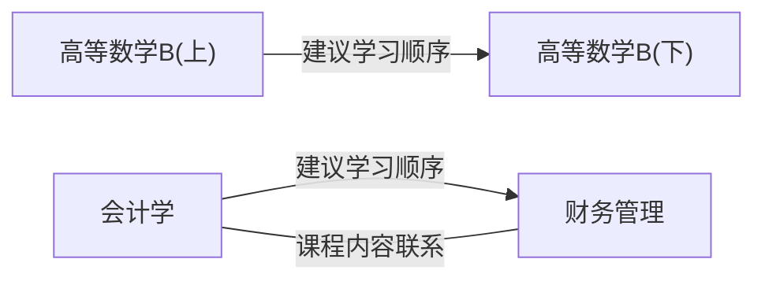

# 公共事业管理专业“2+X”修读建议

2024 年汇编印刷页 1010–1011。原表记录 30 个可配对的课程代码。

[本节原页](plan-1007.pdf#page=4) · [逐行数据](plan-1007.json) · [院系目录](README.md)

## 课程导读

想了解卫生服务与公共管理的课程安排，可以在原表中找到《卫生事业管理学》（`PHPM130041`）、《卫生经济学》（`PHPM130043`）、《公共卫生导论》（`PHPM130084`）。 [原书 PDF 第 1024 页](plan-1007.pdf#page=4) · [原书 PDF 第 1025 页](plan-1007.pdf#page=5)

图中把《财务管理》（`MANA130004`）和《会计学》（`SOSC120006`）列作内容联系。会计信息与企业融资、投资决策存在应用联系。 [原书 PDF 第 1024 页](plan-1007.pdf#page=4) · [原书 PDF 第 1025 页](plan-1007.pdf#page=5)

## 课程关系图

图中展示最多 20 条关系。下表列出本节全部关系。建议学习顺序供规划课程使用，正式选课资格以教务规定为准。

| 课程 | 关联课程 | 关系 | 依据 |
| --- | --- | --- | --- |
| 高等数学B(上)（MATH120003） | 高等数学B(下)（MATH120004） | 建议学习顺序 | 同节课程题名标明连续分册或序号。 |
| 会计学（SOSC120006） | 财务管理（MANA130004） | 建议学习顺序 | 会计报表和核算概念可用于理解财务决策。 |
| 财务管理（MANA130004） | 会计学（SOSC120006） | 课程内容联系 | 会计信息与企业融资、投资决策存在应用联系。 |

## 课程

| 课程代码 | 名称 | 开课学期原文 | 来源（PDF 页） |
| --- | --- | --- | --- |
| MANA130001 | 概率论与数理统计 |  | 1024 |
| MANA130004 | 财务管理 |  | 1025 |
| MANA130007 | 管理信息系统 |  | 1024 |
| MANA130401 | 经济学原理 |  | 1024 |
| MATH120003 | 高等数学B(上) |  | 1024 |
| MATH120004 | 高等数学B(下) |  | 1024 |
| MATH120044 | 线性代数 |  | 1024 |
| PHPM130019 | 毕业论文 |  | 1025 |
| PHPM130037 | 流行病学 |  | 1025 |
| PHPM130041 | 卫生事业管理学 |  | 1025 |
| PHPM130042 | 医院管理学 |  | 1025 |
| PHPM130043 | 卫生经济学 |  | 1025 |
| PHPM130044 | 预防医学导论 |  | 1025 |
| PHPM130045 | 卫生法与卫生监督 |  | 1025 |
| PHPM130048 | 医疗保险 |  | 1025 |
| PHPM130061 | 卫生管理运筹学 |  | 1025 |
| PHPM130062 | 生产见习 |  | 1025 |
| PHPM130084 | 公共卫生导论 |  | 1024 |
| PHPM130091 | 卫生政策研究理论 |  | 1025 |
| PHPM130101 | 组织行为学 |  | 1025 |
| PTSS110082 | 毛泽东思想和中国特色社会主义理论体系概论 |  | 1024 |
| PTSS110087 | 马克思主义基本原理 |  | 1024 |
| PTSS110088 | 中国近现代史纲要 |  | 1024 |
| PTSS110089 | 思想道德与法治 |  | 1024 |
| PTSS110090 | 习近平新时代中国特色社会主义思想概论 |  | 1024 |
| SOSC120004 | 微观经济学 |  | 1024 |
| SOSC120005 | 宏观经济学 |  | 1024 |
| SOSC120006 | 会计学 |  | 1024 |
| SOSC120010 | 社会研究方法B |  | 1024 |
| SOSC120014 | 管理学导论 |  | 1024 |
