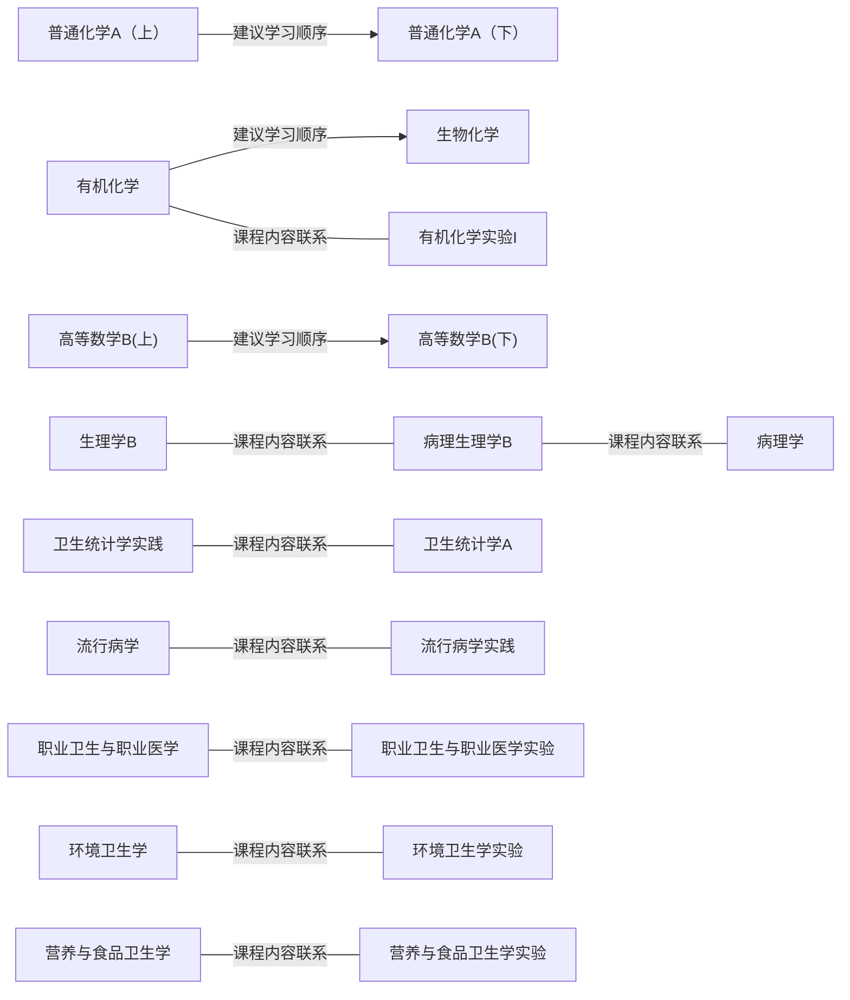

# 预防医学-公共事业管理双学士学位项目“2+X”修读建议

2024 年汇编印刷页 1048–1051。原表记录 69 个可配对的课程代码。

[本节原页](plan-1044.pdf#page=5) · [逐行数据](plan-1044.json) · [院系目录](README.md)

## 课程导读

想了解公共卫生与管理的课程安排，可以在原表中找到《公共卫生导论》（`PHPM130084`）、《流行病学》（`PHPM130068`）、《卫生管理运筹学》（`PHPM130061`）。 [原书 PDF 第 1064 页](plan-1044.pdf#page=7)

图中把《流行病学》（`PHPM130068`）和《流行病学实践》（`PHPM130069`）列作内容联系。同节同题名的课程与实验、实习或实践。 [原书 PDF 第 1064 页](plan-1044.pdf#page=7)

## 课程关系图

图中展示最多 20 条关系。下表列出本节全部关系。建议学习顺序供规划课程使用，正式选课资格以教务规定为准。

| 课程 | 关联课程 | 关系 | 依据 |
| --- | --- | --- | --- |
| 有机化学（CHEM120003） | 生物化学（MED130242） | 建议学习顺序 | 官能团与有机反应是理解生物分子性质的基础。 |
| 普通化学A（上）（CHEM120005） | 普通化学A（下）（CHEM120006） | 建议学习顺序 | 同节课程题名标明连续分册或序号。 |
| 高等数学B(上)（MATH120003） | 高等数学B(下)（MATH120004） | 建议学习顺序 | 同节课程题名标明连续分册或序号。 |
| 有机化学（CHEM120003） | 有机化学实验I（CHEM120011） | 课程内容联系 | 本方案两门课程的题名均含“有机化学”，可据此对照这一主题。 |
| 生理学B（MED130005） | 病理生理学B（MED130013） | 课程内容联系 | 本方案两门课程的题名均含“生理学”，可据此对照这一主题。 |
| 病理生理学B（MED130013） | 病理学（MED130267） | 课程内容联系 | 本方案两门课程的题名均含“病理”，可据此对照这一主题。 |
| 卫生统计学实践（PHPM130065） | 卫生统计学A（PHPM130066） | 课程内容联系 | 本方案两门课程的题名均含“统计学”，可据此对照这一主题。 |
| 流行病学（PHPM130068） | 流行病学实践（PHPM130069） | 课程内容联系 | 同节同题名的课程与实验、实习或实践。 |
| 职业卫生与职业医学（PHPM130070） | 职业卫生与职业医学实验（PHPM130071） | 课程内容联系 | 同节同题名的课程与实验、实习或实践。 |
| 环境卫生学（PHPM130072） | 环境卫生学实验（PHPM130073） | 课程内容联系 | 同节同题名的课程与实验、实习或实践。 |
| 营养与食品卫生学（PHPM130074） | 营养与食品卫生学实验（PHPM130075） | 课程内容联系 | 同节同题名的课程与实验、实习或实践。 |

## 课程

| 课程代码 | 名称 | 开课学期原文 | 来源（PDF 页） |
| --- | --- | --- | --- |
| BIOL120004 | 现代生物科学导论C |  | 1063 |
| CHEM120003 | 有机化学 |  | 1063 |
| CHEM120005 | 普通化学A（上） |  | 1063 |
| CHEM120006 | 普通化学A（下） |  | 1063 |
| CHEM120009 | 普通化学实验I |  | 1063 |
| CHEM120011 | 有机化学实验I |  | 1063 |
| MANA130001 | 概率论与数理统计 |  | 1064 |
| MANA130401 | 经济学原理 |  | 1064 |
| MATH120003 | 高等数学B(上) |  | 1063 |
| MATH120004 | 高等数学B(下) |  | 1063 |
| MATH120044 | 线性代数 |  | 1063 |
| MED130002 | 系统解剖学B |  | 1063 |
| MED130003 | 组织胚胎学B |  | 1063 |
| MED130005 | 生理学B |  | 1063 |
| MED130006 | 免疫学C |  | 1063 |
| MED130012 | 寄生虫学C |  | 1063 |
| MED130013 | 病理生理学B |  | 1063 |
| MED130014 | 药理学C |  | 1063 |
| MED130015 | 功能学科综合实验 |  | 1063 |
| MED130049 | 诊断学B |  | 1063 |
| MED130050 | 影像诊断学C |  | 1063 |
| MED130056 | 内科学C |  | 1063 |
| MED130057 | 外科学C |  | 1063 |
| MED130058 | 妇产科学C |  | 1063 |
| MED130059 | 儿科学C |  | 1063 |
| MED130109 | 传染病学B |  | 1063 |
| MED130184 | 医学细胞与遗传学 |  | 1063 |
| MED130242 | 生物化学 |  | 1063 |
| MED130267 | 病理学 |  | 1063 |
| MED130343 | 医学微生物学C |  | 1063 |
| PHPM130002 | 基础毒理 |  | 1063 |
| PHPM130003 | 社会医学 |  | 1063 |
| PHPM130004 | 健康教育学 |  | 1063 |
| PHPM130006 | 卫生化学 |  | 1063 |
| PHPM130014 | 儿少卫生学 |  | 1063 |
| PHPM130019 | 毕业论文 |  | 1064 |
| PHPM130041 | 卫生事业管理学 |  | 1064 |
| PHPM130042 | 医院管理学 |  | 1064 |
| PHPM130043 | 卫生经济学 |  | 1064 |
| PHPM130045 | 卫生法与卫生监督 |  | 1064 |
| PHPM130048 | 医疗保险 |  | 1064 |
| PHPM130061 | 卫生管理运筹学 |  | 1064 |
| PHPM130065 | 卫生统计学实践 |  | 1064 |
| PHPM130066 | 卫生统计学A |  | 1064 |
| PHPM130068 | 流行病学 |  | 1064 |
| PHPM130069 | 流行病学实践 |  | 1064 |
| PHPM130070 | 职业卫生与职业医学 |  | 1063 |
| PHPM130071 | 职业卫生与职业医学实验 |  | 1064 |
| PHPM130072 | 环境卫生学 |  | 1063 |
| PHPM130073 | 环境卫生学实验 |  | 1064 |
| PHPM130074 | 营养与食品卫生学 |  | 1064 |
| PHPM130075 | 营养与食品卫生学实验 |  | 1064 |
| PHPM130084 | 公共卫生导论 |  | 1064 |
| PHPM130091 | 卫生政策研究理论 |  | 1064 |
| PHPM130101 | 组织行为学：卫生视角 |  | 1064 |
| PHPM130104 | 临床实习 |  | 1063 |
| PHPM130105 | 生产实习 |  | 1064 |
| PHYS120003 | 普通物理B |  | 1063 |
| PHYS120015 | 基础物理实验 |  | 1063 |
| PTSS110082 | 毛泽东思想和中国特色社会主义理论体系概论 |  | 1062 |
| PTSS110087 | 马克思主义基本原理 |  | 1062 |
| PTSS110088 | 中国近现代史纲要 |  | 1062 |
| PTSS110089 | 思想道德与法治 |  | 1062 |
| PTSS110090 | 习近平新时代中国特色社会主义思想概论 |  | 1062 |
| SOSC120004 | 微观经济学 |  | 1063 |
| SOSC120005 | 宏观经济学 |  | 1063 |
| SOSC120006 | 会计学 |  | 1063 |
| SOSC120010 | 社会研究方法B |  | 1063 |
| SOSC120014 | 管理学导论 |  | 1063 |
