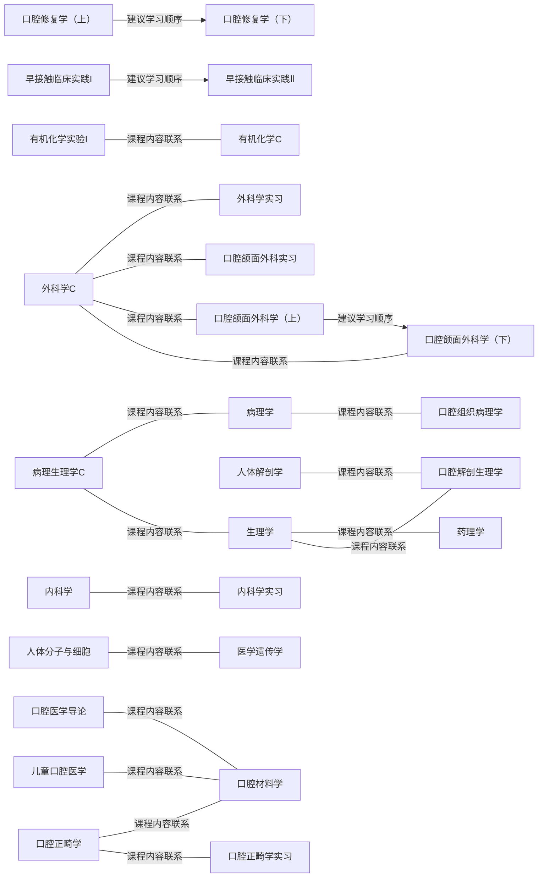

# 口腔医学（五年制）专业“2+X”教学培养方案

2024 年汇编印刷页 1034–1037。原表记录 66 个可配对的课程代码。

[本节原页](plan-1034.pdf#page=1) · [逐行数据](plan-1034.json) · [院系目录](README.md)

## 课程关系图

图中展示最多 20 条关系。下表列出本节全部关系。建议学习顺序供规划课程使用，正式选课资格以教务规定为准。

| 课程 | 关联课程 | 关系 | 依据 |
| --- | --- | --- | --- |
| 口腔颌面外科学（上）（STOM130057） | 口腔颌面外科学（下）（STOM130058） | 建议学习顺序 | 同节课程题名标明连续分册或序号。 |
| 口腔修复学（上）（STOM130062） | 口腔修复学（下）（STOM130063） | 建议学习顺序 | 同节课程题名标明连续分册或序号。 |
| 早接触临床实践I（STOM130065） | 早接触临床实践Ⅱ（STOM130066） | 建议学习顺序 | 同节课程题名标明连续分册或序号。 |
| 有机化学实验I（CHEM120011） | 有机化学C（CHEM120012） | 课程内容联系 | 本方案两门课程的题名均含“有机化学”，可据此对照这一主题。 |
| 外科学C（MED130057） | 外科学实习（STOM130038） | 课程内容联系 | 本方案两门课程的题名均含“外科”，可据此对照这一主题。 |
| 外科学C（MED130057） | 口腔颌面外科实习（STOM130056） | 课程内容联系 | 本方案两门课程的题名均含“外科”，可据此对照这一主题。 |
| 外科学C（MED130057） | 口腔颌面外科学（上）（STOM130057） | 课程内容联系 | 本方案两门课程的题名均含“外科”，可据此对照这一主题。 |
| 外科学C（MED130057） | 口腔颌面外科学（下）（STOM130058） | 课程内容联系 | 本方案两门课程的题名均含“外科”，可据此对照这一主题。 |
| 病理生理学C（MED130396） | 病理学（MED130397） | 课程内容联系 | 本方案两门课程的题名均含“病理”，可据此对照这一主题。 |
| 病理生理学C（MED130396） | 生理学（MED130399） | 课程内容联系 | 本方案两门课程的题名均含“生理学”，可据此对照这一主题。 |
| 病理学（MED130397） | 口腔组织病理学（STOM130036） | 课程内容联系 | 本方案两门课程的题名均含“病理”，可据此对照这一主题。 |
| 人体解剖学（MED130398） | 口腔解剖生理学（STOM130059） | 课程内容联系 | 本方案两门课程的题名均含“解剖”，可据此对照这一主题。 |
| 生理学（MED130399） | 药理学（MED130401） | 课程内容联系 | 生理调节与药物作用 |
| 生理学（MED130399） | 口腔解剖生理学（STOM130059） | 课程内容联系 | 本方案两门课程的题名均含“生理学”，可据此对照这一主题。 |
| 内科学（MED130408） | 内科学实习（STOM130037） | 课程内容联系 | 同节同题名的课程与实验、实习或实践。 |
| 人体分子与细胞（MED130479） | 医学遗传学（MED130480） | 课程内容联系 | 基因、细胞与人体性状是共同知识背景。 |
| 口腔医学导论（STOM130001） | 口腔材料学（STOM130039） | 课程内容联系 | 本方案两门课程的题名均含“口腔”，可据此对照这一主题。 |
| 儿童口腔医学（STOM130017） | 口腔材料学（STOM130039） | 课程内容联系 | 本方案两门课程的题名均含“口腔”，可据此对照这一主题。 |
| 口腔正畸学（STOM130018） | 口腔材料学（STOM130039） | 课程内容联系 | 本方案两门课程的题名均含“口腔”，可据此对照这一主题。 |
| 口腔正畸学（STOM130018） | 口腔正畸学实习（STOM130064） | 课程内容联系 | 同节同题名的课程与实验、实习或实践。 |
| 口腔种植学（STOM130019） | 口腔材料学（STOM130039） | 课程内容联系 | 本方案两门课程的题名均含“口腔”，可据此对照这一主题。 |
| 口腔颌面外科学（上）（STOM130057） | 口腔颌面外科学（下）（STOM130058） | 方案排课先后 | 本节原表所列全部明确学期均早于后者。 |
| 口腔修复学（上）（STOM130062） | 口腔修复学（下）（STOM130063） | 方案排课先后 | 本节原表所列全部明确学期均早于后者。 |
| 早接触临床实践I（STOM130065） | 早接触临床实践Ⅱ（STOM130066） | 方案排课先后 | 本节原表所列全部明确学期均早于后者。 |

## 课程

| 课程代码 | 名称 | 开课学期原文 | 来源（PDF 页） |
| --- | --- | --- | --- |
| BIOL120004 | 现代生物科学导论C | 1，2 | 1048 |
| CHEM120009 | 普通化学实验I | 2 | 1048 |
| CHEM120011 | 有机化学实验I | 2 | 1048 |
| CHEM120012 | 有机化学C | 2 | 1048 |
| CHEM120013 | 普通化学C | 1 | 1048 |
| MATH120045 | 高等数学CI | 1 | 1048 |
| MED130041 | 免疫学B | 4 | 1049 |
| MED130049 | 诊断学B | 5 | 1050 |
| MED130057 | 外科学C | 5 | 1049 |
| MED130215 | 医学伦理学 | 5 | 1049 |
| MED130395 | 组织胚胎学 | 3 | 1048 |
| MED130396 | 病理生理学C | 4 | 1049 |
| MED130397 | 病理学 | 4 | 1049 |
| MED130398 | 人体解剖学 | 3 | 1048 |
| MED130399 | 生理学 | 4 | 1049 |
| MED130401 | 药理学 | 4 | 1049 |
| MED130408 | 内科学 | 5 | 1049 |
| MED130409 | 妇产科学总论 | 6 | 1049 |
| MED130410 | 皮肤病与性病学概论 | 5 | 1050 |
| MED130411 | 传染病学 | 5 | 1050 |
| MED130412 | 耳鼻咽喉科学 | 6 | 1050 |
| MED130413 | 儿科学总论 | 6 | 1049 |
| MED130443 | 医学微生物学C | 6 | 1049 |
| MED130444 | 功能学科综合实验 | 4 | 1050 |
| MED130448 | 医学心理学 | 6 | 1049 |
| MED130479 | 人体分子与细胞 | 3 | 1048 |
| MED130480 | 医学遗传学 | 5 | 1050 |
| PHPM130054 | 卫生法 | 5 | 1049 |
| PHPM130066 | 卫生统计学A | 6 | 1050 |
| PHPM130107 | 预防医学 | 5 | 1049 |
| PHYS120003 | 普通物理B | 1 | 1048 |
| PHYS120015 | 基础物理实验 | 1 | 1048 |
| STOM130001 | 口腔医学导论 | 2 | 1050 |
| STOM130012 | 口腔颌面医学影像诊断学 | 7 | 1049 |
| STOM130013 | 牙体牙髓病学 | 7 | 1049 |
| STOM130014 | 牙周病学 | 7 | 1049 |
| STOM130016 | 口腔预防医学 | 8 | 1049 |
| STOM130017 | 儿童口腔医学 | 8 | 1049 |
| STOM130018 | 口腔正畸学 | 8 | 1049 |
| STOM130019 | 口腔种植学 | 8 | 1049 |
| STOM130020 | 临床衔接课程 | 8 | 1049 |
| STOM130026 | 口腔预防科实习 | 9 | 1049 |
| STOM130027 | 口腔黏膜病科实习 | 9 | 1050 |
| STOM130029 | 口腔放射科实习 | 9 | 1050 |
| STOM130032 | 牙周科实习 | 10 | 1050 |
| STOM130036 | 口腔组织病理学 | 6 | 1049 |
| STOM130037 | 内科学实习 | 6 | 1049 |
| STOM130038 | 外科学实习 | 6 | 1049 |
| STOM130039 | 口腔材料学 | 5 | 1050 |
| STOM130042 | 学𬌗 | 8 | 1050 |
| STOM130045 | 早接触科研思维训练 | 8 | 1050 |
| STOM130051 | 口腔修复科实习 | 9 | 1049 |
| STOM130052 | 儿童口腔科实习 | 9 | 1050 |
| STOM130054 | 牙体牙髓病科实习 | 10 | 1050 |
| STOM130055 | 基于口腔疾病的多学科教学 | 8 | 1050 |
| STOM130056 | 口腔颌面外科实习 | 10 | 1050 |
| STOM130057 | 口腔颌面外科学（上） | 7 | 1049 |
| STOM130058 | 口腔颌面外科学（下） | 8 | 1049 |
| STOM130059 | 口腔解剖生理学 | 6 | 1049 |
| STOM130060 | 口腔黏膜病学 | 7 | 1049 |
| STOM130061 | 口腔人工智能设备学 | 8 | 1050 |
| STOM130062 | 口腔修复学（上） | 7 | 1049 |
| STOM130063 | 口腔修复学（下） | 8 | 1049 |
| STOM130064 | 口腔正畸学实习 | 10 | 1050 |
| STOM130065 | 早接触临床实践I | 3 | 1050 |
| STOM130066 | 早接触临床实践Ⅱ | 5 | 1050 |
