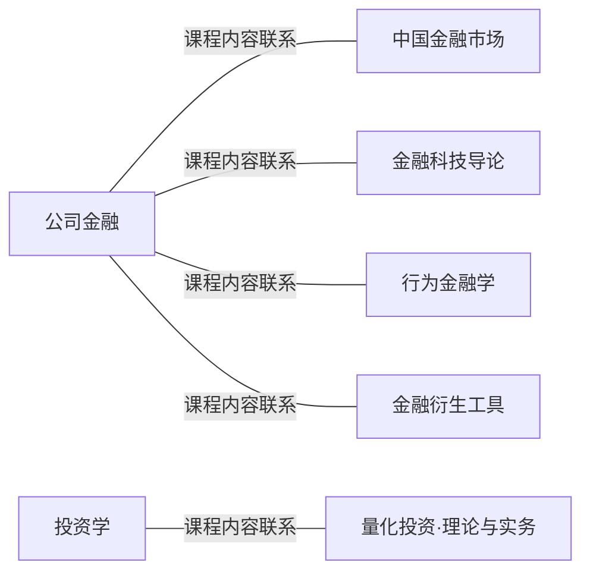

# 金融学（金融科技方向）专业“2+X”教学培养方案 / Study Scheme of Finance (FinTech Stream)

2024 年汇编印刷页 464–468。原表记录 24 个可配对的课程代码。

[本节原页](plan-464.pdf#page=1) · [逐行数据](plan-464.json) · [院系目录](README.md)

## 课程导读

想了解金融科技的课程安排，可以在原表中找到《金融科技导论》（`FISF130008`）、《中国金融市场》（`FISF130003`）、《金融数据科学和编程》（`FISF130007`）。 [原书 PDF 第 480 页](plan-464.pdf#page=3)

图中连接《公司金融》（`FISF130001`）和《金融科技导论》（`FISF130008`），两门课都从课程题名标出的“金融”切入，可沿这一主题对照阅读。 [原书 PDF 第 479 页](plan-464.pdf#page=2) · [原书 PDF 第 480 页](plan-464.pdf#page=3)

## 课程关系图

图中展示最多 20 条关系。下表列出本节全部关系。建议学习顺序供规划课程使用，正式选课资格以教务规定为准。

| 课程 | 关联课程 | 关系 | 依据 |
| --- | --- | --- | --- |
| 公司金融（FISF130001） | 中国金融市场（FISF130003） | 课程内容联系 | 本方案两门课程的题名均含“金融”，可据此对照这一主题。 |
| 公司金融（FISF130001） | 金融科技导论（FISF130008） | 课程内容联系 | 本方案两门课程的题名均含“金融”，可据此对照这一主题。 |
| 公司金融（FISF130001） | 行为金融学（FISF130017） | 课程内容联系 | 本方案两门课程的题名均含“金融”，可据此对照这一主题。 |
| 公司金融（FISF130001） | 金融衍生工具（FISF130023） | 课程内容联系 | 本方案两门课程的题名均含“金融”，可据此对照这一主题。 |
| 投资学（FISF130002） | 量化投资：理论与实务（FISF130034） | 课程内容联系 | 本方案两门课程的题名均含“投资”，可据此对照这一主题。 |

## 课程

| 课程代码 | 名称 | 开课学期原文 | 来源（PDF 页） |
| --- | --- | --- | --- |
| FISF130001 | 公司金融、Corporate Finance | 2 | 479 |
| FISF130002 | 投资学、Investment | 4 | 479 |
| FISF130003 | 中国金融市场、China's Financial Market | 5、6、7 | 480, 481 |
| FISF130004 | 中国经济、Chinese Economy |  | 480, 481 |
| FISF130005 | 计量经济学、Econometrics | 4 | 479 |
| FISF130007 | 金融数据科学和编程、Data Science and Programming for Finance | 5 | 480, 481 |
| FISF130008 | 金融科技导论、Introduction to FinTech | 6 | 480, 481 |
| FISF130009 | 区块链与数字货币、Block-chain and Digital Currency |  | 480, 481 |
| FISF130010 | 领导力课程系列一和二、Leadership Course Series I, II | 2、4 | 479, 480 |
| FISF130012 | 专业实习、Professional Internship | 6 | 479, 480 |
| FISF130017 | 行为金融学、Behaviorial Finance |  | 480, 481 |
| FISF130019 | 中级宏观经济学、Intermediate Macroeconomics | 4 | 480, 481 |
| FISF130020 | 计算机导论、Introduction to Computer Science | 3 | 479 |
| FISF130023 | 金融衍生工具、Derivative Securities |  | 480, 481 |
| FISF130024 | 财务报表分析、Financial Statement Analysis | 4 | 480, 481 |
| FISF130025 | 行动学习、Intellection through Action | 5 | 479, 480 |
| FISF130026 | 金融经济实证分析方法、Empirical Methods in Finance and Economics | 6 | 480, 481 |
| FISF130027 | 统计学基础与R软件、Fundamental Statistics and R Software | 2 | 479 |
| FISF130028 | 毕业论文、Graduation Thesis | 8 | 479, 480 |
| FISF130029 | 社会科学数据挖掘、Data Mining in Social Science |  | 480, 481 |
| FISF130032 | 机器学习、Machine Learning |  | 480, 481 |
| FISF130033 | 金融中的数学方法、Mathematical Methods for Finance |  | 480, 481 |
| FISF130034 | 量化投资：理论与实务、Quantitative Investments: Theory and Practice |  | 480, 481 |
| FISF130035 | 中级微观经济学、Intermediate Microeconomics | 3 | 479 |
