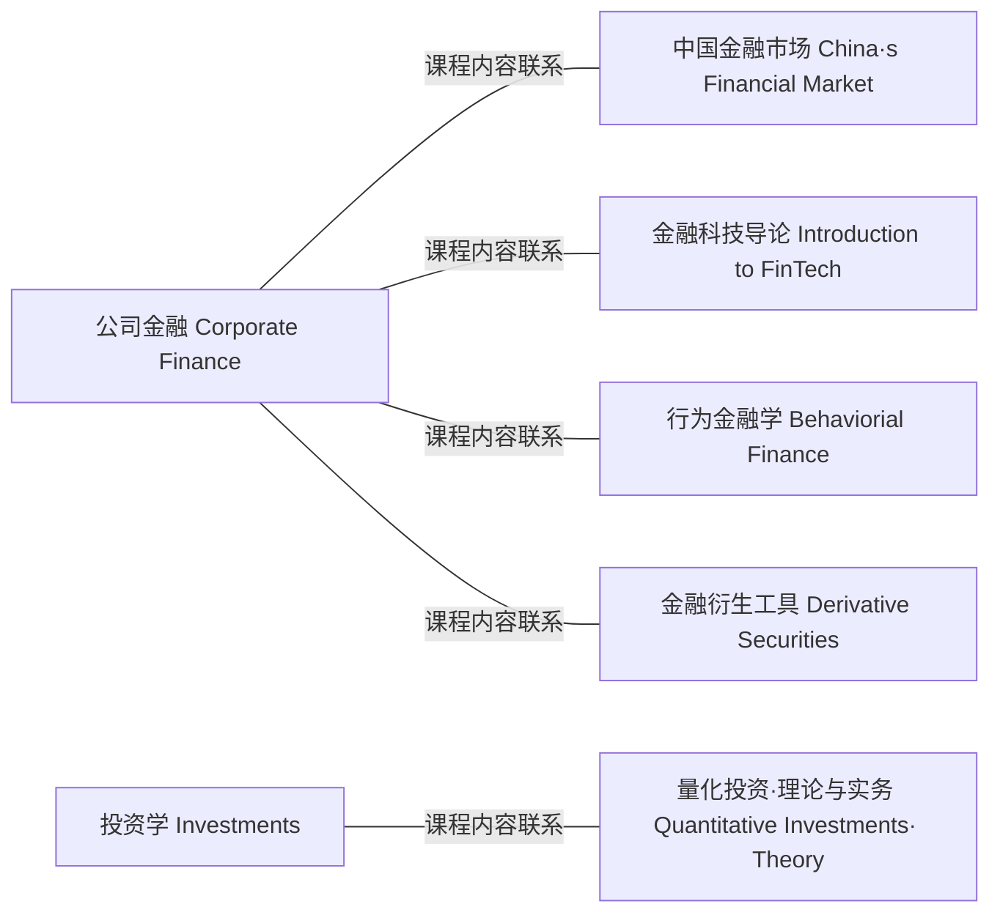

# 金融学（金融科技方向）专业“2+X”修读建议（留学生适用）

2024 年汇编印刷页 474–477。原表记录 40 个可配对的课程代码。

[本节原页](plan-464.pdf#page=11) · [逐行数据](plan-464.json) · [院系目录](README.md)

## 课程导读

想了解金融科技的课程安排，可以在原表中找到《金融科技导论 Introduction to FinTech》（`FISF130008`）、《中国金融市场 China's Financial Market》（`FISF130003`）、《金融数据科学与编程 Data Science and Programming for Finance》（`FISF130007`）。 [原书 PDF 第 490 页](plan-464.pdf#page=13)

图中连接《公司金融 Corporate Finance》（`FISF130001`）和《中国金融市场 China's Financial Market》（`FISF130003`），两门课都从课程题名标出的“金融”切入，可沿这一主题对照阅读。 [原书 PDF 第 489 页](plan-464.pdf#page=12) · [原书 PDF 第 490 页](plan-464.pdf#page=13)

## 课程关系图

图中展示最多 20 条关系。下表列出本节全部关系。建议学习顺序供规划课程使用，正式选课资格以教务规定为准。

| 课程 | 关联课程 | 关系 | 依据 |
| --- | --- | --- | --- |
| 公司金融 Corporate Finance（FISF130001） | 中国金融市场 China's Financial Market（FISF130003） | 课程内容联系 | 本方案两门课程的题名均含“金融”，可据此对照这一主题。 |
| 公司金融 Corporate Finance（FISF130001） | 金融科技导论 Introduction to FinTech（FISF130008） | 课程内容联系 | 本方案两门课程的题名均含“金融”，可据此对照这一主题。 |
| 公司金融 Corporate Finance（FISF130001） | 行为金融学 Behaviorial Finance（FISF130017） | 课程内容联系 | 本方案两门课程的题名均含“金融”，可据此对照这一主题。 |
| 公司金融 Corporate Finance（FISF130001） | 金融衍生工具 Derivative Securities（FISF130023） | 课程内容联系 | 本方案两门课程的题名均含“金融”，可据此对照这一主题。 |
| 投资学 Investments（FISF130002） | 量化投资：理论与实务 Quantitative Investments, Theory and Practice（FISF130034） | 课程内容联系 | 本方案两门课程的题名均含“投资”，可据此对照这一主题。 |

## 课程

| 课程代码 | 名称 | 开课学期原文 | 来源（PDF 页） |
| --- | --- | --- | --- |
| AIB110002 | Python 程序设计 Python Programming |  | 488 |
| AIB110003 | 走近人工智能 Towards Artificial Intelligence |  | 488 |
| FISF130001 | 公司金融 Corporate Finance |  | 489 |
| FISF130002 | 投资学 Investments |  | 489 |
| FISF130003 | 中国金融市场 China's Financial Market |  | 490 |
| FISF130004 | 中国经济 Chinese Economy |  | 490 |
| FISF130005 | 计量经济学 Econometrics |  | 489 |
| FISF130007 | 金融数据科学与编程 Data Science and Programming for Finance |  | 490 |
| FISF130008 | 金融科技导论 Introduction to FinTech |  | 490 |
| FISF130009 | 区块链与数字货币 Block-chain and Digital Currency |  | 490 |
| FISF130010 | 领导力课程系列一 Leadership Course Series I |  | 489 |
| FISF130011 | 领导力课程系列二 Leadership Course Series II |  | 489 |
| FISF130012 | 专业实习 Professional Internship |  | 489 |
| FISF130017 | 行为金融学 Behaviorial Finance |  | 490 |
| FISF130019 | 中级宏观经济学 Intermediate Macroeconomics |  | 490 |
| FISF130020 | 计算机导论 Introduction to Computer Science |  | 489 |
| FISF130023 | 金融衍生工具 Derivative Securities |  | 490 |
| FISF130024 | 财务报表分析 Financial Statement Analysis |  | 490 |
| FISF130025 | 行动学习 Intellection through Action |  | 489 |
| FISF130026 | 金融经济实证分析方法 Empirical Methods in Finance and Economics |  | 490 |
| FISF130027 | 统计学基础与R软件 Fundamental Statistics and R Software |  | 489 |
| FISF130028 | 毕业论文 Graduation Thesis |  | 489 |
| FISF130029 | 社会科学数据挖掘 Data Mining in Social Science |  | 490 |
| FISF130032 | 机器学习 Machine Learning |  | 490 |
| FISF130033 | 金融中的数学方法 Mathematical Methods for Finance |  | 490 |
| FISF130034 | 量化投资：理论与实务 Quantitative Investments, Theory and Practice |  | 490 |
| FISF130035 | 中级微观经济学 Intermediate Microeconomics |  | 489 |
| ICES110010 | 初级汉语 Elementary Chinese |  | 489 |
| ICES110011 | 中级汉语 Intermediate Chinese |  | 489 |
| ICES110012 | 中国概况(上) China: A General Survey I |  | 488 |
| ICES110013 | 中国概况(下) China: A General Survey II |  | 488 |
| MATH120003 | 高等数学B(上) Advanced Mathematics B I |  | 489 |
| MATH120004 | 高等数学B(下) Advanced Mathematics B II |  | 489 |
| MATH120016 | 数学分析B I Mathematical Analysis BI |  | 489 |
| MATH120017 | 数学分析B II Mathematical Analysis BII |  | 489 |
| MATH120021 | 高等数学A(上) Advanced Mathematics A I |  | 489 |
| MATH120022 | 高等数学A(下) Advanced Mathematics A II |  | 489 |
| SOSC120004 | 微观经济学 Microeconomics |  | 489 |
| SOSC120005 | 宏观经济学 Macroeconomics |  | 489 |
| SOSC120006 | 会计学 Accounting |  | 489 |
