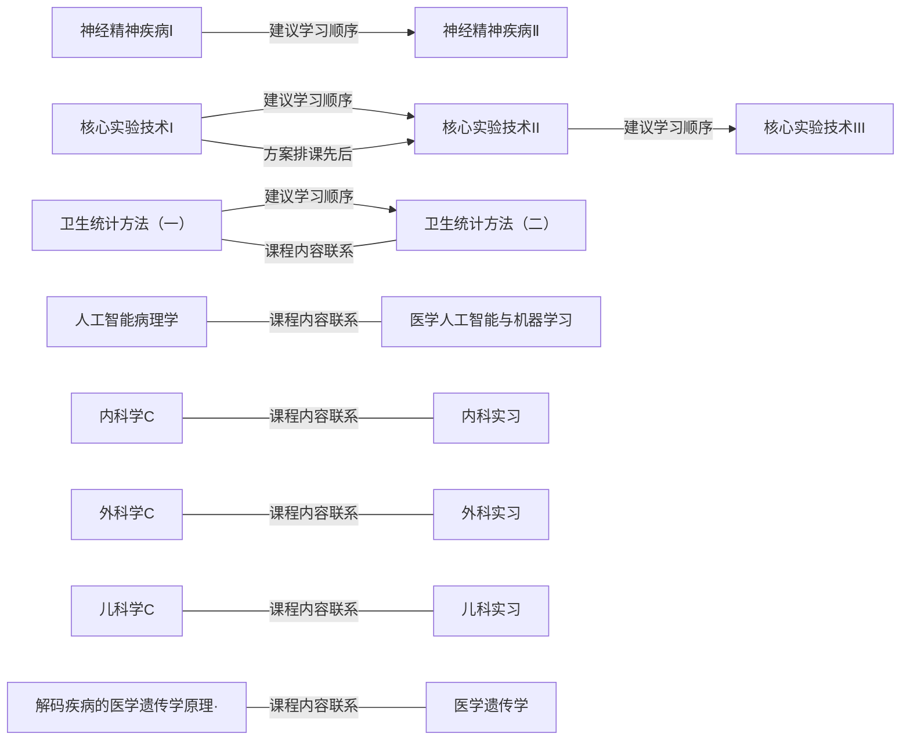

# 基础医学专业教学培养方案（强基班适用）

2024 年汇编印刷页 988–991。原表记录 57 个可配对的课程代码。

[本节原页](plan-988.pdf#page=1) · [逐行数据](plan-988.json) · [院系目录](README.md)

## 课程关系图

图中展示最多 20 条关系。下表列出本节全部关系。建议学习顺序供规划课程使用，正式选课资格以教务规定为准。

| 课程 | 关联课程 | 关系 | 依据 |
| --- | --- | --- | --- |
| 神经精神疾病Ⅰ（MED130311） | 神经精神疾病Ⅱ（MED130312） | 建议学习顺序 | 同节课程题名标明连续分册或序号。 |
| 核心实验技术I（MED130419） | 核心实验技术II（MED130427） | 建议学习顺序 | 同节课程题名标明连续分册或序号。 |
| 核心实验技术II（MED130427） | 核心实验技术III（MED130430） | 建议学习顺序 | 同节课程题名标明连续分册或序号。 |
| 卫生统计方法（一）（PHPM130058） | 卫生统计方法（二）（PHPM130059） | 建议学习顺序 | 同节课程题名标明连续分册或序号。 |
| 人工智能病理学（AIS631011） | 医学人工智能与机器学习（MED130347） | 课程内容联系 | 本方案两门课程的题名均含“人工智能”，可据此对照这一主题。 |
| 内科学C（MED130056） | 内科实习（MED130128） | 课程内容联系 | 本方案两门课程的题名均含“内科”，可据此对照这一主题。 |
| 外科学C（MED130057） | 外科实习（MED130129） | 课程内容联系 | 本方案两门课程的题名均含“外科”，可据此对照这一主题。 |
| 儿科学C（MED130059） | 儿科实习（MED130349） | 课程内容联系 | 本方案两门课程的题名均含“儿科”，可据此对照这一主题。 |
| 解码疾病的医学遗传学原理*（MED130433） | 医学遗传学（MED130480） | 课程内容联系 | 本方案两门课程的题名均含“遗传学”，可据此对照这一主题。 |
| 卫生统计方法（一）（PHPM130058） | 卫生统计方法（二）（PHPM130059） | 课程内容联系 | 本方案两门课程的题名均含“卫生统计”，可据此对照这一主题。 |
| 核心实验技术I（MED130419） | 核心实验技术II（MED130427） | 方案排课先后 | 本节原表所列全部明确学期均早于后者。 |

## 课程

| 课程代码 | 名称 | 开课学期原文 | 来源（PDF 页） |
| --- | --- | --- | --- |
| AIS310019 | 医学影像深度学习 | 秋 | 1004 |
| AIS631011 | 人工智能病理学 | 秋 | 1004 |
| MED130012 | 寄生虫学C | 5 | 1003 |
| MED130017 | 医学心理学 | 春 | 1004 |
| MED130041 | 免疫学B | 4 | 1003 |
| MED130046 | 医学文献检索与利用A | 秋 | 1004 |
| MED130049 | 诊断学B | 5 | 1003 |
| MED130050 | 影像诊断学C | 春 | 1004 |
| MED130056 | 内科学C | 6 | 1003 |
| MED130057 | 外科学C | 6 | 1003 |
| MED130058 | 妇产科学C | 6 | 1003 |
| MED130059 | 儿科学C | 6 | 1003 |
| MED130077 | 细胞超微结构与电镜技术 | 春，秋 | 1004 |
| MED130097 | 中西医结合基础概论 | 秋 | 1004 |
| MED130099 | 免疫工程 | 秋 | 1004 |
| MED130105 | 法医学概论 | 春，秋 | 1004 |
| MED130128 | 内科实习 | 7 | 1003 |
| MED130129 | 外科实习 | 7 | 1003 |
| MED130162 | 实验动物学 | 春，秋 | 1004 |
| MED130183 | 细胞生物学C | 2 | 1002 |
| MED130242 | 生物化学 | 3 | 1002 |
| MED130283 | 人体的社交网络：共生微生物 | 暑期 | 1004 |
| MED130310 | 生物医学信息学概论* | 春 | 1004 |
| MED130311 | 神经精神疾病Ⅰ | 春 | 1004 |
| MED130312 | 神经精神疾病Ⅱ | 秋 | 1004 |
| MED130343 | 医学微生物学C | 4 | 1003 |
| MED130347 | 医学人工智能与机器学习 | 暑期 | 1004 |
| MED130348 | 达尔文演化论和现代医学 | 暑期 | 1004 |
| MED130349 | 儿科实习 | 7 | 1003 |
| MED130350 | 妇产科实习 | 7 | 1003 |
| MED130354 | 疼痛生物医学 | 春，秋 | 1004 |
| MED130393 | 基础医学导论 | 2 | 1002 |
| MED130398 | 人体解剖学 | 3 | 1002 |
| MED130406 | 脑科学前沿* | 春 | 1004 |
| MED130407 | 医学伦理与法规 | 5 | 1003 |
| MED130418 | 基础医学分论 | 3 | 1003 |
| MED130419 | 核心实验技术I | 3 | 1003 |
| MED130420 | 神经系统疾病基础 | 4 | 1003 |
| MED130421 | 循环血液系统疾病基础 | 4 | 1003 |
| MED130422 | 呼吸系统疾病基础 | 4 | 1003 |
| MED130423 | 消化系统疾病基础 | 5 | 1003 |
| MED130424 | 泌尿系统疾病基础 | 5 | 1003 |
| MED130425 | 内分泌生殖系统疾病基础 | 5 | 1003 |
| MED130427 | 核心实验技术II | 4 | 1003 |
| MED130430 | 核心实验技术III | 秋 | 1004 |
| MED130431 | 代谢分子医学和疾病* | 秋 | 1004 |
| MED130432 | 免疫学进阶* | 秋 | 1004 |
| MED130433 | 解码疾病的医学遗传学原理* | 春 | 1004 |
| MED130478 | 基因组学-高通量测序实验与数据分析 | 春，秋 | 1004 |
| MED130480 | 医学遗传学 | 4 | 1003 |
| MED130568 | 人体寄生虫感染的原理* | 春 | 1004 |
| MED130569 | 医学微生物学进阶* | 秋 | 1004 |
| MED130570 | 专业实习 | 9 | 1003 |
| MED130571 | 毕业论文 | 10 | 1003 |
| PHPM130058 | 卫生统计方法（一） | 3 | 1003 |
| PHPM130059 | 卫生统计方法（二） | 春，秋 | 1004 |
| PHYS130088 | 医学物理实验 | 2 | 1004 |
