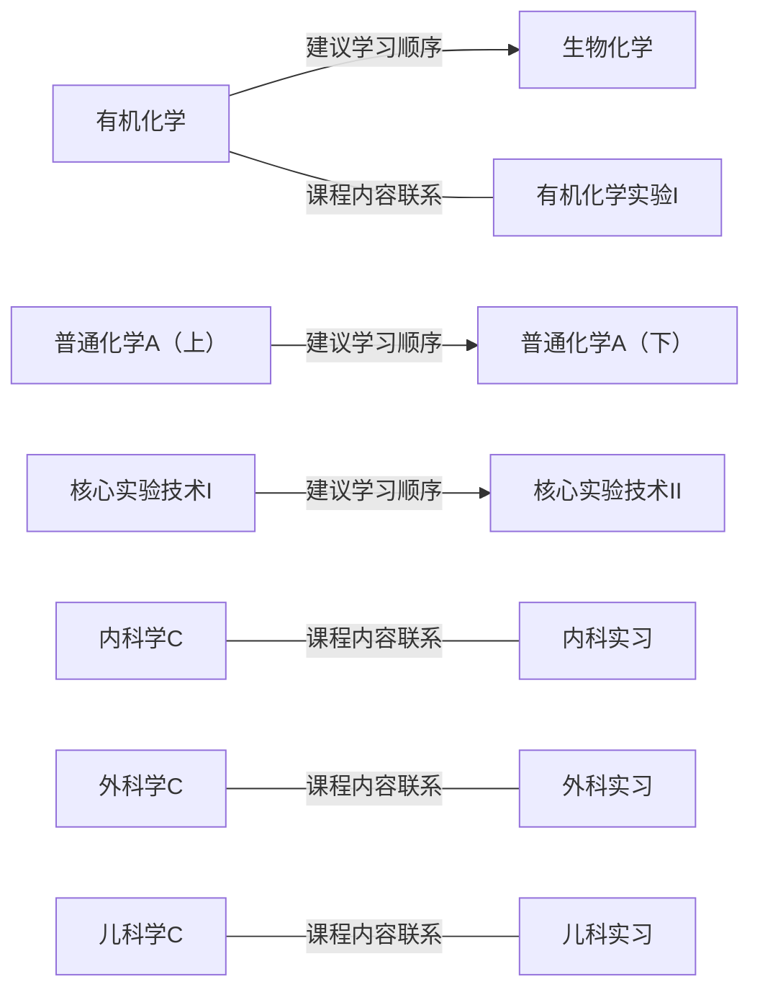

# 基础医学专业“2+X”修读建议

2024 年汇编印刷页 992–993。原表记录 43 个可配对的课程代码。

[本节原页](plan-988.pdf#page=5) · [逐行数据](plan-988.json) · [院系目录](README.md)

## 课程导读

想了解医学基础的课程安排，可以在原表中找到《人体解剖学》（`MED130398`）、《生物化学》（`MED130242`）。 [原书 PDF 第 1006 页](plan-988.pdf#page=5)

图谱建议先读《有机化学》（`CHEM120003`）再读《生物化学》（`MED130242`）。官能团与有机反应是理解生物分子性质的基础。 [原书 PDF 第 1006 页](plan-988.pdf#page=5)

## 课程关系图

图中展示最多 20 条关系。下表列出本节全部关系。建议学习顺序供规划课程使用，正式选课资格以教务规定为准。

| 课程 | 关联课程 | 关系 | 依据 |
| --- | --- | --- | --- |
| 有机化学（CHEM120003） | 生物化学（MED130242） | 建议学习顺序 | 官能团与有机反应是理解生物分子性质的基础。 |
| 普通化学A（上）（CHEM120005） | 普通化学A（下）（CHEM120006） | 建议学习顺序 | 同节课程题名标明连续分册或序号。 |
| 核心实验技术I（MED130419） | 核心实验技术II（MED130427） | 建议学习顺序 | 同节课程题名标明连续分册或序号。 |
| 有机化学（CHEM120003） | 有机化学实验I（CHEM120011） | 课程内容联系 | 本方案两门课程的题名均含“有机化学”，可据此对照这一主题。 |
| 内科学C（MED130056） | 内科实习（MED130128） | 课程内容联系 | 本方案两门课程的题名均含“内科”，可据此对照这一主题。 |
| 外科学C（MED130057） | 外科实习（MED130129） | 课程内容联系 | 本方案两门课程的题名均含“外科”，可据此对照这一主题。 |
| 儿科学C（MED130059） | 儿科实习（MED130349） | 课程内容联系 | 本方案两门课程的题名均含“儿科”，可据此对照这一主题。 |

## 课程

| 课程代码 | 名称 | 开课学期原文 | 来源（PDF 页） |
| --- | --- | --- | --- |
| BIOL120004 | 现代生物科学导论C |  | 1006 |
| CHEM120003 | 有机化学 |  | 1006 |
| CHEM120005 | 普通化学A（上） |  | 1006 |
| CHEM120006 | 普通化学A（下） |  | 1006 |
| CHEM120009 | 普通化学实验I |  | 1006 |
| CHEM120011 | 有机化学实验I |  | 1006 |
| MATH120045 | 高等数学CI |  | 1006 |
| MED130012 | 寄生虫学C |  | 1007 |
| MED130041 | 免疫学B |  | 1007 |
| MED130049 | 诊断学B |  | 1007 |
| MED130056 | 内科学C |  | 1007 |
| MED130057 | 外科学C |  | 1007 |
| MED130058 | 妇产科学C |  | 1007 |
| MED130059 | 儿科学C |  | 1007 |
| MED130128 | 内科实习 |  | 1007 |
| MED130129 | 外科实习 |  | 1007 |
| MED130183 | 细胞生物学C |  | 1006 |
| MED130242 | 生物化学 |  | 1006 |
| MED130343 | 医学微生物C |  | 1007 |
| MED130349 | 儿科实习 |  | 1007 |
| MED130350 | 妇产科实习 |  | 1007 |
| MED130398 | 人体解剖学 |  | 1006 |
| MED130407 | 医学伦理与法规 |  | 1007 |
| MED130418 | 基础医学分论 |  | 1006 |
| MED130419 | 核心实验技术I |  | 1006 |
| MED130420 | 神经系统疾病基础 |  | 1007 |
| MED130421 | 循环血液系统疾病基础 |  | 1007 |
| MED130422 | 呼吸系统疾病基础 |  | 1007 |
| MED130423 | 消化系统疾病基础 |  | 1007 |
| MED130424 | 泌尿系统疾病基础 |  | 1007 |
| MED130425 | 内分泌生殖系统疾病基础 |  | 1007 |
| MED130427 | 核心实验技术II |  | 1007 |
| MED130480 | 医学遗传学 |  | 1007 |
| MED130570 | 专业实习 |  | 1007 |
| MED130571 | 毕业论文 |  | 1007 |
| PHPM130058 | 卫生统计方法（一） |  | 1006 |
| PHYS120003 | 普通物理B |  | 1006 |
| PHYS120015 | 基础物理实验 |  | 1006 |
| PTSS110082 | 毛泽东思想和中国特色社会主义理论体系概论 |  | 1006 |
| PTSS110087 | 马克思主义基本原理 |  | 1006 |
| PTSS110088 | 中国近现代史纲要 |  | 1006 |
| PTSS110089 | 思想道德与法治 |  | 1006 |
| PTSS110090 | 习近平新时代中国特色社会主义思想概论 |  | 1006 |
