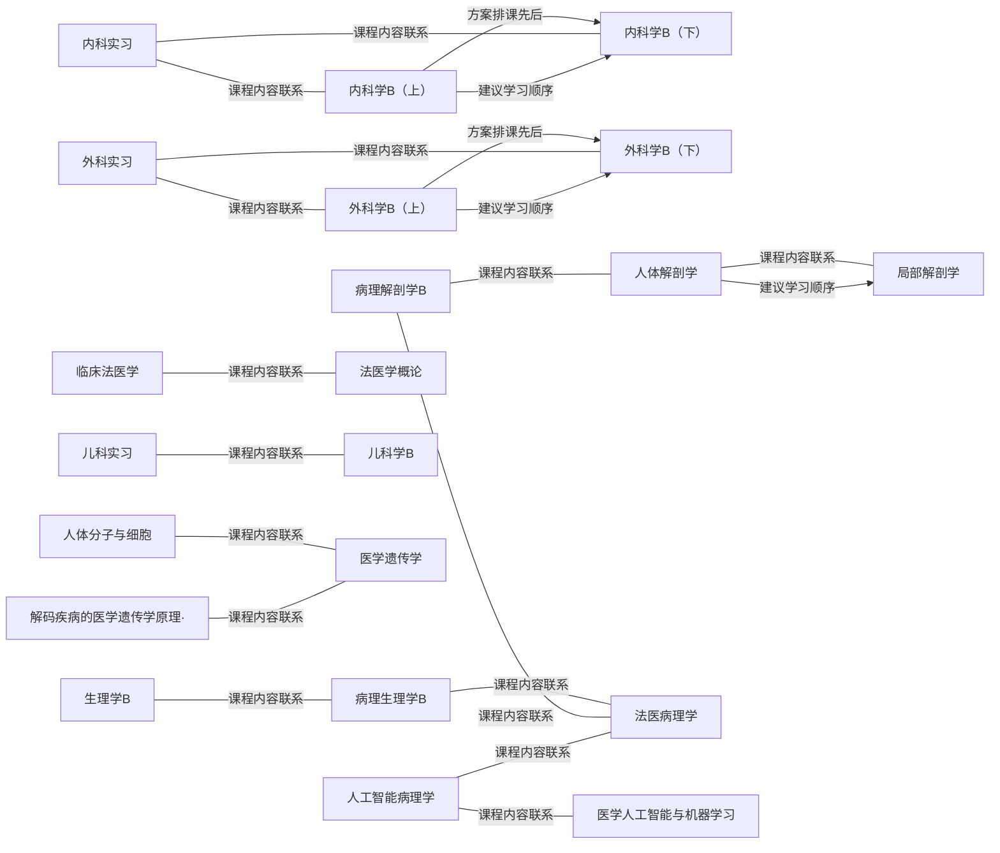

# 法医学专业“2+X”教学培养方案

2024 年汇编印刷页 994–997。原表记录 55 个可配对的课程代码。

[本节原页](plan-994.pdf#page=1) · [逐行数据](plan-994.json) · [院系目录](README.md)

## 课程导读

想了解法医鉴定与医学基础的课程安排，可以在原表中找到《法医学概论》（`MED130105`）、《法医毒物分析》（`MED130073`）、《病理解剖学B》（`MED130010`）。 [原书 PDF 第 1008 页](plan-994.pdf#page=1) · [原书 PDF 第 1009 页](plan-994.pdf#page=2)

图中连接《人工智能病理学》（`AIS631011`）和《法医病理学》（`MED130070`），两门课都从课程题名标出的“病理”切入，可沿这一主题对照阅读。 [原书 PDF 第 1009 页](plan-994.pdf#page=2) · [原书 PDF 第 1010 页](plan-994.pdf#page=3)

## 课程关系图

图中展示最多 20 条关系。下表列出本节全部关系。建议学习顺序供规划课程使用，正式选课资格以教务规定为准。

| 课程 | 关联课程 | 关系 | 依据 |
| --- | --- | --- | --- |
| 内科学B（上）（MED130380） | 内科学B（下）（MED130381） | 建议学习顺序 | 同节课程题名标明连续分册或序号。 |
| 外科学B（上）（MED130382） | 外科学B（下）（MED130383） | 建议学习顺序 | 同节课程题名标明连续分册或序号。 |
| 人体解剖学（MED130398） | 局部解剖学（MED130446） | 建议学习顺序 | 系统结构与位置关系可用于区域解剖学习。 |
| 人工智能病理学（AIS631011） | 法医病理学（MED130070） | 课程内容联系 | 本方案两门课程的题名均含“病理”，可据此对照这一主题。 |
| 人工智能病理学（AIS631011） | 医学人工智能与机器学习（MED130347） | 课程内容联系 | 本方案两门课程的题名均含“人工智能”，可据此对照这一主题。 |
| 生理学B（MED130005） | 病理生理学B（MED130013） | 课程内容联系 | 本方案两门课程的题名均含“生理学”，可据此对照这一主题。 |
| 病理解剖学B（MED130010） | 法医病理学（MED130070） | 课程内容联系 | 本方案两门课程的题名均含“病理”，可据此对照这一主题。 |
| 病理解剖学B（MED130010） | 人体解剖学（MED130398） | 课程内容联系 | 本方案两门课程的题名均含“解剖”，可据此对照这一主题。 |
| 病理生理学B（MED130013） | 法医病理学（MED130070） | 课程内容联系 | 本方案两门课程的题名均含“病理”，可据此对照这一主题。 |
| 临床法医学（MED130075） | 法医学概论（MED130105） | 课程内容联系 | 本方案两门课程的题名均含“法医学”，可据此对照这一主题。 |
| 内科实习（MED130132） | 内科学B（上）（MED130380） | 课程内容联系 | 本方案两门课程的题名均含“内科”，可据此对照这一主题。 |
| 内科实习（MED130132） | 内科学B（下）（MED130381） | 课程内容联系 | 本方案两门课程的题名均含“内科”，可据此对照这一主题。 |
| 外科实习（MED130133） | 外科学B（上）（MED130382） | 课程内容联系 | 本方案两门课程的题名均含“外科”，可据此对照这一主题。 |
| 外科实习（MED130133） | 外科学B（下）（MED130383） | 课程内容联系 | 本方案两门课程的题名均含“外科”，可据此对照这一主题。 |
| 儿科实习（MED130349） | 儿科学B（MED130384） | 课程内容联系 | 本方案两门课程的题名均含“儿科”，可据此对照这一主题。 |
| 人体解剖学（MED130398） | 局部解剖学（MED130446） | 课程内容联系 | 本方案两门课程的题名均含“解剖”，可据此对照这一主题。 |
| 解码疾病的医学遗传学原理*（MED130433） | 医学遗传学（MED130480） | 课程内容联系 | 本方案两门课程的题名均含“遗传学”，可据此对照这一主题。 |
| 人体分子与细胞（MED130479） | 医学遗传学（MED130480） | 课程内容联系 | 基因、细胞与人体性状是共同知识背景。 |
| 内科学B（上）（MED130380） | 内科学B（下）（MED130381） | 方案排课先后 | 本节原表所列全部明确学期均早于后者。 |
| 外科学B（上）（MED130382） | 外科学B（下）（MED130383） | 方案排课先后 | 本节原表所列全部明确学期均早于后者。 |
| 人体解剖学（MED130398） | 局部解剖学（MED130446） | 方案排课先后 | 本节原表所列全部明确学期均早于后者。 |

## 课程

| 课程代码 | 名称 | 开课学期原文 | 来源（PDF 页） |
| --- | --- | --- | --- |
| AIS310019 | 医学影像深度学习 | 秋 | 1010 |
| AIS631011 | 人工智能病理学 | 秋 | 1010 |
| LAWS130007 | 刑事诉讼法 | 春 | 1010 |
| MED130003 | 组织胚胎学B | 3 | 1008 |
| MED130005 | 生理学B | 4 | 1008 |
| MED130010 | 病理解剖学B | 4 | 1008 |
| MED130012 | 寄生虫学C | 秋 | 1010 |
| MED130013 | 病理生理学B | 5 | 1008 |
| MED130014 | 药理学C | 5 | 1008 |
| MED130028 | 妇产科学B | 7 | 1009 |
| MED130033 | 口腔科学B | 春 | 1010 |
| MED130034 | 精神医学 | 6 | 1009 |
| MED130035 | 神经病学 | 6 | 1009 |
| MED130070 | 法医病理学 | 9 | 1009 |
| MED130071 | 法医物证学 | 5 | 1009 |
| MED130072 | 法医人类学 | 5 | 1009 |
| MED130073 | 法医毒物分析 | 7 | 1009 |
| MED130074 | 法医毒理学 | 7 | 1009 |
| MED130075 | 临床法医学 | 9 | 1009 |
| MED130087 | 医学文献检索与利用B | 暑期 | 1010 |
| MED130097 | 中西医结合基础概论 | 秋 | 1010 |
| MED130105 | 法医学概论 | 3 | 1009 |
| MED130132 | 内科实习 | 8 | 1009 |
| MED130133 | 外科实习 | 8 | 1009 |
| MED130134 | 专业实习 | 10 | 1009 |
| MED130135 | 毕业论文 | 10 | 1009 |
| MED130156 | 眼科学 | 6 | 1010 |
| MED130157 | 耳鼻喉科学 | 6 | 1010 |
| MED130269 | 刑事科学技术 | 9 | 1009 |
| MED130285 | 司法精神医学 | 7 | 1009 |
| MED130287 | 医疗纠纷防范与应对 | 春 | 1010 |
| MED130310 | 生物医学信息学概论* | 春 | 1010 |
| MED130343 | 医学微生物学C | 4 | 1008 |
| MED130347 | 医学人工智能与机器学习 | 暑期 | 1010 |
| MED130349 | 儿科实习 | 8 | 1009 |
| MED130350 | 妇产科实习 | 8 | 1009 |
| MED130380 | 内科学B（上） | 6 | 1008 |
| MED130381 | 内科学B（下） | 7 | 1009 |
| MED130382 | 外科学B（上） | 6 | 1009 |
| MED130383 | 外科学B（下） | 7 | 1009 |
| MED130384 | 儿科学B | 7 | 1009 |
| MED130398 | 人体解剖学 | 3 | 1008 |
| MED130406 | 脑科学前沿* | 春 | 1010 |
| MED130431 | 代谢分子医学和疾病* | 秋 | 1010 |
| MED130432 | 免疫学进阶* | 秋 | 1010 |
| MED130433 | 解码疾病的医学遗传学原理* | 春 | 1010 |
| MED130441 | 生物化学实验C | 3 | 1009 |
| MED130442 | 免疫学B | 4 | 1008 |
| MED130444 | 功能学科综合实验 | 5 | 1009 |
| MED130446 | 局部解剖学 | 4 | 1008 |
| MED130447 | 诊断学 | 5 | 1008 |
| MED130452 | 影像诊断学 | 6 | 1008 |
| MED130479 | 人体分子与细胞 | 3 | 1008 |
| MED130480 | 医学遗传学 | 4 | 1008 |
| PHPM130058 | 卫生统计方法（一） | 3 | 1010 |
