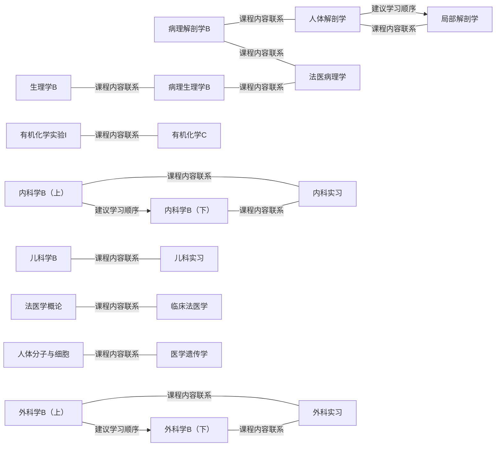

# 法医学专业“2+X”修读建议

2024 年汇编印刷页 998–999。原表记录 41 个可配对的课程代码。

[本节原页](plan-994.pdf#page=5) · [逐行数据](plan-994.json) · [院系目录](README.md)

## 课程关系图

图中展示最多 20 条关系。下表列出本节全部关系。建议学习顺序供规划课程使用，正式选课资格以教务规定为准。

| 课程 | 关联课程 | 关系 | 依据 |
| --- | --- | --- | --- |
| 内科学B（上）（MED130021） | 内科学B（下）（MED130022） | 建议学习顺序 | 同节课程题名标明连续分册或序号。 |
| 外科学B（上）（MED130023） | 外科学B（下）（MED130024） | 建议学习顺序 | 同节课程题名标明连续分册或序号。 |
| 人体解剖学（MED130398） | 局部解剖学（MED130446） | 建议学习顺序 | 系统结构与位置关系可用于区域解剖学习。 |
| 有机化学实验I（CHEM120011） | 有机化学C（CHEM120012） | 课程内容联系 | 本方案两门课程的题名均含“有机化学”，可据此对照这一主题。 |
| 生理学B（MED130005） | 病理生理学B（MED130013） | 课程内容联系 | 本方案两门课程的题名均含“生理学”，可据此对照这一主题。 |
| 病理解剖学B（MED130010） | 法医病理学（MED130070） | 课程内容联系 | 本方案两门课程的题名均含“病理”，可据此对照这一主题。 |
| 病理解剖学B（MED130010） | 人体解剖学（MED130398） | 课程内容联系 | 本方案两门课程的题名均含“解剖”，可据此对照这一主题。 |
| 病理生理学B（MED130013） | 法医病理学（MED130070） | 课程内容联系 | 本方案两门课程的题名均含“病理”，可据此对照这一主题。 |
| 内科学B（上）（MED130021） | 内科实习（MED130132） | 课程内容联系 | 本方案两门课程的题名均含“内科”，可据此对照这一主题。 |
| 内科学B（下）（MED130022） | 内科实习（MED130132） | 课程内容联系 | 本方案两门课程的题名均含“内科”，可据此对照这一主题。 |
| 外科学B（上）（MED130023） | 外科实习（MED130133） | 课程内容联系 | 本方案两门课程的题名均含“外科”，可据此对照这一主题。 |
| 外科学B（下）（MED130024） | 外科实习（MED130133） | 课程内容联系 | 本方案两门课程的题名均含“外科”，可据此对照这一主题。 |
| 儿科学B（MED130084） | 儿科实习（MED130349） | 课程内容联系 | 本方案两门课程的题名均含“儿科”，可据此对照这一主题。 |
| 法医学概论（MED130105） | 临床法医学（MED130129） | 课程内容联系 | 本方案两门课程的题名均含“法医学”，可据此对照这一主题。 |
| 人体解剖学（MED130398） | 局部解剖学（MED130446） | 课程内容联系 | 本方案两门课程的题名均含“解剖”，可据此对照这一主题。 |
| 人体分子与细胞（MED130479） | 医学遗传学（MED130480） | 课程内容联系 | 基因、细胞与人体性状是共同知识背景。 |

## 课程

| 课程代码 | 名称 | 开课学期原文 | 来源（PDF 页） |
| --- | --- | --- | --- |
| BIOL120004 | 现代生物科学导论C |  | 1012 |
| CHEM120009 | 普通化学实验I |  | 1012 |
| CHEM120011 | 有机化学实验I |  | 1012 |
| CHEM120012 | 有机化学C |  | 1012 |
| CHEM120013 | 普通化学C |  | 1012 |
| MATH120045 | 高等数学CI |  | 1012 |
| MED130003 | 组织胚胎学B |  | 1012 |
| MED130005 | 生理学B |  | 1013 |
| MED130010 | 病理解剖学B |  | 1013 |
| MED130013 | 病理生理学B |  | 1013 |
| MED130014 | 药理学C |  | 1013 |
| MED130021 | 内科学B（上） |  | 1013 |
| MED130022 | 内科学B（下） |  | 1013 |
| MED130023 | 外科学B（上） |  | 1013 |
| MED130024 | 外科学B（下） |  | 1013 |
| MED130028 | 妇产科学B |  | 1013 |
| MED130070 | 法医病理学 |  | 1013 |
| MED130084 | 儿科学B |  | 1013 |
| MED130105 | 法医学概论 |  | 1012 |
| MED130129 | 临床法医学 |  | 1013 |
| MED130132 | 内科实习 |  | 1013 |
| MED130133 | 外科实习 |  | 1013 |
| MED130134 | 专业实习 |  | 1013 |
| MED130135 | 毕业论文 |  | 1013 |
| MED130343 | 医学微生物学 |  | 1013 |
| MED130349 | 儿科实习 |  | 1013 |
| MED130350 | 妇产科实习 |  | 1013 |
| MED130398 | 人体解剖学 |  | 1012 |
| MED130442 | 免疫学B |  | 1013 |
| MED130446 | 局部解剖学 |  | 1012 |
| MED130447 | 诊断学 |  | 1013 |
| MED130452 | 影像诊断学 |  | 1013 |
| MED130479 | 人体分子与细胞 |  | 1012 |
| MED130480 | 医学遗传学 |  | 1012 |
| PHYS120003 | 普通物理B |  | 1012 |
| PHYS120015 | 基础物理实验 |  | 1012 |
| PTSS110082 | 毛泽东思想和中国特色社会主义理论体系概论 |  | 1012 |
| PTSS110087 | 马克思主义基本原理 |  | 1012 |
| PTSS110088 | 中国近现代史纲要 |  | 1012 |
| PTSS110089 | 思想道德与法治 |  | 1012 |
| PTSS110090 | 习近平新时代中国特色社会主义思想概论 |  | 1012 |
