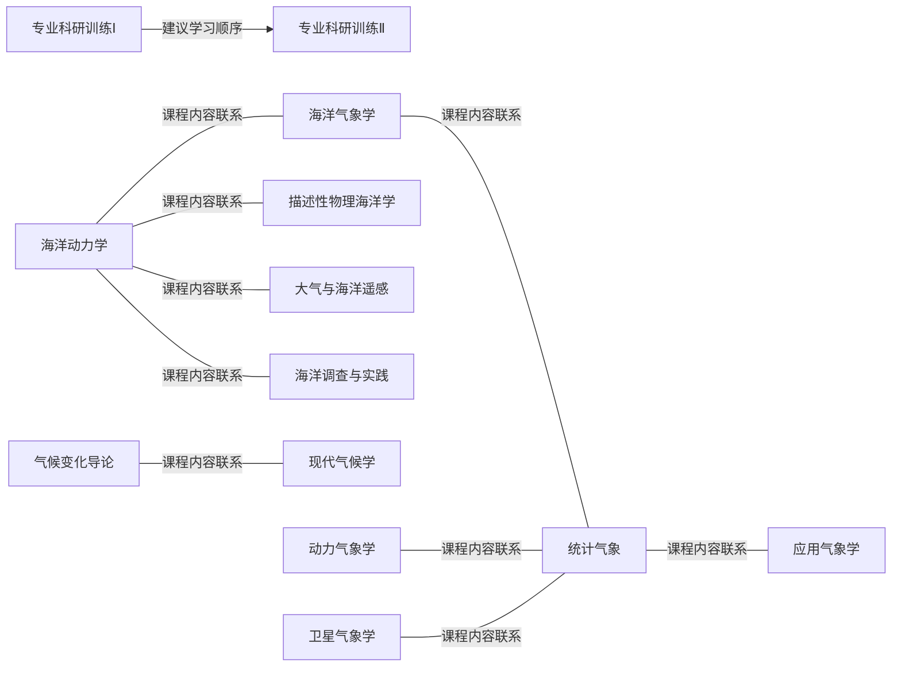

# 大气科学专业“2+X”教学培养方案

2024 年汇编印刷页 691–693。原表记录 42 个可配对的课程代码。

[本节原页](plan-691.pdf#page=1) · [逐行数据](plan-691.json) · [院系目录](README.md)

## 课程关系图

图中展示最多 20 条关系。下表列出本节全部关系。建议学习顺序供规划课程使用，正式选课资格以教务规定为准。

| 课程 | 关联课程 | 关系 | 依据 |
| --- | --- | --- | --- |
| 专业科研训练Ⅰ（ATMO130050） | 专业科研训练Ⅱ（ATMO130051） | 建议学习顺序 | 同节课程题名标明连续分册或序号。 |
| 海洋动力学（ATMO130013） | 海洋气象学（ATMO130034） | 课程内容联系 | 本方案两门课程的题名均含“海洋”，可据此对照这一主题。 |
| 海洋动力学（ATMO130013） | 描述性物理海洋学（ATMO130036） | 课程内容联系 | 本方案两门课程的题名均含“海洋”，可据此对照这一主题。 |
| 海洋动力学（ATMO130013） | 大气与海洋遥感（ATMO130047） | 课程内容联系 | 本方案两门课程的题名均含“海洋”，可据此对照这一主题。 |
| 海洋动力学（ATMO130013） | 海洋调查与实践（ATMO130052） | 课程内容联系 | 本方案两门课程的题名均含“海洋”，可据此对照这一主题。 |
| 气候变化导论（ATMO130028） | 现代气候学（ATMO130037） | 课程内容联系 | 本方案两门课程的题名均含“气候”，可据此对照这一主题。 |
| 动力气象学（ATMO130033） | 统计气象（ATMO130041） | 课程内容联系 | 本方案两门课程的题名均含“气象”，可据此对照这一主题。 |
| 海洋气象学（ATMO130034） | 统计气象（ATMO130041） | 课程内容联系 | 本方案两门课程的题名均含“气象”，可据此对照这一主题。 |
| 卫星气象学（ATMO130038） | 统计气象（ATMO130041） | 课程内容联系 | 本方案两门课程的题名均含“气象”，可据此对照这一主题。 |
| 统计气象（ATMO130041） | 应用气象学（ATMO130053） | 课程内容联系 | 本方案两门课程的题名均含“气象”，可据此对照这一主题。 |

## 课程

| 课程代码 | 名称 | 开课学期原文 | 来源（PDF 页） |
| --- | --- | --- | --- |
| AIS410013 | 气象大数据与人工智能 | 6 | 706 |
| ATMO130002 | 天气学原理 | 5 | 705 |
| ATMO130003 | 大气科学导论 | 1 | 705 |
| ATMO130007 | 专业实习 | 6 | 706 |
| ATMO130008 | 毕业论文 | 8 | 705 |
| ATMO130009 | 天气分析与预报 | 6 | 706 |
| ATMO130010 | 数值天气预报 | 6 | 706 |
| ATMO130012 | 中小尺度气象学 | 6 | 706 |
| ATMO130013 | 海洋动力学 | 4 | 706 |
| ATMO130017 | 热带气象学 | 6 | 706 |
| ATMO130019 | 大气辐射学 | 5 | 706 |
| ATMO130028 | 气候变化导论 | 6 | 706 |
| ATMO130032 | 并行计算与性能优化 | 6 | 706 |
| ATMO130033 | 动力气象学 | 4 | 705 |
| ATMO130034 | 海洋气象学 | 7 | 706 |
| ATMO130035 | 大气物理学 | 3 | 705 |
| ATMO130036 | 描述性物理海洋学 | 3 | 705 |
| ATMO130037 | 现代气候学 | 7 | 707 |
| ATMO130038 | 卫星气象学 | 7 | 707 |
| ATMO130039 | 大数据分析与可视化 | 5 | 706 |
| ATMO130040 | 气象预报与预测实践 | 6暑假 | 706 |
| ATMO130041 | 统计气象 | 5 | 706 |
| ATMO130043 | 热带厄尔尼诺动力学 | 7 | 706 |
| ATMO130044 | 空气污染与人体健康 | 7 | 707 |
| ATMO130045 | 大气探测 | 4 | 705 |
| ATMO130046 | Fortran语言程序设计 | 4 | 706 |
| ATMO130047 | 大气与海洋遥感 | 5 | 706 |
| ATMO130048 | 环境气象学 | 7 | 707 |
| ATMO130049 | 大气化学 | 4 | 705 |
| ATMO130050 | 专业科研训练Ⅰ | 6 | 706 |
| ATMO130051 | 专业科研训练Ⅱ | 6 | 706 |
| ATMO130052 | 海洋调查与实践 | 4暑假 | 706 |
| ATMO130053 | 应用气象学 | 7 | 707 |
| CHEM130012 | 物理化学AⅠ | 5 | 706 |
| CHEM130016 | 无机化学 | 4 | 706 |
| CHEM130067 | 有机化学AI | 5 | 706 |
| MANA130001 | 概率论与数理统计 | 3 | 705 |
| MATH130016 | 微分方程数值解法 | 6 | 706 |
| MATH130036 | 计算方法 | 5 | 705 |
| MECH130009 | 流体力学I | 4 | 706 |
| PHYS130006 | 数学物理方法A | 3 | 706 |
| PHYS130113 | 热力学与统计物理I | 4 | 705 |
