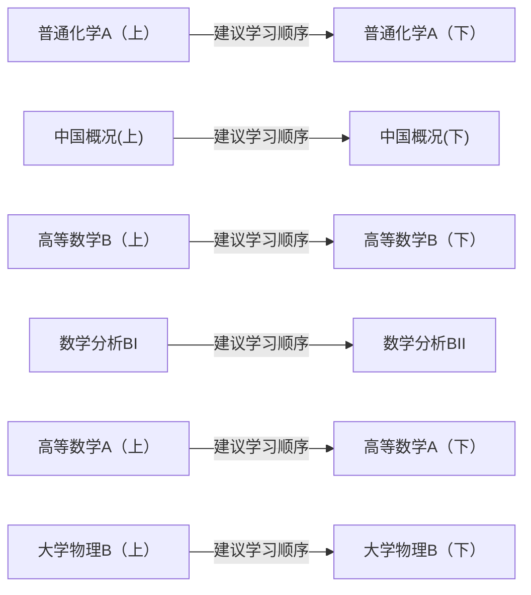

# 大气科学专业“2+X”修读建议（留学生适用）

2024 年汇编印刷页 696–697。原表记录 29 个可配对的课程代码。

[本节原页](plan-691.pdf#page=6) · [逐行数据](plan-691.json) · [院系目录](README.md)

## 课程关系图

图中展示最多 20 条关系。下表列出本节全部关系。建议学习顺序供规划课程使用，正式选课资格以教务规定为准。

| 课程 | 关联课程 | 关系 | 依据 |
| --- | --- | --- | --- |
| 普通化学A（上）（CHEM120005） | 普通化学A（下）（CHEM120006） | 建议学习顺序 | 同节课程题名标明连续分册或序号。 |
| 中国概况(上)（ICES110012） | 中国概况(下)（ICES110013） | 建议学习顺序 | 同节课程题名标明连续分册或序号。 |
| 高等数学B（上）（MATH120003） | 高等数学B（下）（MATH120004） | 建议学习顺序 | 同节课程题名标明连续分册或序号。 |
| 数学分析BI（MATH120016） | 数学分析BII（MATH120017） | 建议学习顺序 | 同节课程题名标明连续分册或序号。 |
| 高等数学A（上）（MATH120021） | 高等数学A（下）（MATH120022） | 建议学习顺序 | 同节课程题名标明连续分册或序号。 |
| 大学物理B（上）（PHYS120013） | 大学物理B（下）（PHYS120014） | 建议学习顺序 | 同节课程题名标明连续分册或序号。 |

## 课程

| 课程代码 | 名称 | 开课学期原文 | 来源（PDF 页） |
| --- | --- | --- | --- |
| ATMO130002 | 天气学原理 |  | 711 |
| ATMO130003 | 大气科学导论 |  | 710 |
| ATMO130008 | 毕业论文 |  | 711 |
| ATMO130033 | 动力气象学 |  | 710 |
| ATMO130035 | 大气物理学 |  | 710 |
| ATMO130036 | 描述性物理海洋学 |  | 710 |
| ATMO130045 | 大气探测 |  | 710 |
| ATMO130049 | 大气化学 |  | 711 |
| CHEM120005 | 普通化学A（上） |  | 710 |
| CHEM120006 | 普通化学A（下） |  | 710 |
| CHEM120009 | 普通化学实验I |  | 710 |
| ICES110012 | 中国概况(上) |  | 710 |
| ICES110013 | 中国概况(下) |  | 710 |
| MANA130001 | 概率论与数理统计 |  | 710 |
| MATH120003 | 高等数学B（上） |  | 710 |
| MATH120004 | 高等数学B（下） |  | 710 |
| MATH120016 | 数学分析BI |  | 710 |
| MATH120017 | 数学分析BII |  | 710 |
| MATH120020 | 线性代数（理工类） |  | 710 |
| MATH120021 | 高等数学A（上） |  | 710 |
| MATH120022 | 高等数学A（下） |  | 710 |
| MATH130036 | 计算方法 |  | 711 |
| PHYS120013 | 大学物理B（上） |  | 710 |
| PHYS120014 | 大学物理B（下） |  | 710 |
| PHYS120015 | 基础物理实验 |  | 710 |
| PHYS120016 | 大学物理A：力学 |  | 710 |
| PHYS120017 | 大学物理A：热学 |  | 710 |
| PHYS120018 | 大学物理A：电磁学 |  | 710 |
| PHYS130113 | 热力学与统计物理I |  | 711 |
