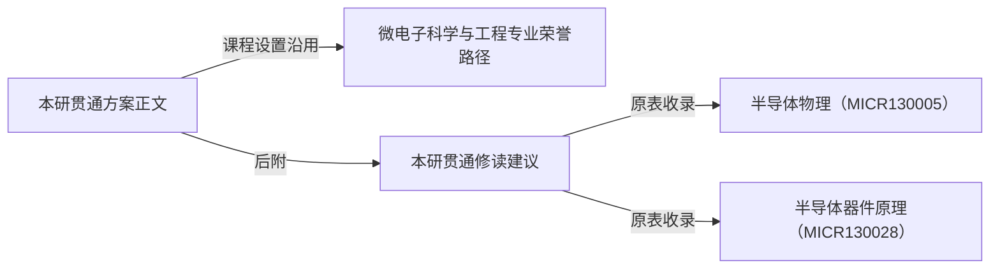

# 微电子科学与工程专业“2+X”培养方案（新工科本研贯通适用）

2024 年汇编印刷页 843–843。原表记录 0 个可配对的课程代码。

[本节原页](plan-843.pdf#page=1) · [逐行数据](plan-843.json) · [院系目录](README.md)

## 课程导读

本节“课程设置与修读要求”指向微电子科学与工程专业方案的荣誉路径，正文未逐门列出课号。要查本研贯通班的具体课程，可翻到紧随正文的修读建议，其中列有《半导体物理》（`MICR130005`）和《半导体器件原理》（`MICR130028`）。 [方案正文，原书 PDF 第 857 页](plan-843.pdf#page=1) · [配套修读建议，原书 PDF 第 858 页](plan-843.pdf#page=2) · [配套修读建议课程图](section-844.md)

下图标明正文引用的课程设置和另行列课的配套表。

本节未核实可定位到课程对的关系。

## 课程

| 课程代码 | 名称 | 开课学期原文 | 来源（PDF 页） |
| --- | --- | --- | --- |
