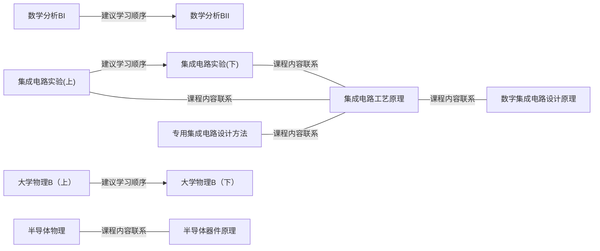

# 微电子科学与工程专业“2+X”修读建议（新工科本研贯通适用）

2024 年汇编印刷页 844–845。原表记录 26 个可配对的课程代码。

[本节原页](plan-843.pdf#page=2) · [逐行数据](plan-843.json) · [院系目录](README.md)

## 课程导读

想了解半导体与集成电路的课程安排，可以在原表中找到《半导体物理》（`MICR130005`）、《数字集成电路设计原理》（`MICR130029`）、《嵌入式处理器与芯片系统设计》（`MICR130006`）。 [原书 PDF 第 858 页](plan-843.pdf#page=2)

图中连接《集成电路实验(上)》（`INFO130027`）和《集成电路工艺原理》（`MICR130007`），两门课都从课程题名标出的“集成电路”切入，可沿这一主题对照阅读。 [原书 PDF 第 859 页](plan-843.pdf#page=3)

## 课程关系图

图中展示最多 20 条关系。下表列出本节全部关系。建议学习顺序供规划课程使用，正式选课资格以教务规定为准。

| 课程 | 关联课程 | 关系 | 依据 |
| --- | --- | --- | --- |
| 集成电路实验(上)（INFO130027） | 集成电路实验(下)（INFO130028） | 建议学习顺序 | 同节课程题名标明连续分册或序号。 |
| 数学分析BI（MATH120016） | 数学分析BII（MATH120017） | 建议学习顺序 | 同节课程题名标明连续分册或序号。 |
| 大学物理B（上）（PHYS120013） | 大学物理B（下）（PHYS120014） | 建议学习顺序 | 同节课程题名标明连续分册或序号。 |
| 集成电路实验(上)（INFO130027） | 集成电路工艺原理（MICR130007） | 课程内容联系 | 本方案两门课程的题名均含“集成电路”，可据此对照这一主题。 |
| 集成电路实验(下)（INFO130028） | 集成电路工艺原理（MICR130007） | 课程内容联系 | 本方案两门课程的题名均含“集成电路”，可据此对照这一主题。 |
| 专用集成电路设计方法（INFO130094） | 集成电路工艺原理（MICR130007） | 课程内容联系 | 本方案两门课程的题名均含“集成电路”，可据此对照这一主题。 |
| 半导体物理（MICR130005） | 半导体器件原理（MICR130028） | 课程内容联系 | 本方案两门课程的题名均含“半导体”，可据此对照这一主题。 |
| 集成电路工艺原理（MICR130007） | 数字集成电路设计原理（MICR130029） | 课程内容联系 | 本方案两门课程的题名均含“集成电路”，可据此对照这一主题。 |

## 课程

| 课程代码 | 名称 | 开课学期原文 | 来源（PDF 页） |
| --- | --- | --- | --- |
| COMP120004 | 线性代数 |  | 858 |
| COMP120006 | 程序设计 |  | 858 |
| INFO130016 | 毕业论文/设计 |  | 859 |
| INFO130027 | 集成电路实验(上) |  | 859 |
| INFO130028 | 集成电路实验(下) |  | 859 |
| INFO130094 | 专用集成电路设计方法 |  | 859 |
| MATH120016 | 数学分析BI |  | 858 |
| MATH120017 | 数学分析BII |  | 858 |
| MICR120001 | 电路基础 |  | 858 |
| MICR130002 | 模拟电子线路 |  | 858 |
| MICR130003 | 数字逻辑基础 |  | 858 |
| MICR130004 | 信号与系统概论 |  | 858 |
| MICR130005 | 半导体物理 |  | 858 |
| MICR130006 | 嵌入式处理器与芯片系统设计 |  | 858 |
| MICR130007 | 集成电路工艺原理 |  | 859 |
| MICR130028 | 半导体器件原理 |  | 858 |
| MICR130029 | 数字集成电路设计原理 |  | 858 |
| MICR130030 | 模拟集成电路设计原理 |  | 859 |
| PHYS120013 | 大学物理B（上） |  | 858 |
| PHYS120014 | 大学物理B（下） |  | 858 |
| PHYS120015 | 基础物理实验 |  | 858 |
| PTSS110082 | 毛泽东思想和中国特色社会主义理论体系概论 |  | 858 |
| PTSS110087 | 马克思主义基本原理 |  | 858 |
| PTSS110088 | 中国近现代史纲要 |  | 858 |
| PTSS110089 | 思想道德与法治 |  | 858 |
| PTSS110090 | 习近平新时代中国特色社会主义思想概论 |  | 858 |
