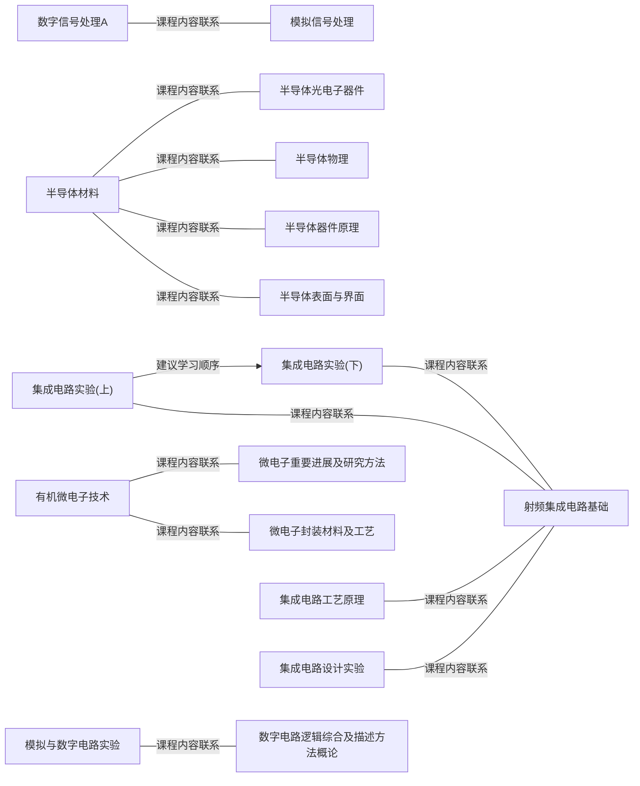

# 微电子科学与工程专业“2+X”教学培养方案

2024 年汇编印刷页 908–911。原表记录 62 个可配对的课程代码。

[本节原页](plan-908.pdf#page=1) · [逐行数据](plan-908.json) · [院系目录](README.md)

## 课程导读

想了解半导体与集成电路的课程安排，可以在原表中找到《半导体物理》（`MICR130005`）、《数字集成电路设计原理》（`MICR130029`）、《嵌入式处理器与芯片系统设计》（`MICR130006`）。 [原书 PDF 第 922 页](plan-908.pdf#page=1)

图中连接《集成电路实验(上)》（`INFO130027`）和《射频集成电路基础》（`MICR130023`），两门课都从课程题名标出的“集成电路”切入，可沿这一主题对照阅读。 [原书 PDF 第 923 页](plan-908.pdf#page=2) · [原书 PDF 第 924 页](plan-908.pdf#page=3)

## 课程关系图

图中展示最多 20 条关系。下表列出本节全部关系。建议学习顺序供规划课程使用，正式选课资格以教务规定为准。

| 课程 | 关联课程 | 关系 | 依据 |
| --- | --- | --- | --- |
| 集成电路实验(上)（INFO130027） | 集成电路实验(下)（INFO130028） | 建议学习顺序 | 同节课程题名标明连续分册或序号。 |
| 数字信号处理A（INFO130010） | 模拟信号处理（MICR130040） | 课程内容联系 | 本方案两门课程的题名均含“信号处理”，可据此对照这一主题。 |
| 集成电路实验(上)（INFO130027） | 射频集成电路基础（MICR130023） | 课程内容联系 | 本方案两门课程的题名均含“集成电路”，可据此对照这一主题。 |
| 集成电路实验(下)（INFO130028） | 射频集成电路基础（MICR130023） | 课程内容联系 | 本方案两门课程的题名均含“集成电路”，可据此对照这一主题。 |
| 半导体材料（INFO130103） | 半导体光电子器件（INFO130112） | 课程内容联系 | 本方案两门课程的题名均含“半导体”，可据此对照这一主题。 |
| 半导体材料（INFO130103） | 半导体物理（MICR130005） | 课程内容联系 | 本方案两门课程的题名均含“半导体”，可据此对照这一主题。 |
| 半导体材料（INFO130103） | 半导体器件原理（MICR130028） | 课程内容联系 | 本方案两门课程的题名均含“半导体”，可据此对照这一主题。 |
| 半导体材料（INFO130103） | 半导体表面与界面（MICR130039） | 课程内容联系 | 本方案两门课程的题名均含“半导体”，可据此对照这一主题。 |
| 有机微电子技术（INFO130269） | 微电子重要进展及研究方法（INFO130271） | 课程内容联系 | 本方案两门课程的题名均含“微电子”，可据此对照这一主题。 |
| 有机微电子技术（INFO130269） | 微电子封装材料及工艺（MICR130020） | 课程内容联系 | 本方案两门课程的题名均含“微电子”，可据此对照这一主题。 |
| 模拟与数字电路实验（INFO130348） | 数字电路逻辑综合及描述方法概论（MICR130047） | 课程内容联系 | 本方案两门课程的题名均含“数字电路”，可据此对照这一主题。 |
| 集成电路工艺原理（MICR130007） | 射频集成电路基础（MICR130023） | 课程内容联系 | 本方案两门课程的题名均含“集成电路”，可据此对照这一主题。 |
| 集成电路设计实验（MICR130011） | 射频集成电路基础（MICR130023） | 课程内容联系 | 本方案两门课程的题名均含“集成电路”，可据此对照这一主题。 |

## 课程

| 课程代码 | 名称 | 开课学期原文 | 来源（PDF 页） |
| --- | --- | --- | --- |
| INFO130004 | 高频电子线路A | 春，秋 | 924 |
| INFO130010 | 数字信号处理A | 春，秋 | 923 |
| INFO130016 | 毕业论文/设计 | 8 | 923 |
| INFO130027 | 集成电路实验(上) | 7 | 923 |
| INFO130028 | 集成电路实验(下) | 7 | 923 |
| INFO130038 | 计算机体系结构 | 春，秋 | 923 |
| INFO130094 | 专用集成电路设计方法 | 6 | 923 |
| INFO130098 | Perl语言入门和提高 | 春，秋 | 924 |
| INFO130103 | 半导体材料 | 春，秋 | 923 |
| INFO130112 | 半导体光电子器件 | 春，秋 | 923 |
| INFO130236 | 前沿讲座 | 春，秋 | 923, 924 |
| INFO130257 | 射频微波测试基础 | 春，秋 | 924 |
| INFO130269 | 有机微电子技术 | 春，秋 | 923 |
| INFO130270 | 数模/模数转换器原理概论 | 春，秋 | 923 |
| INFO130271 | 微电子重要进展及研究方法 | 春，秋 | 924 |
| INFO130285 | 电子标签与物联网 | 春，秋 | 924 |
| INFO130326 | 智能硬件创新方法概论与基础实践 | 春，秋 | 924 |
| INFO130348 | 模拟与数字电路实验 | 春，秋 | 924 |
| MICR130002 | 模拟电子线路 | 3 | 922 |
| MICR130003 | 数字逻辑基础 | 3 | 922 |
| MICR130004 | 信号与系统概论 | 4 | 922 |
| MICR130005 | 半导体物理 | 4 | 922 |
| MICR130006 | 嵌入式处理器与芯片系统设计 | 4 | 922 |
| MICR130007 | 集成电路工艺原理 | 6 | 922 |
| MICR130008 | 工程数学及概率方法 | 春，秋 | 923 |
| MICR130009 | 数据结构与算法 | 春，秋 | 923 |
| MICR130010 | 新型微纳器件概论 | 春，秋 | 923 |
| MICR130011 | 集成电路设计实验 | 春，秋 | 923 |
| MICR130013 | 固体物理基础 | 春，秋 | 923 |
| MICR130014 | 器件可靠性原理与测试 | 春，秋 | 923 |
| MICR130015 | 量子力学 | 春，秋 | 923 |
| MICR130016 | 特色工艺与功率半导体技术 | 春，秋 | 923 |
| MICR130017 | 微机电系统应用 | 春，秋 | 923 |
| MICR130018 | 先进集成电路工艺技术 | 春，秋 | 923 |
| MICR130020 | 微电子封装材料及工艺 | 春，秋 | 924 |
| MICR130021 | PrinciplesandapplicationsofmodelinginICmanufacturing | 春，秋 | 923 |
| MICR130022 | MATLAB概论 | 春，秋 | 924 |
| MICR130023 | 射频集成电路基础 | 春，秋 | 924 |
| MICR130024 | FPGA结构原理和应用 | 春，秋 | 924 |
| MICR130025 | 可编程逻辑结构与设计原理 | 春，秋 | 924 |
| MICR130026 | 模拟集成电路设计自动化基础 | 春，秋 | 924 |
| MICR130027 | 数字集成电路设计自动化基础 | 春，秋 | 924 |
| MICR130028 | 半导体器件原理 | 5 | 922 |
| MICR130029 | 数字集成电路设计原理 | 5 | 922 |
| MICR130030 | 模拟集成电路设计原理 | 6 | 922 |
| MICR130031 | 电子材料薄膜测试表征方法 | 春，秋 | 924 |
| MICR130032 | 传感器原理及应用 | 春，秋 | 923 |
| MICR130033 | 闪存（FLASH）存储器技术与设计实现 | 春，秋 | 924 |
| MICR130034 | 存储器电路设计导论 | 春，秋 | 924 |
| MICR130035 | 超大规模集成电路物理设计中的数学方法 | 春，秋 | 924 |
| MICR130036 | 集成电路高级硬件描述语言 | 春，秋 | 924 |
| MICR130037 | EDA系统软件分析和 设计方法学 | 春，秋 | 924 |
| MICR130038 | 计算机软件基础 | 春，秋 | 924 |
| MICR130039 | 半导体表面与界面 | 春，秋 | 924 |
| MICR130040 | 模拟信号处理 | 春，秋 | 924 |
| MICR130041 | 集成电路版图设计基础 | 春，秋 | 924 |
| MICR130042 | 超低功耗半导体器件 | 春，秋 | 924 |
| MICR130043 | 现代集成电路光刻技术导论 | 春，秋 | 924 |
| MICR130044 | 模拟测试原理与电路设计 | 春，秋 | 924 |
| MICR130045 | 基于FPGA的人工智能算法加速及应用 | 春，秋 | 924 |
| MICR130046 | 智能计算芯片导论 | 春，秋 | 924 |
| MICR130047 | 数字电路逻辑综合及描述方法概论 | 春，秋 | 924 |
