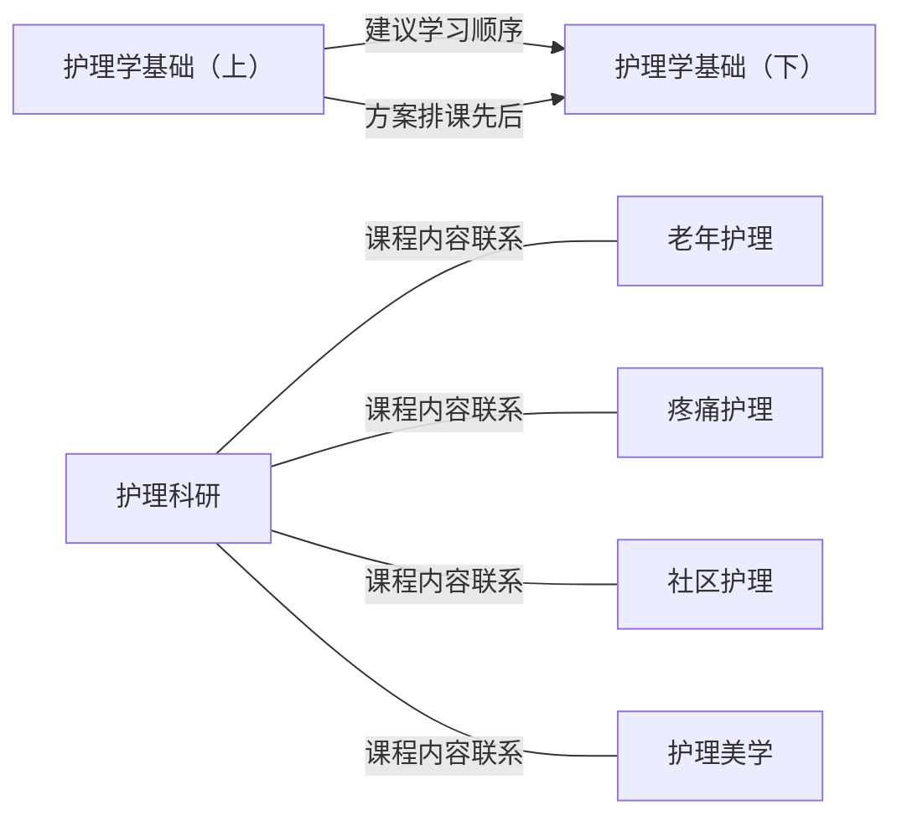

# 护理学专业“2+X”教学培养方案

2024 年汇编印刷页 1029–1031。原表记录 52 个可配对的课程代码。

[本节原页](plan-1029.pdf#page=1) · [逐行数据](plan-1029.json) · [院系目录](README.md)

## 课程导读

想了解护理评估与实践的课程安排，可以在原表中找到《护理学基础（上）》（`NURS130003`）、《健康评估》（`NURS130002`）、《护理科研》（`NURS130010`）。 [原书 PDF 第 1043 页](plan-1029.pdf#page=1)

图中连接《护理科研》（`NURS130010`）和《老年护理》（`NURS130022`），两门课都从课程题名标出的“护理”切入，可沿这一主题对照阅读。 [原书 PDF 第 1043 页](plan-1029.pdf#page=1) · [原书 PDF 第 1044 页](plan-1029.pdf#page=2)

## 课程关系图

图中展示最多 20 条关系。下表列出本节全部关系。建议学习顺序供规划课程使用，正式选课资格以教务规定为准。

| 课程 | 关联课程 | 关系 | 依据 |
| --- | --- | --- | --- |
| 护理学基础（上）（NURS130003） | 护理学基础（下）（NURS130004） | 建议学习顺序 | 同节课程题名标明连续分册或序号。 |
| 护理科研（NURS130010） | 老年护理（NURS130022） | 课程内容联系 | 本方案两门课程的题名均含“护理”，可据此对照这一主题。 |
| 护理科研（NURS130010） | 疼痛护理（NURS130023） | 课程内容联系 | 本方案两门课程的题名均含“护理”，可据此对照这一主题。 |
| 护理科研（NURS130010） | 社区护理（NURS130029） | 课程内容联系 | 本方案两门课程的题名均含“护理”，可据此对照这一主题。 |
| 护理科研（NURS130010） | 护理美学（NURS130031） | 课程内容联系 | 本方案两门课程的题名均含“护理”，可据此对照这一主题。 |
| 护理学基础（上）（NURS130003） | 护理学基础（下）（NURS130004） | 方案排课先后 | 本节原表所列全部明确学期均早于后者。 |

## 课程

| 课程代码 | 名称 | 开课学期原文 | 来源（PDF 页） |
| --- | --- | --- | --- |
| AIS531013 | AI赋能护理科研与实践的策略与方法 | 5 | 1044 |
| MED119012 | 元宇宙与未来医学 | 2 | 1044 |
| MED130014 | 药理学C | 4 | 1043 |
| MED130085 | 针灸与推拿学 | 春，秋 | 1044 |
| MED130110 | 正常人体形态与功能学IB | 3 | 1043 |
| MED130111 | 正常人体形态与功能 学IIB | 3 | 1043 |
| MED130112 | 正常人体形态与功能 学IIIB | 3 | 1043 |
| MED130113 | 正常人体形态与功能 学IVB | 3 | 1043 |
| MED130115 | 中医护理学 | 春 | 1045 |
| MED130137 | 新发传染病 | 春，秋 | 1044 |
| MED130185 | 医患交流技巧 | 秋 | 1044 |
| MED130193 | 微生物学 | 3 | 1043 |
| MED130194 | 免疫学 | 3 | 1043 |
| MED130195 | 疾病机制 | 4 | 1043 |
| MED130197 | 医学与生物安全 | 春，秋 | 1045 |
| MED130359 | 医学人工智能导论 | 1 | 1044 |
| NURS130002 | 健康评估 | 4 | 1043 |
| NURS130003 | 护理学基础（上） | 3 | 1043 |
| NURS130004 | 护理学基础（下） | 4 | 1043 |
| NURS130005 | 内科护理学 | 5 | 1044 |
| NURS130008 | 儿科护理学 | 5 | 1044 |
| NURS130010 | 护理科研 | 4 | 1043 |
| NURS130011 | 精神科护理学 | 6 | 1044 |
| NURS130012 | 护理教育学 | 5 | 1044 |
| NURS130013 | 护理管理学 | 6 | 1044 |
| NURS130018 | 急救护理学 | 5 | 1044 |
| NURS130020 | 肿瘤护理 | 春，秋 | 1045 |
| NURS130022 | 老年护理 | 6 | 1044 |
| NURS130023 | 疼痛护理 | 春，秋 | 1045 |
| NURS130029 | 社区护理 | 6 | 1044 |
| NURS130031 | 护理美学 | 春，秋 | 1045 |
| NURS130042 | 循证护理概论 | 春，秋 | 1045 |
| NURS130043 | 学术前沿专题 | 春 | 1045 |
| NURS130052 | 护理学导论 | 1 | 1044 |
| NURS130054 | 传染病护理学 | 秋 | 1045 |
| NURS130055 | 外科护理学 | 6 | 1044 |
| NURS130056 | 妇产科护理学 | 6 | 1044 |
| NURS130061 | 健康与护理 | 2 | 1044 |
| NURS130074 | 护理伦理学 | 6 | 1044 |
| NURS130075 | 安宁疗护概论 | 春，秋 | 1045 |
| NURS130076 | 患者报告结局导论 | 春，秋 | 1045 |
| NURS130077 | 护理创新设计理论与实践 | 秋 | 1045 |
| NURS130081 | 健康教育学 | 8 | 1044 |
| NURS130084 | 护理学社会实践 | 3,4 | 1044 |
| NURS130086 | 毕业论文 | 7,8 | 1044 |
| NURS130087 | 毕业实习 | 7,8 | 1044 |
| PHPM130003 | 社会医学 | 秋 | 1045 |
| PHPM130009 | 卫生法学 | 4 | 1044 |
| PHPM130052 | 医学营养学 | 春 | 1045 |
| PHPM130053 | 卫生统计学C | 3 | 1043 |
| PHPM130064 | 全球卫生导论 | 春 | 1045 |
| PHPM130068 | 流行病学 | 6 | 1044 |
