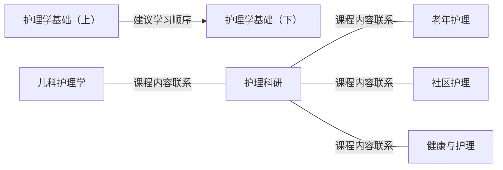

# 护理学专业“2+X”修读建议

2024 年汇编印刷页 1032–1033。原表记录 43 个可配对的课程代码。

[本节原页](plan-1029.pdf#page=4) · [逐行数据](plan-1029.json) · [院系目录](README.md)

## 课程关系图

图中展示最多 20 条关系。下表列出本节全部关系。建议学习顺序供规划课程使用，正式选课资格以教务规定为准。

| 课程 | 关联课程 | 关系 | 依据 |
| --- | --- | --- | --- |
| 护理学基础（上）（NURS130003） | 护理学基础（下）（NURS130004） | 建议学习顺序 | 同节课程题名标明连续分册或序号。 |
| 儿科护理学（NURS130008） | 护理科研（NURS130010） | 课程内容联系 | 本方案两门课程的题名均含“护理”，可据此对照这一主题。 |
| 护理科研（NURS130010） | 老年护理（NURS130022） | 课程内容联系 | 本方案两门课程的题名均含“护理”，可据此对照这一主题。 |
| 护理科研（NURS130010） | 社区护理（NURS130029） | 课程内容联系 | 本方案两门课程的题名均含“护理”，可据此对照这一主题。 |
| 护理科研（NURS130010） | 健康与护理（NURS130061） | 课程内容联系 | 本方案两门课程的题名均含“护理”，可据此对照这一主题。 |

## 课程

| 课程代码 | 名称 | 开课学期原文 | 来源（PDF 页） |
| --- | --- | --- | --- |
| AIS531013 | AI赋能护理科研与实践的策略与方法 |  | 1047 |
| BIOL120004 | 现代生物科学导论C |  | 1046 |
| CHEM120003 | 有机化学 |  | 1046 |
| MATH120007 | 高等数学D |  | 1046 |
| MED119012 | 元宇宙与未来医学 |  | 1047 |
| MED130014 | 药理学C |  | 1047 |
| MED130110 | 正常人体形态与功能学IB |  | 1046 |
| MED130111 | 正常人体形态与功能 学IIB |  | 1046 |
| MED130112 | 正常人体形态与功能 学IIIB |  | 1046 |
| MED130113 | 正常人体形态与功能 学IVB |  | 1046 |
| MED130193 | 微生物学 |  | 1046 |
| MED130194 | 免疫学 |  | 1046 |
| MED130195 | 疾病机制 |  | 1047 |
| MED130359 | 医学人工智能导论 |  | 1047 |
| NURS130002 | 健康评估 |  | 1047 |
| NURS130003 | 护理学基础（上） |  | 1047 |
| NURS130004 | 护理学基础（下） |  | 1047 |
| NURS130008 | 儿科护理学 |  | 1047 |
| NURS130010 | 护理科研 |  | 1047 |
| NURS130011 | 精神科护理学 |  | 1047 |
| NURS130012 | 护理教育学 |  | 1047 |
| NURS130013 | 护理管理学 |  | 1047 |
| NURS130018 | 急救护理学 |  | 1047 |
| NURS130022 | 老年护理 |  | 1047 |
| NURS130029 | 社区护理 |  | 1047 |
| NURS130052 | 护理学导论 |  | 1047 |
| NURS130056 | 妇产科护理学 |  | 1047 |
| NURS130061 | 健康与护理 |  | 1047 |
| NURS130070 | 内科护理学 |  | 1047 |
| NURS130071 | 外科护理学 |  | 1047 |
| NURS130074 | 护理伦理学 |  | 1047 |
| NURS130081 | 健康教育学 |  | 1047 |
| NURS130084 | 护理学社会实践 |  | 1047 |
| NURS130086 | 毕业论文 |  | 1047 |
| NURS130087 | 毕业实习 |  | 1047 |
| PHPM130009 | 卫生法学 |  | 1047 |
| PHPM130053 | 卫生统计学C |  | 1046 |
| PHPM130068 | 流行病学 |  | 1047 |
| PTSS110082 | 毛泽东思想和中国特色社会主义理论体系概论 |  | 1046 |
| PTSS110087 | 马克思主义基本原理 |  | 1046 |
| PTSS110088 | 中国近现代史纲要 |  | 1046 |
| PTSS110089 | 思想道德与法治 |  | 1046 |
| PTSS110090 | 习近平新时代中国特色社会主义思想概论 |  | 1046 |
