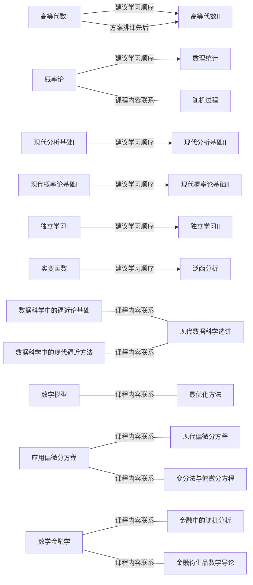

# 数学与应用数学专业“2+X”教学培养方案

2024 年汇编印刷页 555–559。原表记录 106 个可配对的课程代码。

[本节原页](plan-555.pdf#page=1) · [逐行数据](plan-555.json) · [院系目录](README.md)

## 课程导读

想了解数学分析与代数的课程安排，可以在原表中找到《数学分析III》（`MATH130001`）、《高等代数II》（`MATH130002`）、《抽象代数》（`MATH130184`）。 [原书 PDF 第 569 页](plan-555.pdf#page=1)

《高等代数I》（`MATH120011`）和《高等代数II》（`MATH130002`）是同一系列，图中的箭头按题名标出的分册顺序排列。原表分别排在第 1 学期和第 2 学期。 [原书 PDF 第 569 页](plan-555.pdf#page=1)

## 课程关系图

图中展示最多 20 条关系。下表列出本节全部关系。建议学习顺序供规划课程使用，正式选课资格以教务规定为准。

| 课程 | 关联课程 | 关系 | 依据 |
| --- | --- | --- | --- |
| 高等代数I（MATH120011） | 高等代数II（MATH130002） | 建议学习顺序 | 同节课程题名标明连续分册或序号。 |
| 概率论（MATH130009） | 数理统计（MATH130060） | 建议学习顺序 | 分布和期望为统计估计与检验提供基础。 |
| 现代分析基础I（MATH130089） | 现代分析基础II（MATH130090） | 建议学习顺序 | 同节课程题名标明连续分册或序号。 |
| 现代概率论基础I（MATH130159） | 现代概率论基础II（MATH130160） | 建议学习顺序 | 同节课程题名标明连续分册或序号。 |
| 独立学习I（MATH130162） | 独立学习II（MATH130163） | 建议学习顺序 | 同节课程题名标明连续分册或序号。 |
| 实变函数（MATH130186） | 泛函分析（MATH130011） | 建议学习顺序 | 测度与积分有助于理解函数空间。 |
| 数据科学中的逼近论基础（AIS631003） | 现代数据科学选讲（MATH130178） | 课程内容联系 | 本方案两门课程的题名均含“数据科学”，可据此对照这一主题。 |
| 数学模型（MATH130008） | 最优化方法（MATH130138） | 课程内容联系 | 模型目标、决策变量与优化求解 |
| 概率论（MATH130009） | 随机过程（MATH130044） | 课程内容联系 | 随机现象与概率模型 |
| 应用偏微分方程（MATH130022） | 现代偏微分方程（MATH130121） | 课程内容联系 | 本方案两门课程的题名均含“偏微分方程”，可据此对照这一主题。 |
| 应用偏微分方程（MATH130022） | 变分法与偏微分方程（MATH130127） | 课程内容联系 | 本方案两门课程的题名均含“偏微分方程”，可据此对照这一主题。 |
| 数学金融学（MATH130027） | 金融中的随机分析（MATH130148） | 课程内容联系 | 本方案两门课程的题名均含“金融”，可据此对照这一主题。 |
| 数学金融学（MATH130027） | 金融衍生品数学导论（MATH130179） | 课程内容联系 | 本方案两门课程的题名均含“金融”，可据此对照这一主题。 |
| 数据科学中的现代逼近方法（MATH130096） | 现代数据科学选讲（MATH130178） | 课程内容联系 | 本方案两门课程的题名均含“数据科学”，可据此对照这一主题。 |
| 高等代数I（MATH120011） | 高等代数II（MATH130002） | 方案排课先后 | 本节原表所列全部明确学期均早于后者。 |

## 课程

| 课程代码 | 名称 | 开课学期原文 | 来源（PDF 页） |
| --- | --- | --- | --- |
| AIS631003 | 数据科学中的逼近论基础 | 春，秋 | 572 |
| AIS631004 | 新型算法 | 春，秋 | 572 |
| MATH120011 | 高等代数I | 1 | 569 |
| MATH130001 | 数学分析III | 3 | 569 |
| MATH130002 | 高等代数II | 2 | 569 |
| MATH130008 | 数学模型 | 4 | 570 |
| MATH130009 | 概率论 | 5-8 | 570 |
| MATH130011 | 泛函分析 | 5或7 | 570 |
| MATH130012 | 数理方程 | 5-8 | 570 |
| MATH130013 | 微分几何 | 5或7 | 570 |
| MATH130014 | 生产实习 | 7 | 570 |
| MATH130015 | 毕业论文(含专题讨论) | 8 | 569 |
| MATH130016 | 微分方程数值解法 | 6或8 | 570 |
| MATH130018 | 小波分析 | 春，秋 | 570 |
| MATH130022 | 应用偏微分方程 | 春，秋 | 570 |
| MATH130024 | 计算机辅助几何设计 | 春，秋 | 570 |
| MATH130026 | 生物数学 | 春，秋 | 570 |
| MATH130027 | 数学金融学 | 春，秋 | 570 |
| MATH130029 | 应用几何 | 春，秋 | 570 |
| MATH130030 | 专题讨论 | 春，秋 | 570 |
| MATH130032 | 动力系统 | 春，秋 | 570 |
| MATH130033 | 利息理论 | 春，秋 | 570 |
| MATH130036 | 计算方法 | 5 | 570 |
| MATH130038 | 组合优化 | 春，秋 | 570 |
| MATH130039 | 最优控制理论 | 春，秋 | 570 |
| MATH130040 | 分形几何 | 春，秋 | 570 |
| MATH130041 | 多复变函数论 | 春，秋 | 570 |
| MATH130043 | 数论基础 | 5或7、春，秋 | 570 |
| MATH130044 | 随机过程 | 春，秋 | 570 |
| MATH130052 | Fourier分析 | 春，秋 | 571 |
| MATH130055 | 非寿险精算数学 | 春，秋 | 571 |
| MATH130056 | 复分析 | 春，秋 | 571 |
| MATH130057 | 控制理论基础 | 5或7、春，秋 | 570, 571 |
| MATH130058 | 寿险精算数学 | 春，秋 | 571 |
| MATH130059 | 数据结构 | 春，秋 | 571 |
| MATH130060 | 数理统计 | 6 | 571 |
| MATH130061 | 数字信号处理 | 春，秋 | 571 |
| MATH130067 | 时间序列分析 | 春，秋 | 571 |
| MATH130068 | 抽象代数续论 | 春，秋 | 571 |
| MATH130070 | 测度论 | 春，秋 | 571 |
| MATH130077 | 数学建模与实验(上) | 春，秋 | 571 |
| MATH130080 | 科学计算 | 春，秋 | 571 |
| MATH130089 | 现代分析基础I | 春，秋 | 571 |
| MATH130090 | 现代分析基础II | 春，秋 | 571 |
| MATH130091 | 数学分析原理 | 春，秋 | 571 |
| MATH130096 | 数据科学中的现代逼近方法 | 春，秋 | 571 |
| MATH130099 | 统计中的计算方法 | 春，秋 | 571 |
| MATH130101 | 马氏链及其应用 | 春，秋 | 571 |
| MATH130102 | 对策论 | 春，秋 | 571 |
| MATH130103 | 统计方法选讲 | 春，秋 | 571 |
| MATH130104 | 反问题的模型与计算 | 春，秋 | 571 |
| MATH130107 | 学术前沿专题 | 春，秋 | 571 |
| MATH130108 | 反问题的正则化理论 | 春，秋 | 571 |
| MATH130111 | 流形的拓扑学 | 春，秋 | 571 |
| MATH130113 | 几何拓扑选讲 | 春，秋 | 571 |
| MATH130114 | 泛函分析续论 | 春，秋 | 571 |
| MATH130116 | 随机分析 | 春，秋 | 571 |
| MATH130119 | 统计推断 | 春，秋 | 571 |
| MATH130120 | 李群和李代数 | 春，秋 | 571 |
| MATH130121 | 现代偏微分方程 | 春，秋 | 571 |
| MATH130123 | 黎曼曲面 | 春，秋 | 571 |
| MATH130124 | 泛函分析续论Ⅱ | 春，秋 | 571 |
| MATH130126 | 遍历论 | 春，秋 | 571 |
| MATH130127 | 变分法与偏微分方程 | 春，秋 | 571 |
| MATH130128 | 抽象代数Ⅱ | 4 | 570 |
| MATH130130 | 代数几何初步 | 春，秋 | 571 |
| MATH130131 | 代数数论初步 | 春，秋 | 571 |
| MATH130132 | 拓扑群 | 春，秋 | 571 |
| MATH130135 | 模形式初步 | 春，秋 | 571 |
| MATH130137 | 线性与非线性规划 | 春，秋 | 572 |
| MATH130138 | 最优化方法 | 春，秋 | 572 |
| MATH130139 | 几何测度论 | 春，秋 | 572 |
| MATH130141 | 图论初步 | 春，秋 | 572 |
| MATH130148 | 金融中的随机分析 | 春，秋 | 572 |
| MATH130149 | 深度学习 | 春，秋 | 572 |
| MATH130150 | 微分几何续论 | 春，秋 | 572 |
| MATH130151 | 面向智能制造的数学方法及应用 | 春，秋 | 572 |
| MATH130153 | 布朗运动 | 春，秋 | 572 |
| MATH130157 | 代数拓扑 | 5或7 | 570 |
| MATH130158 | 概率模型与随机计算选讲 | 春，秋 | 572 |
| MATH130159 | 现代概率论基础I | 春，秋 | 572 |
| MATH130160 | 现代概率论基础II | 春，秋 | 572 |
| MATH130161 | 概率极限理论及应用 | 春，秋 | 572 |
| MATH130162 | 独立学习I | 5-8 | 572 |
| MATH130163 | 独立学习II | 5-8 | 572 |
| MATH130167 | Current理论 | 春，秋 | 572 |
| MATH130168 | 随机矩阵理论 | 春，秋 | 572 |
| MATH130169 | 微局部分析 | 春，秋 | 572 |
| MATH130171 | 现代调和分析 | 春，秋 | 572 |
| MATH130172 | 计算机代数 | 春，秋 | 572 |
| MATH130173 | 高维概率及其应用 | 春，秋 | 572 |
| MATH130174 | 规范场 | 春，秋 | 572 |
| MATH130175 | 非交换几何入门 | 春，秋 | 572 |
| MATH130177 | 数学建模及应用 | 春，秋 | 572 |
| MATH130178 | 现代数据科学选讲 | 春，秋 | 572 |
| MATH130179 | 金融衍生品数学导论 | 春，秋 | 572 |
| MATH130180 | 几何群论 | 春，秋 | 572 |
| MATH130181 | 代数数论进阶 | 春，秋 | 572 |
| MATH130182 | 解析几何 | 1 | 569 |
| MATH130183 | 常微分方程 | 3 | 569 |
| MATH130184 | 抽象代数 | 3 | 569 |
| MATH130185 | 复变函数 | 4 | 569 |
| MATH130186 | 实变函数 | 4 | 569 |
| MATH130187 | 拓扑学 | 4 | 569 |
| MATH130193 | 神经网络的模型与应用 | 春，秋 | 572 |
| MECH130084 | 基础力学 | 6或8 | 570 |
