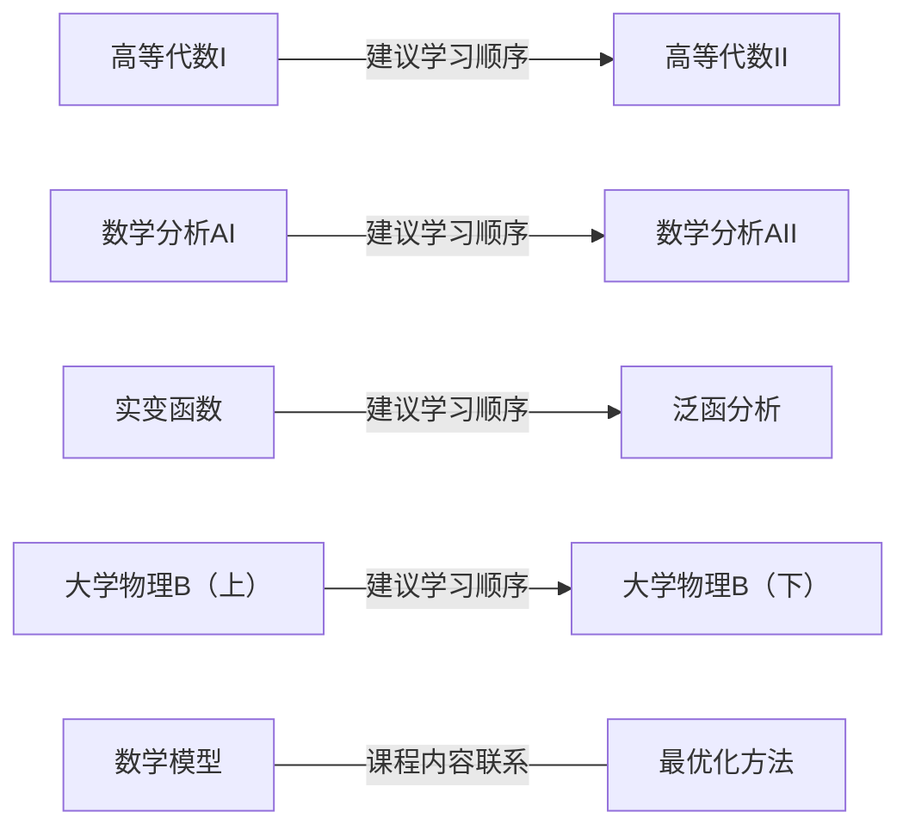

# 信息与计算科学专业“2+X”修读建议

2024 年汇编印刷页 576–577。原表记录 30 个可配对的课程代码。

[本节原页](plan-571.pdf#page=6) · [逐行数据](plan-571.json) · [院系目录](README.md)

## 课程导读

想了解计算方法与数学基础的课程安排，可以在原表中找到《微分方程数值解法》（`MATH130016`）、《数学分析III》（`MATH130001`）、《数学分析AI》（`MATH120014`）。 [原书 PDF 第 590 页](plan-571.pdf#page=6) · [原书 PDF 第 591 页](plan-571.pdf#page=7)

《数学分析AI》（`MATH120014`）和《数学分析AII》（`MATH120015`）是同一系列，图中的箭头按题名标出的分册顺序排列。 [原书 PDF 第 590 页](plan-571.pdf#page=6)

## 课程关系图

图中展示最多 20 条关系。下表列出本节全部关系。建议学习顺序供规划课程使用，正式选课资格以教务规定为准。

| 课程 | 关联课程 | 关系 | 依据 |
| --- | --- | --- | --- |
| 高等代数I（MATH120011） | 高等代数II（MATH130002） | 建议学习顺序 | 同节课程题名标明连续分册或序号。 |
| 数学分析AI（MATH120014） | 数学分析AII（MATH120015） | 建议学习顺序 | 同节课程题名标明连续分册或序号。 |
| 实变函数（MATH130186） | 泛函分析（MATH130011） | 建议学习顺序 | 测度与积分有助于理解函数空间。 |
| 大学物理B（上）（PHYS120013） | 大学物理B（下）（PHYS120014） | 建议学习顺序 | 同节课程题名标明连续分册或序号。 |
| 数学模型（MATH130008） | 最优化方法（MATH130138） | 课程内容联系 | 模型目标、决策变量与优化求解 |

## 课程

| 课程代码 | 名称 | 开课学期原文 | 来源（PDF 页） |
| --- | --- | --- | --- |
| MATH120011 | 高等代数I |  | 591 |
| MATH120014 | 数学分析AI |  | 590 |
| MATH120015 | 数学分析AII |  | 590 |
| MATH130001 | 数学分析III |  | 591 |
| MATH130002 | 高等代数II |  | 591 |
| MATH130008 | 数学模型 |  | 591 |
| MATH130009 | 概率论 |  | 591 |
| MATH130011 | 泛函分析 |  | 591 |
| MATH130012 | 数理方程 |  | 591 |
| MATH130013 | 微分几何 |  | 591 |
| MATH130015 | 毕业论文(含专题讨论) |  | 591 |
| MATH130016 | 微分方程数值解法 |  | 591 |
| MATH130057 | 控制理论基础 |  | 591 |
| MATH130138 | 最优化方法 |  | 591 |
| MATH130182 | 解析几何 |  | 591 |
| MATH130183 | 常微分方程 |  | 591 |
| MATH130184 | 抽象代数 |  | 591 |
| MATH130185 | 复变函数 |  | 591 |
| MATH130186 | 实变函数 |  | 591 |
| MATH130187 | 拓扑学 |  | 591 |
| PHYS120013 | 大学物理B（上） |  | 590 |
| PHYS120014 | 大学物理B（下） |  | 590 |
| PHYS120016 | 大学物理A：力学 |  | 590 |
| PHYS120017 | 大学物理A：热学 |  | 590 |
| PHYS120018 | 大学物理A：电磁学 |  | 590 |
| PTSS110082 | 毛泽东思想和中国特色社会主义理论体系概论 |  | 590 |
| PTSS110087 | 马克思主义基本原理 |  | 590 |
| PTSS110088 | 中国近现代史纲要 |  | 590 |
| PTSS110089 | 思想道德与法治 |  | 590 |
| PTSS110090 | 习近平新时代中国特色社会主义思想概论 |  | 590 |
