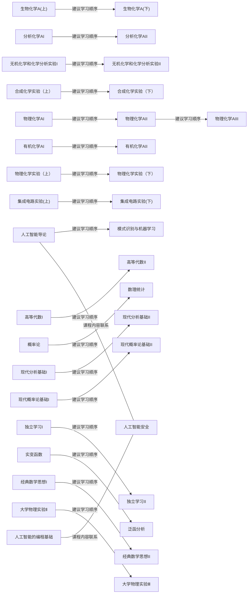

# 数学与应用数学专业教学培养方案（相辉计划适用）

2024 年汇编印刷页 740–747。原表记录 189 个可配对的课程代码。

[本节原页](plan-740.pdf#page=1) · [逐行数据](plan-740.json) · [院系目录](README.md)

## 课程导读

想了解数学分析与代数的课程安排，可以在原表中找到《数学分析原理》（`MATH130091`）、《高等代数II》（`MATH130002`）、《抽象代数》（`MATH130184`）。 [原书 PDF 第 754 页](plan-740.pdf#page=1) · [原书 PDF 第 756 页](plan-740.pdf#page=3)

《高等代数I》（`MATH120011`）和《高等代数II》（`MATH130002`）是同一系列，图中的箭头按题名标出的分册顺序排列。原表分别排在第 1 学期和第 2 学期。 [原书 PDF 第 754 页](plan-740.pdf#page=1)

## 课程关系图

图中展示最多 20 条关系。下表列出本节全部关系。建议学习顺序供规划课程使用，正式选课资格以教务规定为准。

| 课程 | 关联课程 | 关系 | 依据 |
| --- | --- | --- | --- |
| 人工智能导论（AIE310005） | 模式识别与机器学习（AIE410001） | 建议学习顺序 | 人工智能问题与模型类别可为学习模式识别作准备。 |
| 生物化学A(上)（BIOL130005） | 生物化学A(下)（BIOL130188） | 建议学习顺序 | 同节课程题名标明连续分册或序号。 |
| 分析化学AI（CHEM130001） | 分析化学AII（CHEM130002） | 建议学习顺序 | 同节课程题名标明连续分册或序号。 |
| 无机化学和化学分析实验I（CHEM130003） | 无机化学和化学分析实验II（CHEM130004） | 建议学习顺序 | 同节课程题名标明连续分册或序号。 |
| 合成化学实验（上）（CHEM130010） | 合成化学实验（下）（CHEM130011） | 建议学习顺序 | 同节课程题名标明连续分册或序号。 |
| 物理化学AI（CHEM130012） | 物理化学AII（CHEM130013） | 建议学习顺序 | 同节课程题名标明连续分册或序号。 |
| 物理化学AII（CHEM130013） | 物理化学AIII（CHEM130014） | 建议学习顺序 | 同节课程题名标明连续分册或序号。 |
| 有机化学AI（CHEM130067） | 有机化学AII（CHEM130068） | 建议学习顺序 | 同节课程题名标明连续分册或序号。 |
| 物理化学实验（上）（CHEM130104） | 物理化学实验（下）（CHEM130105） | 建议学习顺序 | 同节课程题名标明连续分册或序号。 |
| 集成电路实验(上)（INFO130027） | 集成电路实验(下)（INFO130028） | 建议学习顺序 | 同节课程题名标明连续分册或序号。 |
| 高等代数I（MATH120011） | 高等代数II（MATH130002） | 建议学习顺序 | 同节课程题名标明连续分册或序号。 |
| 概率论（MATH130009） | 数理统计（MATH130060） | 建议学习顺序 | 分布和期望为统计估计与检验提供基础。 |
| 现代分析基础I（MATH130089） | 现代分析基础II（MATH130090） | 建议学习顺序 | 同节课程题名标明连续分册或序号。 |
| 现代概率论基础I（MATH130159） | 现代概率论基础II（MATH130160） | 建议学习顺序 | 同节课程题名标明连续分册或序号。 |
| 独立学习I（MATH130162） | 独立学习II（MATH130163） | 建议学习顺序 | 同节课程题名标明连续分册或序号。 |
| 实变函数（MATH130186） | 泛函分析（MATH130011） | 建议学习顺序 | 测度与积分有助于理解函数空间。 |
| 经典数学思想I（MATH130190） | 经典数学思想II（MATH130191） | 建议学习顺序 | 同节课程题名标明连续分册或序号。 |
| 大学物理实验Ⅱ（PHYS130125） | 大学物理实验Ⅲ（PHYS130126） | 建议学习顺序 | 同节课程题名标明连续分册或序号。 |
| 人工智能导论（AIE310005） | 人工智能安全（AIE831001） | 课程内容联系 | 本方案两门课程的题名均含“人工智能”，可据此对照这一主题。 |
| 人工智能的编程基础（AIE310006） | 人工智能安全（AIE831001） | 课程内容联系 | 本方案两门课程的题名均含“人工智能”，可据此对照这一主题。 |
| 人工智能的数学基础（AIE310009） | 模式识别与机器学习（AIE410001） | 课程内容联系 | 数学表达与学习模型的统计、优化工具可对照。 |
| 人工智能的数学基础（AIE310009） | 人工智能安全（AIE831001） | 课程内容联系 | 本方案两门课程的题名均含“人工智能”，可据此对照这一主题。 |
| 模式识别与机器学习（AIE410001） | 机器学习在物理实验中的应用（AIS310013） | 课程内容联系 | 本方案两门课程的题名均含“机器学习”，可据此对照这一主题。 |
| 人工智能安全（AIE831001） | 人工智能生物学（AIS310017） | 课程内容联系 | 本方案两门课程的题名均含“人工智能”，可据此对照这一主题。 |
| 数据科学中的逼近论基础（AIS631003） | 现代数据科学选讲（MATH130178） | 课程内容联系 | 本方案两门课程的题名均含“数据科学”，可据此对照这一主题。 |
| 生物化学A(上)（BIOL130005） | 生物化学实验（BIOL130007） | 课程内容联系 | 本方案两门课程的题名均含“生物化学”，可据此对照这一主题。 |
| 生物化学实验（BIOL130007） | 生物化学A(下)（BIOL130188） | 课程内容联系 | 本方案两门课程的题名均含“生物化学”，可据此对照这一主题。 |
| 细胞生物学（BIOL130008） | 细胞生物学实验（BIOL130009） | 课程内容联系 | 同节同题名的课程与实验、实习或实践。 |
| 微生物学（BIOL130010） | 微生物学实验（BIOL130011） | 课程内容联系 | 同节同题名的课程与实验、实习或实践。 |
| 遗传学（BIOL130012） | 遗传学实验（BIOL130013） | 课程内容联系 | 同节同题名的课程与实验、实习或实践。 |
| 生理学（BIOL130014） | 生理学实验（BIOL130187） | 课程内容联系 | 同节同题名的课程与实验、实习或实践。 |
| 分析化学AI（CHEM130001） | 分析化学（CHEM130071） | 课程内容联系 | 本方案两门课程的题名均含“分析化学”，可据此对照这一主题。 |
| 分析化学AII（CHEM130002） | 分析化学（CHEM130071） | 课程内容联系 | 本方案两门课程的题名均含“分析化学”，可据此对照这一主题。 |
| 无机化学和化学分析实验I（CHEM130003） | 无机化学（CHEM130016） | 课程内容联系 | 本方案两门课程的题名均含“无机化学”，可据此对照这一主题。 |
| 无机化学和化学分析实验II（CHEM130004） | 无机化学（CHEM130016） | 课程内容联系 | 本方案两门课程的题名均含“无机化学”，可据此对照这一主题。 |
| 物理化学AI（CHEM130012） | 物理化学AII（CHEM130013） | 课程内容联系 | 本方案两门课程的题名均含“物理化学”，可据此对照这一主题。 |
| 物理化学AI（CHEM130012） | 物理化学AIII（CHEM130014） | 课程内容联系 | 本方案两门课程的题名均含“物理化学”，可据此对照这一主题。 |
| 物理化学AI（CHEM130012） | 物理化学实验（上）（CHEM130104） | 课程内容联系 | 本方案两门课程的题名均含“物理化学”，可据此对照这一主题。 |
| 物理化学AI（CHEM130012） | 物理化学实验（下）（CHEM130105） | 课程内容联系 | 本方案两门课程的题名均含“物理化学”，可据此对照这一主题。 |
| 有机化学（CHEM130049） | 有机化学实验（CHEM130050） | 课程内容联系 | 同节同题名的课程与实验、实习或实践。 |
| 有机化学（CHEM130049） | 有机化学AI（CHEM130067） | 课程内容联系 | 本方案两门课程的题名均含“有机化学”，可据此对照这一主题。 |
| 有机化学（CHEM130049） | 有机化学AII（CHEM130068） | 课程内容联系 | 本方案两门课程的题名均含“有机化学”，可据此对照这一主题。 |
| 分析化学（CHEM130071） | 分析化学实验（CHEM130072） | 课程内容联系 | 同节同题名的课程与实验、实习或实践。 |
| 集成电路实验(上)（INFO130027） | 集成电路工艺原理（MICR130007） | 课程内容联系 | 本方案两门课程的题名均含“集成电路”，可据此对照这一主题。 |
| 集成电路实验(下)（INFO130028） | 集成电路工艺原理（MICR130007） | 课程内容联系 | 本方案两门课程的题名均含“集成电路”，可据此对照这一主题。 |
| 专用集成电路设计方法（INFO130094） | 集成电路工艺原理（MICR130007） | 课程内容联系 | 本方案两门课程的题名均含“集成电路”，可据此对照这一主题。 |
| 数学模型（MATH130008） | 最优化方法（MATH130138） | 课程内容联系 | 模型目标、决策变量与优化求解 |
| 概率论（MATH130009） | 随机过程（MATH130044） | 课程内容联系 | 随机现象与概率模型 |
| 应用偏微分方程（MATH130022） | 现代偏微分方程（MATH130121） | 课程内容联系 | 本方案两门课程的题名均含“偏微分方程”，可据此对照这一主题。 |
| 应用偏微分方程（MATH130022） | 变分法与偏微分方程（MATH130127） | 课程内容联系 | 本方案两门课程的题名均含“偏微分方程”，可据此对照这一主题。 |
| 数学金融学（MATH130027） | 金融中的随机分析（MATH130148） | 课程内容联系 | 本方案两门课程的题名均含“金融”，可据此对照这一主题。 |
| 数学金融学（MATH130027） | 金融衍生品数学导论（MATH130179） | 课程内容联系 | 本方案两门课程的题名均含“金融”，可据此对照这一主题。 |
| 数据科学中的现代逼近方法（MATH130096） | 现代数据科学选讲（MATH130178） | 课程内容联系 | 本方案两门课程的题名均含“数据科学”，可据此对照这一主题。 |
| 半导体物理（MICR130005） | 半导体器件原理（MICR130028） | 课程内容联系 | 本方案两门课程的题名均含“半导体”，可据此对照这一主题。 |
| 集成电路工艺原理（MICR130007） | 数字集成电路设计原理（MICR130029） | 课程内容联系 | 本方案两门课程的题名均含“集成电路”，可据此对照这一主题。 |
| 人工智能导论（AIE310005） | 模式识别与机器学习（AIE410001） | 方案排课先后 | 本节原表所列全部明确学期均早于后者。 |
| 生物化学A(上)（BIOL130005） | 生物化学A(下)（BIOL130188） | 方案排课先后 | 本节原表所列全部明确学期均早于后者。 |
| 分析化学AI（CHEM130001） | 分析化学AII（CHEM130002） | 方案排课先后 | 本节原表所列全部明确学期均早于后者。 |
| 合成化学实验（上）（CHEM130010） | 合成化学实验（下）（CHEM130011） | 方案排课先后 | 本节原表所列全部明确学期均早于后者。 |
| 物理化学AI（CHEM130012） | 物理化学AII（CHEM130013） | 方案排课先后 | 本节原表所列全部明确学期均早于后者。 |
| 物理化学AII（CHEM130013） | 物理化学AIII（CHEM130014） | 方案排课先后 | 本节原表所列全部明确学期均早于后者。 |
| 有机化学AI（CHEM130067） | 有机化学AII（CHEM130068） | 方案排课先后 | 本节原表所列全部明确学期均早于后者。 |
| 集成电路实验(上)（INFO130027） | 集成电路实验(下)（INFO130028） | 方案排课先后 | 本节原表所列全部明确学期均早于后者。 |
| 高等代数I（MATH120011） | 高等代数II（MATH130002） | 方案排课先后 | 本节原表所列全部明确学期均早于后者。 |
| 经典数学思想I（MATH130190） | 经典数学思想II（MATH130191） | 方案排课先后 | 本节原表所列全部明确学期均早于后者。 |
| 大学物理实验Ⅱ（PHYS130125） | 大学物理实验Ⅲ（PHYS130126） | 方案排课先后 | 本节原表所列全部明确学期均早于后者。 |

## 课程

| 课程代码 | 名称 | 开课学期原文 | 来源（PDF 页） |
| --- | --- | --- | --- |
| AIE210006 | 计算机系统基础 | 3 | 760 |
| AIE310004 | 计算机视觉 | 7 | 760 |
| AIE310005 | 人工智能导论 | 4 | 760 |
| AIE310006 | 人工智能的编程基础 | 2 | 760 |
| AIE310007 | 数据结构 | 3 | 760 |
| AIE310008 | 人工智能的软件基础 | 4 | 760 |
| AIE310009 | 人工智能的数学基础 | 3 | 760 |
| AIE410001 | 模式识别与机器学习 | 5 | 760 |
| AIE410002 | 自然语言处理与大语言模型 | 6 | 760 |
| AIE531001 | 人工智能前沿探索实践 | 7 | 760 |
| AIE831001 | 人工智能安全 | 5 | 760 |
| AIS310013 | 机器学习在物理实验中的应用 | 春 | 759 |
| AIS310014 | 人工智能在化学中的应用 | 秋 | 759 |
| AIS310017 | 人工智能生物学 | 秋 | 760 |
| AIS410006 | 人工智能结构生物学 | 秋 | 760 |
| AIS410014 | AI在生物分子结构中的研究及应用 | 秋 | 760 |
| AIS531004 | AI物理 | 春 | 759 |
| AIS531005 | 人工智能化学计算模拟 | 春 | 759 |
| AIS631003 | 数据科学中的逼近论基础 | 春，秋 | 758 |
| AIS631004 | 新型算法 | 春，秋 | 758 |
| BIOL130005 | 生物化学A(上) | 4 | 759 |
| BIOL130007 | 生物化学实验 | 4 | 759 |
| BIOL130008 | 细胞生物学 | 4 | 760 |
| BIOL130009 | 细胞生物学实验 | 4 | 760 |
| BIOL130010 | 微生物学 | 5 | 760 |
| BIOL130011 | 微生物学实验 | 5 | 760 |
| BIOL130012 | 遗传学 | 5 | 760 |
| BIOL130013 | 遗传学实验 | 5 | 760 |
| BIOL130014 | 生理学 | 4 | 760 |
| BIOL130065 | 分子生物学 | 5 | 760 |
| BIOL130184 | 普通生物学 | 3 | 759 |
| BIOL130185 | 普通生物学实验-动物 | 3 | 759 |
| BIOL130186 | 普通生物学实验-植物 | 3 | 759 |
| BIOL130187 | 生理学实验 | 4 | 760 |
| BIOL130188 | 生物化学A(下) | 5 | 759 |
| CHEM130001 | 分析化学AI | 3 | 759 |
| CHEM130002 | 分析化学AII | 4 | 759 |
| CHEM130003 | 无机化学和化学分析实验I | 3 | 759 |
| CHEM130004 | 无机化学和化学分析实验II | 3 | 759 |
| CHEM130010 | 合成化学实验（上） | 4 | 759 |
| CHEM130011 | 合成化学实验（下） | 5 | 759 |
| CHEM130012 | 物理化学AI | 3 | 759 |
| CHEM130013 | 物理化学AII | 4 | 759 |
| CHEM130014 | 物理化学AIII | 5 | 759 |
| CHEM130016 | 无机化学 | 5、6 | 759 |
| CHEM130049 | 有机化学 | 3 | 759 |
| CHEM130050 | 有机化学实验 | 3 | 759 |
| CHEM130067 | 有机化学AI | 3 | 759 |
| CHEM130068 | 有机化学AII | 4 | 759 |
| CHEM130071 | 分析化学 | 3 | 759 |
| CHEM130072 | 分析化学实验 | 3 | 759 |
| CHEM130104 | 物理化学实验（上） | 5 | 759 |
| CHEM130105 | 物理化学实验（下） | 4 | 759 |
| CHEM130107 | 仪器分析实验 | 4 | 759 |
| DATA130055 | 人工智能的伦理与治理 | 4或6 | 760 |
| INFO130027 | 集成电路实验(上) | 7 | 761 |
| INFO130028 | 集成电路实验(下) | 8 | 761 |
| INFO130094 | 专用集成电路设计方法 | 6 | 761 |
| MACR130009 | 高分子化学B | 5 | 759 |
| MATH120011 | 高等代数I | 1 | 754 |
| MATH130002 | 高等代数II | 2 | 754 |
| MATH130008 | 数学模型 | 4 | 755 |
| MATH130009 | 概率论 | 5-8 | 755 |
| MATH130011 | 泛函分析 | 5或7 | 755 |
| MATH130012 | 数理方程 | 5-8 | 755 |
| MATH130014 | 生产实习 | 7 | 756 |
| MATH130015 | 毕业论文（含专题讨论） | 8 | 754 |
| MATH130018 | 小波分析 | 春，秋 | 756 |
| MATH130022 | 应用偏微分方程 | 春，秋 | 756 |
| MATH130024 | 计算机辅助几何设计 | 春，秋 | 756 |
| MATH130026 | 生物数学 | 春，秋 | 756 |
| MATH130027 | 数学金融学 | 春，秋 | 756 |
| MATH130029 | 应用几何 | 春，秋 | 756 |
| MATH130030 | 专题讨论 | 春，秋 | 756 |
| MATH130032 | 动力系统 | 春，秋 | 755, 756 |
| MATH130033 | 利息理论 | 春，秋 | 756 |
| MATH130036 | 计算方法 | 5 | 756 |
| MATH130038 | 组合优化 | 春，秋 | 756 |
| MATH130039 | 最优控制理论 | 春，秋 | 756 |
| MATH130040 | 分形几何 | 春，秋 | 756 |
| MATH130041 | 多复变函数论 | 5或7、春，秋 | 755, 756 |
| MATH130043 | 数论基础 | 5或7、春，秋 | 755, 756 |
| MATH130044 | 随机过程 | 6或8、春，秋 | 755, 756 |
| MATH130052 | Fourier分析 | 5或7、春，秋 | 755, 756 |
| MATH130055 | 非寿险精算数学 | 春，秋 | 756 |
| MATH130056 | 复分析 | 春，秋 | 756 |
| MATH130057 | 控制理论基础 | 春，秋 | 756 |
| MATH130058 | 寿险精算数学 | 春，秋 | 756 |
| MATH130059 | 数据结构 | 春，秋 | 756 |
| MATH130060 | 数理统计 | 6或8、6 | 755, 756 |
| MATH130061 | 数字信号处理 | 春，秋 | 756 |
| MATH130067 | 时间序列分析 | 春，秋 | 756 |
| MATH130068 | 抽象代数续论 | 春，秋 | 756 |
| MATH130070 | 测度论 | 春，秋 | 756 |
| MATH130077 | 数学建模与实验(上) | 春，秋 | 756 |
| MATH130080 | 科学计算 | 春，秋 | 756 |
| MATH130089 | 现代分析基础I | 春，秋 | 756 |
| MATH130090 | 现代分析基础II | 春，秋 | 756 |
| MATH130091 | 数学分析原理 | 春，秋 | 756 |
| MATH130096 | 数据科学中的现代逼近方法 | 春，秋 | 757 |
| MATH130099 | 统计中的计算方法 | 春，秋 | 757 |
| MATH130101 | 马氏链及其应用 | 春，秋 | 757 |
| MATH130102 | 对策论 | 春，秋 | 757 |
| MATH130103 | 统计方法选讲 | 春，秋 | 757 |
| MATH130104 | 反问题的模型与计算 | 春，秋 | 757 |
| MATH130107 | 学术前沿专题 | 4 | 754 |
| MATH130108 | 反问题的正则化理论 | 春，秋 | 757 |
| MATH130111 | 流形的拓扑学 | 春，秋 | 757 |
| MATH130113 | 几何拓扑选讲 | 春，秋 | 757 |
| MATH130114 | 泛函分析续论 | 春，秋 | 757 |
| MATH130116 | 随机分析 | 春，秋 | 757 |
| MATH130119 | 统计推断 | 春，秋 | 757 |
| MATH130120 | 李群和李代数 | 春，秋 | 757 |
| MATH130121 | 现代偏微分方程 | 春，秋 | 755, 757 |
| MATH130123 | 黎曼曲面 | 春，秋 | 757 |
| MATH130124 | 泛函分析续论Ⅱ | 春，秋 | 757 |
| MATH130126 | 遍历论 | 春，秋 | 757 |
| MATH130127 | 变分法与偏微分方程 | 春，秋 | 757 |
| MATH130130 | 代数几何初步 | 春，秋 | 757 |
| MATH130131 | 代数数论初步 | 6或8、春，秋 | 755, 757 |
| MATH130132 | 拓扑群 | 春，秋 | 757 |
| MATH130135 | 模形式初步 | 春，秋 | 757 |
| MATH130137 | 线性与非线性规划 | 春，秋 | 757 |
| MATH130138 | 最优化方法 | 春，秋 | 757 |
| MATH130139 | 几何测度论 | 春，秋 | 757 |
| MATH130141 | 图论初步 | 春，秋 | 757 |
| MATH130144h | 代数拓扑与微分形式(H) | 6或8 | 755 |
| MATH130145h | 黎曼几何初步(H) | 5或7 | 755 |
| MATH130148 | 金融中的随机分析 | 春，秋 | 757 |
| MATH130149 | 深度学习 | 春，秋 | 757 |
| MATH130150 | 微分几何续论 | 春，秋 | 757 |
| MATH130151 | 面向智能制造的数学方法及应用 | 春，秋 | 757 |
| MATH130153 | 布朗运动 | 春，秋 | 757 |
| MATH130157 | 代数拓扑 | 5或7 | 755 |
| MATH130158 | 概率模型与随机计算选讲 | 春，秋 | 757 |
| MATH130159 | 现代概率论基础I | 春，秋 | 757 |
| MATH130160 | 现代概率论基础II | 春，秋 | 758 |
| MATH130161 | 概率极限理论及应用 | 春，秋 | 758 |
| MATH130162 | 独立学习I | 5-8 | 758 |
| MATH130163 | 独立学习II | 5-8 | 758 |
| MATH130164h | 数学控制论(H) | 6或8 | 755 |
| MATH130165h | 数值代数与优化(H) | 6或8 | 755 |
| MATH130166 | 经典物理选讲 | 3或5或7 | 755 |
| MATH130167 | Current理论 | 春，秋 | 758 |
| MATH130168 | 随机矩阵理论 | 春，秋 | 758 |
| MATH130169 | 微局部分析 | 春，秋 | 758 |
| MATH130170 | 数学广义相对论 | 5或7 | 755 |
| MATH130171 | 现代调和分析 | 春，秋 | 758 |
| MATH130172 | 计算机代数 | 春，秋 | 758 |
| MATH130173 | 高维概率及其应用 | 春，秋 | 758 |
| MATH130174 | 规范场 | 春，秋 | 758 |
| MATH130175 | 非交换几何入门 | 春，秋 | 758 |
| MATH130177 | 数学建模及应用 | 春，秋 | 758 |
| MATH130178 | 现代数据科学选讲 | 春，秋 | 758 |
| MATH130179 | 金融衍生品数学导论 | 春，秋 | 758 |
| MATH130180 | 几何群论 | 春，秋 | 758 |
| MATH130181 | 代数数论进阶 | 春，秋 | 758 |
| MATH130183 | 常微分方程 | 3 | 754 |
| MATH130184 | 抽象代数 | 3 | 754 |
| MATH130185 | 复变函数 | 3 | 754 |
| MATH130186 | 实变函数 | 4 | 754 |
| MATH130188 | 微分流形 | 4 | 755 |
| MATH130189 | 几何拓扑选讲 | 3 | 754 |
| MATH130190 | 经典数学思想I | 1 | 754 |
| MATH130191 | 经典数学思想II | 2 | 754 |
| MATH130193 | 神经网络的模型与应用 | 春，秋 | 758 |
| MATH130194h | 表示论基础(H) | 4或6或8 | 755 |
| MATH130195h | 交换代数(H) | 5或7 | 755 |
| MATH130196h | 同调代数(H) | 6或8 | 755 |
| MICR130002 | 模拟电子线路 | 3 | 760 |
| MICR130003 | 数字逻辑基础 | 3 | 760 |
| MICR130004 | 信号与系统概论 | 4 | 760 |
| MICR130005 | 半导体物理 | 4 | 760 |
| MICR130006 | 嵌入式处理器与芯片系统设计 | 4 | 760 |
| MICR130007 | 集成电路工艺原理 | 6 | 761 |
| MICR130028 | 半导体器件原理 | 5 | 760 |
| MICR130029 | 数字集成电路设计原理 | 5 | 760 |
| MICR130030 | 模拟集成电路设计原理 | 6 | 761 |
| PHYS130003 | 经典力学 | 3 | 758 |
| PHYS130006 | 数学物理方法A | 4 | 758 |
| PHYS130008 | 量子力学I | 春，秋、5 | 755, 758 |
| PHYS130010 | 固体物理 | 6 | 759 |
| PHYS130058 | 近代物理实验I | 6 | 759 |
| PHYS130092 | 大学物理A：光学 | 3 | 758 |
| PHYS130093 | 大学物理A：原子物理 | 4 | 758 |
| PHYS130113 | 热力学与统计物理I | 4 | 758 |
| PHYS130114 | 电动力学 | 5 | 758 |
| PHYS130125 | 大学物理实验Ⅱ | 3 | 758 |
| PHYS130126 | 大学物理实验Ⅲ | 4 | 758 |
