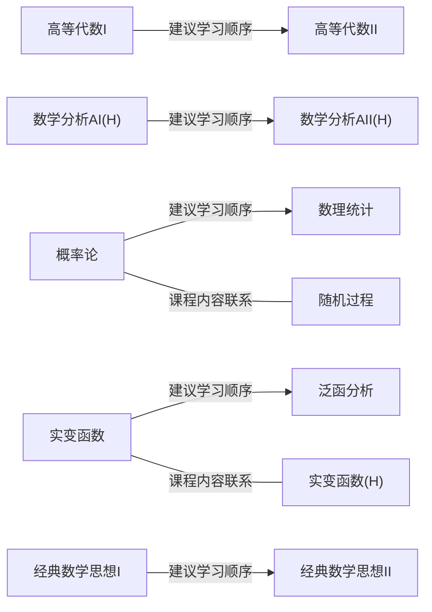

# 数学与应用数学专业修读建议（相辉计划适用）

2024 年汇编印刷页 748–750。原表记录 50 个可配对的课程代码。

[本节原页](plan-740.pdf#page=9) · [逐行数据](plan-740.json) · [院系目录](README.md)

## 课程关系图

图中展示最多 20 条关系。下表列出本节全部关系。建议学习顺序供规划课程使用，正式选课资格以教务规定为准。

| 课程 | 关联课程 | 关系 | 依据 |
| --- | --- | --- | --- |
| 高等代数I（MATH120011） | 高等代数II（MATH130002） | 建议学习顺序 | 同节课程题名标明连续分册或序号。 |
| 数学分析AI(H)（MATH120014h） | 数学分析AII(H)（MATH120015h） | 建议学习顺序 | 同节课程题名标明连续分册或序号。 |
| 概率论（MATH130009） | 数理统计（MATH130060） | 建议学习顺序 | 分布和期望为统计估计与检验提供基础。 |
| 实变函数（MATH130186） | 泛函分析（MATH130011） | 建议学习顺序 | 测度与积分有助于理解函数空间。 |
| 经典数学思想I（MATH130190） | 经典数学思想II（MATH130191） | 建议学习顺序 | 同节课程题名标明连续分册或序号。 |
| 概率论（MATH130009） | 随机过程（MATH130044） | 课程内容联系 | 随机现象与概率模型 |
| 实变函数（MATH130186） | 实变函数(H)（MATH130186h） | 课程内容联系 | 本方案两门课程的题名均含“实变函数”，可据此对照这一主题。 |

## 课程

| 课程代码 | 名称 | 开课学期原文 | 来源（PDF 页） |
| --- | --- | --- | --- |
| MATH120011 | 高等代数I |  | 762 |
| MATH120014h | 数学分析AI(H) |  | 762 |
| MATH120015h | 数学分析AII(H) |  | 762 |
| MATH130002 | 高等代数II |  | 762 |
| MATH130006h | 复变函数(H) |  | 763 |
| MATH130008 | 数学模型 |  | 763 |
| MATH130009 | 概率论 |  | 763 |
| MATH130009h | 概率论(H) |  | 763 |
| MATH130011 | 泛函分析 |  | 763 |
| MATH130011h | 泛函分析(H) |  | 763 |
| MATH130012 | 数理方程 |  | 763 |
| MATH130012h | 数理方程(H) |  | 763 |
| MATH130015 | 毕业论文（含专题讨论） |  | 763 |
| MATH130017h | 微分流形(H) |  | 763 |
| MATH130032 | 动力系统 |  | 763 |
| MATH130041 | 多复变函数论 |  | 763 |
| MATH130041h | 多复变函数论(H) |  | 763 |
| MATH130043 | 数论基础 |  | 763 |
| MATH130044 | 随机过程 |  | 763 |
| MATH130052 | Fourier分析 |  | 763 |
| MATH130060 | 数理统计 |  | 763 |
| MATH130107 | 学术前沿专题 |  | 763 |
| MATH130112h | 代数拓扑(H) |  | 763 |
| MATH130121 | 现代偏微分方程 |  | 763 |
| MATH130131 | 代数数论初步 |  | 763 |
| MATH130144h | 代数拓扑与微分形式(H) |  | 763 |
| MATH130145h | 黎曼几何初步(H) |  | 763 |
| MATH130157 | 代数拓扑 |  | 763 |
| MATH130164h | 数学控制论(H) |  | 763 |
| MATH130165h | 数值代数与优化(H) |  | 763 |
| MATH130166 | 经典物理选讲 |  | 763 |
| MATH130170 | 数学广义相对论 |  | 763 |
| MATH130183 | 常微分方程 |  | 762 |
| MATH130184 | 抽象代数 |  | 762 |
| MATH130185 | 复变函数 |  | 763 |
| MATH130186 | 实变函数 |  | 763 |
| MATH130186h | 实变函数(H) |  | 763 |
| MATH130188 | 微分流形 |  | 763 |
| MATH130189 | 几何拓扑选讲 |  | 762 |
| MATH130190 | 经典数学思想I |  | 762 |
| MATH130191 | 经典数学思想II |  | 762 |
| MATH130194h | 表示论基础(H) |  | 763 |
| MATH130195h | 交换代数(H) |  | 763 |
| MATH130196h | 同调代数(H) |  | 763 |
| PHYS130008 | 量子力学I |  | 763 |
| PTSS110082 | 毛泽东思想和中国特色社会主义理论体系概论 |  | 762 |
| PTSS110087 | 马克思主义基本原理 |  | 762 |
| PTSS110088 | 中国近现代史纲要 |  | 762 |
| PTSS110089 | 思想道德与法治 |  | 762 |
| PTSS110090 | 习近平新时代中国特色社会主义思想概论 |  | 762 |
