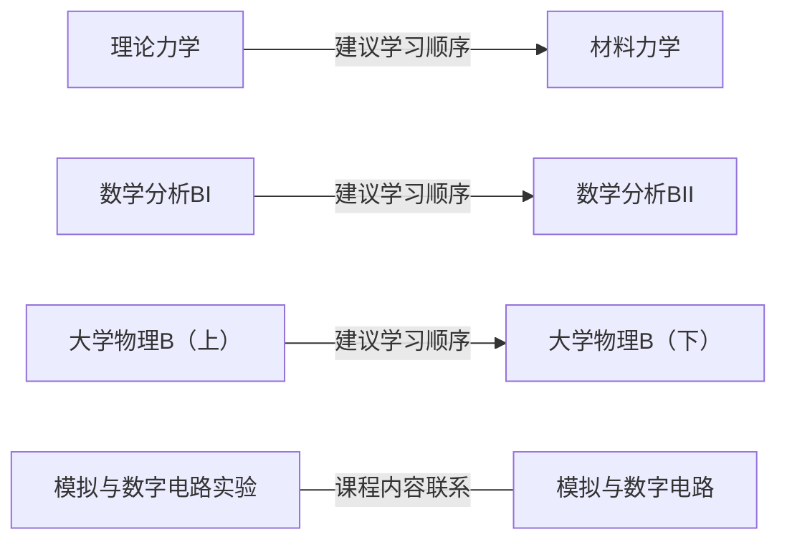

# 智能科学与技术（智能机器人领军人才班）专业修读建议（香农计划适用）

2024 年汇编印刷页 806–807。原表记录 28 个可配对的课程代码。

[本节原页](plan-803.pdf#page=4) · [逐行数据](plan-803.json) · [院系目录](README.md)

## 课程导读

本节原表列有《概率论与数理统计》（`COMP130006`）、《理论力学》（`ATMO130042`）、《模拟与数字电路》（`INFO130369`），可用课号查到各自的学期和备注栏。 [原书 PDF 第 821 页](plan-803.pdf#page=5)

图中把《模拟与数字电路实验》（`INFO130348`）和《模拟与数字电路》（`INFO130369`）列作内容联系。同节同题名的课程与实验、实习或实践。 [原书 PDF 第 821 页](plan-803.pdf#page=5)

## 课程关系图

图中展示最多 20 条关系。下表列出本节全部关系。建议学习顺序供规划课程使用，正式选课资格以教务规定为准。

| 课程 | 关联课程 | 关系 | 依据 |
| --- | --- | --- | --- |
| 理论力学（ATMO130042） | 材料力学（MECH130088） | 建议学习顺序 | 静力学分析有助于理解构件受力。 |
| 数学分析BI（MATH120016） | 数学分析BII（MATH120017） | 建议学习顺序 | 同节课程题名标明连续分册或序号。 |
| 大学物理B（上）（PHYS120013） | 大学物理B（下）（PHYS120014） | 建议学习顺序 | 同节课程题名标明连续分册或序号。 |
| 模拟与数字电路实验（INFO130348） | 模拟与数字电路（INFO130369） | 课程内容联系 | 同节同题名的课程与实验、实习或实践。 |

## 课程

| 课程代码 | 名称 | 开课学期原文 | 来源（PDF 页） |
| --- | --- | --- | --- |
| AIS410007 | 机器人学导论 |  | 821 |
| ATMO130042 | 理论力学 |  | 821 |
| BIOL120002 | 现代生物科学导论A |  | 821 |
| COMP120004 | 线性代数 |  | 820 |
| COMP120006 | 程序设计 |  | 820 |
| COMP130006 | 概率论与数理统计 |  | 821 |
| INFO120011 | 电子系统导论 |  | 821 |
| INFO130016 | 毕业论文 |  | 821 |
| INFO130234 | 工程图学及应用 |  | 821 |
| INFO130310 | 自动控制原理 |  | 821 |
| INFO130348 | 模拟与数字电路实验 |  | 821 |
| INFO130369 | 模拟与数字电路 |  | 821 |
| INFO130370 | 机械设计 |  | 821 |
| INFO130419 | 现代控制理论 |  | 821 |
| INFO130420 | 生机电一体化系统设计 |  | 821 |
| MATH120016 | 数学分析BI |  | 820 |
| MATH120017 | 数学分析BII |  | 820 |
| MECH130088 | 材料力学 |  | 821 |
| MECH130100 | 金工实习 |  | 821 |
| MICR120001 | 电路基础 |  | 821 |
| PHYS120013 | 大学物理B（上） |  | 820 |
| PHYS120014 | 大学物理B（下） |  | 820 |
| PHYS120015 | 基础物理实验 |  | 820 |
| PTSS110082 | 毛泽东思想和中国特色社会主义理论体系概论 |  | 820 |
| PTSS110087 | 马克思主义基本原理 |  | 820 |
| PTSS110088 | 中国近现代史纲要 |  | 820 |
| PTSS110089 | 思想道德与法治 |  | 820 |
| PTSS110090 | 习近平新时代中国特色社会主义思想概论 |  | 820 |
