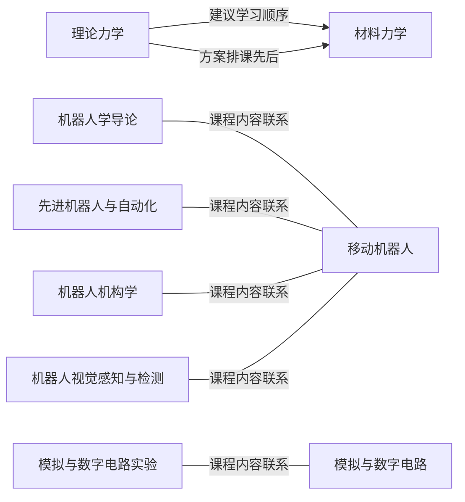

# 智能科学与技术（智能机器人领军人才班）专业“2+X”教学培养方案

2024 年汇编印刷页 833–835。原表记录 27 个可配对的课程代码。

[本节原页](plan-833.pdf#page=1) · [逐行数据](plan-833.json) · [院系目录](README.md)

## 课程导读

想了解智能系统的课程安排，可以在原表中找到《智能科学的数学基础》（`INFO130357`）、《机器人视觉感知与检测》（`INFO130423`）、《数据挖掘与机器学习》（`INFO130424`）。 [原书 PDF 第 848 页](plan-833.pdf#page=2)

图中连接《机器人学导论》（`AIS410007`）和《移动机器人》（`INFO130425`），两门课都从课程题名标出的“机器人”切入，可沿这一主题对照阅读。 [原书 PDF 第 847 页](plan-833.pdf#page=1) · [原书 PDF 第 848 页](plan-833.pdf#page=2)

## 课程关系图

图中展示最多 20 条关系。下表列出本节全部关系。建议学习顺序供规划课程使用，正式选课资格以教务规定为准。

| 课程 | 关联课程 | 关系 | 依据 |
| --- | --- | --- | --- |
| 理论力学（ATMO130042） | 材料力学（MECH130088） | 建议学习顺序 | 静力学分析有助于理解构件受力。 |
| 机器人学导论（AIS410007） | 移动机器人（INFO130425） | 课程内容联系 | 本方案两门课程的题名均含“机器人”，可据此对照这一主题。 |
| 模拟与数字电路实验（INFO130348） | 模拟与数字电路（INFO130369） | 课程内容联系 | 同节同题名的课程与实验、实习或实践。 |
| 先进机器人与自动化（INFO130398） | 移动机器人（INFO130425） | 课程内容联系 | 本方案两门课程的题名均含“机器人”，可据此对照这一主题。 |
| 机器人机构学（INFO130422） | 移动机器人（INFO130425） | 课程内容联系 | 本方案两门课程的题名均含“机器人”，可据此对照这一主题。 |
| 机器人视觉感知与检测（INFO130423） | 移动机器人（INFO130425） | 课程内容联系 | 本方案两门课程的题名均含“机器人”，可据此对照这一主题。 |
| 理论力学（ATMO130042） | 材料力学（MECH130088） | 方案排课先后 | 本节原表所列全部明确学期均早于后者。 |

## 课程

| 课程代码 | 名称 | 开课学期原文 | 来源（PDF 页） |
| --- | --- | --- | --- |
| AIS410007 | 机器人学导论 | 5 | 847 |
| ATMO130042 | 理论力学 | 3 | 847 |
| COMP130006 | 概率论与数理统计 | 3 | 847 |
| INFO130016 | 毕业论文 | 8 | 848 |
| INFO130234 | 工程图学及应用 | 4 | 847 |
| INFO130305 | 数据结构与算法设计 | 5 | 848 |
| INFO130310 | 自动控制原理 | 5 | 847 |
| INFO130311 | 计算机原理与体系结构 | 4 | 848 |
| INFO130348 | 模拟与数字电路实验 | 4 | 847 |
| INFO130357 | 智能科学的数学基础 | 4 | 848 |
| INFO130368 | 微机原理与接口实验 | 5 | 848 |
| INFO130369 | 模拟与数字电路 | 3 | 847 |
| INFO130370 | 机械设计 | 6 | 847 |
| INFO130398 | 先进机器人与自动化 | 7 | 848 |
| INFO130399 | 随机过程 | 4 | 848 |
| INFO130419 | 现代控制理论 | 6 | 847 |
| INFO130420 | 生机电一体化系统设计 | 7 | 848 |
| INFO130421 | 电机学 | 6 | 848 |
| INFO130422 | 机器人机构学 | 7 | 848 |
| INFO130423 | 机器人视觉感知与检测 | 7 | 848 |
| INFO130424 | 数据挖掘与机器学习 | 5 | 848 |
| INFO130425 | 移动机器人 | 7 | 848 |
| INFO130428 | 图像处理与机器视觉 | 6 | 848 |
| INFO130429 | 计算神经学 | 5 | 848 |
| MECH130088 | 材料力学 | 4 | 847 |
| MECH130100 | 金工实习 | 7 | 848 |
| MECH130129 | 弹性结构的力学基础 | 5 | 848 |
