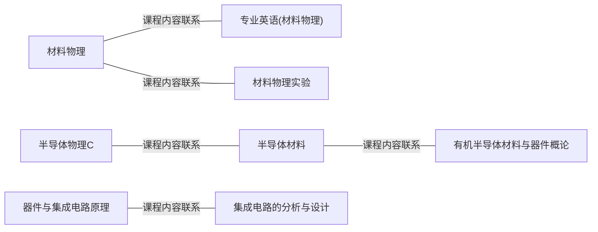

# 材料物理专业“2+X”教学培养方案

2024 年汇编印刷页 710–713。原表记录 52 个可配对的课程代码。

[本节原页](plan-710.pdf#page=1) · [逐行数据](plan-710.json) · [院系目录](README.md)

## 课程关系图

图中展示最多 20 条关系。下表列出本节全部关系。建议学习顺序供规划课程使用，正式选课资格以教务规定为准。

| 课程 | 关联课程 | 关系 | 依据 |
| --- | --- | --- | --- |
| 材料物理（MATE130010） | 专业英语(材料物理)（MATE130018） | 课程内容联系 | 本方案两门课程的题名均含“材料物理”，可据此对照这一主题。 |
| 材料物理（MATE130010） | 材料物理实验（MATE130093） | 课程内容联系 | 同节同题名的课程与实验、实习或实践。 |
| 半导体物理C（MATE130013） | 半导体材料（MATE130036） | 课程内容联系 | 本方案两门课程的题名均含“半导体”，可据此对照这一主题。 |
| 器件与集成电路原理（MATE130014） | 集成电路的分析与设计（MATE130016） | 课程内容联系 | 本方案两门课程的题名均含“集成电路”，可据此对照这一主题。 |
| 半导体材料（MATE130036） | 有机半导体材料与器件概论（MATE130080） | 课程内容联系 | 本方案两门课程的题名均含“半导体”，可据此对照这一主题。 |

## 课程

| 课程代码 | 名称 | 开课学期原文 | 来源（PDF 页） |
| --- | --- | --- | --- |
| CHEM120009 | 普通化学实验I | 3 | 724 |
| MATE130001 | 电子封装材料与工艺 | 春 | 725 |
| MATE130008 | 生产实习 | 7 | 725 |
| MATE130009 | 毕业论文 | 8 | 725 |
| MATE130010 | 材料物理 | 5 | 724 |
| MATE130011 | 材料化学基础 | 春 | 725 |
| MATE130013 | 半导体物理C | 5 | 724 |
| MATE130014 | 器件与集成电路原理 | 6 | 725 |
| MATE130015 | 电子材料与器件工艺 | 6 | 725 |
| MATE130016 | 集成电路的分析与设计 | 7 | 725, 726 |
| MATE130017 | 电子材料分析 | 5 | 725 |
| MATE130018 | 专业英语(材料物理) | 5 | 725 |
| MATE130025 | 材料失效分析 | 春 | 726 |
| MATE130032 | 薄膜材料工艺学 | 春 | 725 |
| MATE130034 | 材料科学导论 | 3 | 724 |
| MATE130035 | 工程材料的电学性质 | 秋 | 725 |
| MATE130036 | 半导体材料 | 秋 | 725, 726 |
| MATE130037 | 新型能源材料 | 春 | 726 |
| MATE130041 | 电子显微分析技术 | 秋 | 725, 726 |
| MATE130042 | 电子与信息材料 | 秋 | 725, 726 |
| MATE130044 | 有机化学与聚合物引论 | 春，秋 | 726 |
| MATE130046 | 纳米科技导论 | 春 | 726 |
| MATE130048 | 液晶物理学 | 春 | 726 |
| MATE130050 | 数学物理方法 | 3 | 724 |
| MATE130051 | 无机功能材料 | 春 | 726 |
| MATE130052 | 材料科学前沿讲座 | 春 | 725, 726 |
| MATE130054 | 光子晶体导论 | 秋 | 725 |
| MATE130057 | 扫描探针显微技术及其应用 | 春 | 726 |
| MATE130058 | 模拟与数字电子线路 | 4 | 725 |
| MATE130061 | 材料制备与加工 | 5 | 725 |
| MATE130062 | 材料分析 | 6 | 725 |
| MATE130064 | 材料综合实验 | 6 | 725 |
| MATE130065 | 薄膜材料与器件 | 秋 | 727 |
| MATE130067 | 材料力学 | 4 | 724 |
| MATE130073 | 柔性光电子学 | 春 | 727 |
| MATE130075 | 纳米功能材料 | 秋 | 726 |
| MATE130077 | 光电材料 | 春 | 725, 726, 727 |
| MATE130078 | 计算物理 | 春 | 727 |
| MATE130080 | 有机半导体材料与器件概论 | 秋 | 726 |
| MATE130081 | 电子材料的化学处理 | 秋 | 726 |
| MATE130087 | 智能材料 | 秋 | 726 |
| MATE130091 | 普通化学 | 3 | 724 |
| MATE130092 | 材料结构与性能 | 4 | 724 |
| MATE130093 | 材料物理实验 | 7 | 725 |
| MATE130095 | 锂电池材料 | 秋 | 726 |
| MATE130096 | 氢能材料与技术 | 春 | 726 |
| MATE130097 | 新能源转换材料及应用 | 春 | 726 |
| MATE130098 | 有机光电材料与器件 | 春 | 726 |
| MATE130099 | 太阳能电池器件物理 | 春 | 726 |
| PHYS130055 | 近代物理A | 3 | 724 |
| PHYS130056 | 近代物理实验A | 5 | 725 |
| PHYS130057 | 经典物理A | 4 | 724 |
