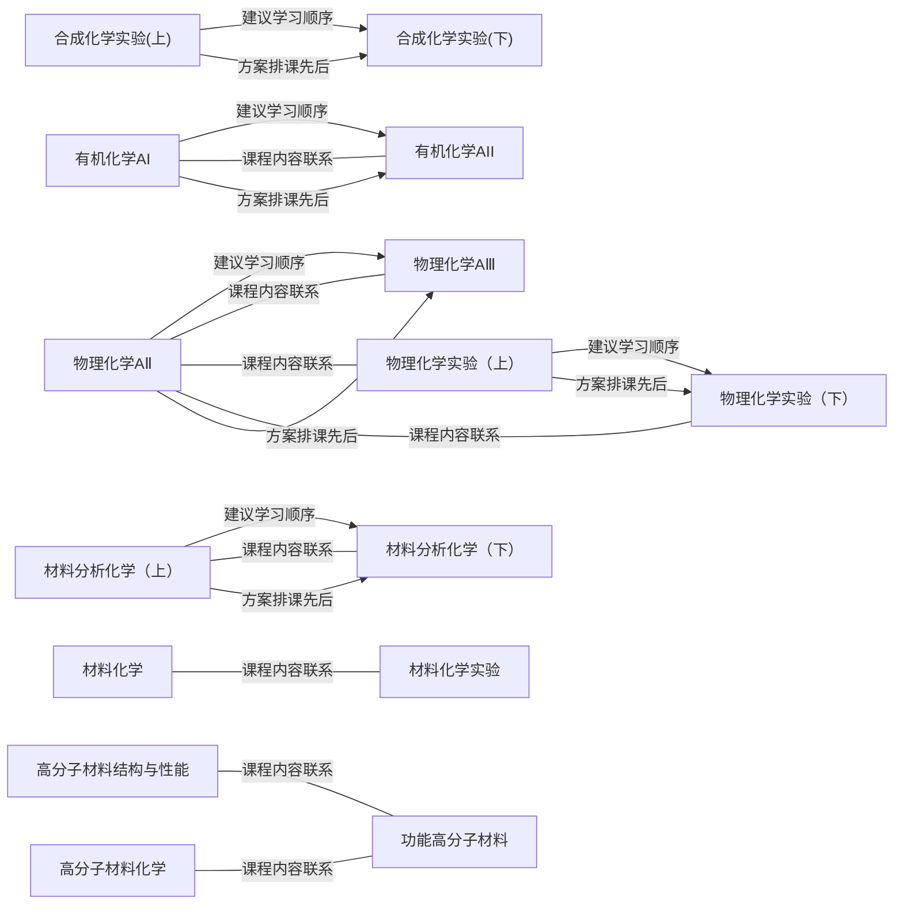

# 材料化学专业“2+X”教学培养方案

2024 年汇编印刷页 718–720。原表记录 45 个可配对的课程代码。

[本节原页](plan-718.pdf#page=1) · [逐行数据](plan-718.json) · [院系目录](README.md)

## 课程关系图

图中展示最多 20 条关系。下表列出本节全部关系。建议学习顺序供规划课程使用，正式选课资格以教务规定为准。

| 课程 | 关联课程 | 关系 | 依据 |
| --- | --- | --- | --- |
| 合成化学实验(上)（CHEM130010） | 合成化学实验(下)（CHEM130011） | 建议学习顺序 | 同节课程题名标明连续分册或序号。 |
| 物理化学AⅡ（CHEM130013） | 物理化学AⅢ（CHEM130014） | 建议学习顺序 | 同节课程题名标明连续分册或序号。 |
| 有机化学AI（CHEM130067） | 有机化学AII（CHEM130068） | 建议学习顺序 | 同节课程题名标明连续分册或序号。 |
| 物理化学实验（上）（CHEM130104） | 物理化学实验（下）（CHEM130105） | 建议学习顺序 | 同节课程题名标明连续分册或序号。 |
| 材料分析化学（上）（MATE130068） | 材料分析化学（下）（MATE130069） | 建议学习顺序 | 同节课程题名标明连续分册或序号。 |
| 物理化学AⅡ（CHEM130013） | 物理化学AⅢ（CHEM130014） | 课程内容联系 | 本方案两门课程的题名均含“物理化学”，可据此对照这一主题。 |
| 物理化学AⅡ（CHEM130013） | 物理化学实验（上）（CHEM130104） | 课程内容联系 | 本方案两门课程的题名均含“物理化学”，可据此对照这一主题。 |
| 物理化学AⅡ（CHEM130013） | 物理化学实验（下）（CHEM130105） | 课程内容联系 | 本方案两门课程的题名均含“物理化学”，可据此对照这一主题。 |
| 有机化学AI（CHEM130067） | 有机化学AII（CHEM130068） | 课程内容联系 | 本方案两门课程的题名均含“有机化学”，可据此对照这一主题。 |
| 材料化学（MATE130005） | 材料化学实验（MATE130070） | 课程内容联系 | 同节同题名的课程与实验、实习或实践。 |
| 高分子材料结构与性能（MATE130006） | 功能高分子材料（MATE130049） | 课程内容联系 | 本方案两门课程的题名均含“高分子”，可据此对照这一主题。 |
| 高分子材料化学（MATE130007） | 功能高分子材料（MATE130049） | 课程内容联系 | 本方案两门课程的题名均含“高分子”，可据此对照这一主题。 |
| 材料分析化学（上）（MATE130068） | 材料分析化学（下）（MATE130069） | 课程内容联系 | 本方案两门课程的题名均含“分析化学”，可据此对照这一主题。 |
| 合成化学实验(上)（CHEM130010） | 合成化学实验(下)（CHEM130011） | 方案排课先后 | 本节原表所列全部明确学期均早于后者。 |
| 物理化学AⅡ（CHEM130013） | 物理化学AⅢ（CHEM130014） | 方案排课先后 | 本节原表所列全部明确学期均早于后者。 |
| 有机化学AI（CHEM130067） | 有机化学AII（CHEM130068） | 方案排课先后 | 本节原表所列全部明确学期均早于后者。 |
| 物理化学实验（上）（CHEM130104） | 物理化学实验（下）（CHEM130105） | 方案排课先后 | 本节原表所列全部明确学期均早于后者。 |
| 材料分析化学（上）（MATE130068） | 材料分析化学（下）（MATE130069） | 方案排课先后 | 本节原表所列全部明确学期均早于后者。 |

## 课程

| 课程代码 | 名称 | 开课学期原文 | 来源（PDF 页） |
| --- | --- | --- | --- |
| CHEM130003 | 无机化学和化学分析实验Ⅰ | 3 | 733 |
| CHEM130010 | 合成化学实验(上) | 4 | 732 |
| CHEM130011 | 合成化学实验(下) | 5 | 732 |
| CHEM130013 | 物理化学AⅡ | 4 | 732 |
| CHEM130014 | 物理化学AⅢ | 5 | 732 |
| CHEM130067 | 有机化学AI | 3 | 732 |
| CHEM130068 | 有机化学AII | 4 | 732 |
| CHEM130104 | 物理化学实验（上） | 5 | 732 |
| CHEM130105 | 物理化学实验（下） | 6 | 733 |
| CHEM130107 | 仪器分析实验 | 4 | 733 |
| MATE130005 | 材料化学 | 7 | 733 |
| MATE130006 | 高分子材料结构与性能 | 6 | 733 |
| MATE130007 | 高分子材料化学 | 5 | 733 |
| MATE130008 | 生产实习 | 7 | 733 |
| MATE130009 | 毕业论文 | 8 | 733 |
| MATE130025 | 材料失效分析 | 春 | 733, 734 |
| MATE130034 | 材料科学导论 | 3 | 732 |
| MATE130037 | 新型能源材料 | 春 | 734 |
| MATE130041 | 电子显微分析技术 | 秋 | 734 |
| MATE130049 | 功能高分子材料 | 春 | 733 |
| MATE130051 | 无机功能材料 | 春 | 734 |
| MATE130052 | 材料科学前沿讲座 | 春 | 733, 734 |
| MATE130061 | 材料制备与加工 | 5 | 732 |
| MATE130062 | 材料分析 | 6 | 732 |
| MATE130064 | 材料综合实验 | 6 | 732 |
| MATE130068 | 材料分析化学（上） | 3 | 733 |
| MATE130069 | 材料分析化学（下） | 4 | 733 |
| MATE130070 | 材料化学实验 | 7 | 733 |
| MATE130075 | 纳米功能材料 | 秋 | 734 |
| MATE130077 | 光电材料 | 春 | 734 |
| MATE130082 | 复合材料 | 春 | 733 |
| MATE130083 | 精细化工工艺学 | 秋 | 733 |
| MATE130084 | 聚合物材料研究方法 | 秋 | 733 |
| MATE130087 | 智能材料 | 秋 | 733, 734 |
| MATE130088 | 材料与环境保护 | 秋 | 733 |
| MATE130089 | 工程材料 | 秋 | 733 |
| MATE130092 | 材料结构与性能 | 4 | 732 |
| MATE130094 | 专业英语（材料化学） | 5 | 733 |
| MATE130095 | 锂电池材料 | 秋 | 734 |
| MATE130096 | 氢能材料与技术 | 春 | 734 |
| MATE130097 | 新能源转换材料及应用 | 春 | 734 |
| MATE130098 | 有机光电材料与器件 | 春 | 733, 734 |
| MATE130099 | 太阳能电池器件物理 | 春 | 734 |
| MATE130100 | 有机发光材料 | 秋 | 733 |
| MATE130101 | 有机功能材料微纳结构制备与应用 | 秋 | 734 |
