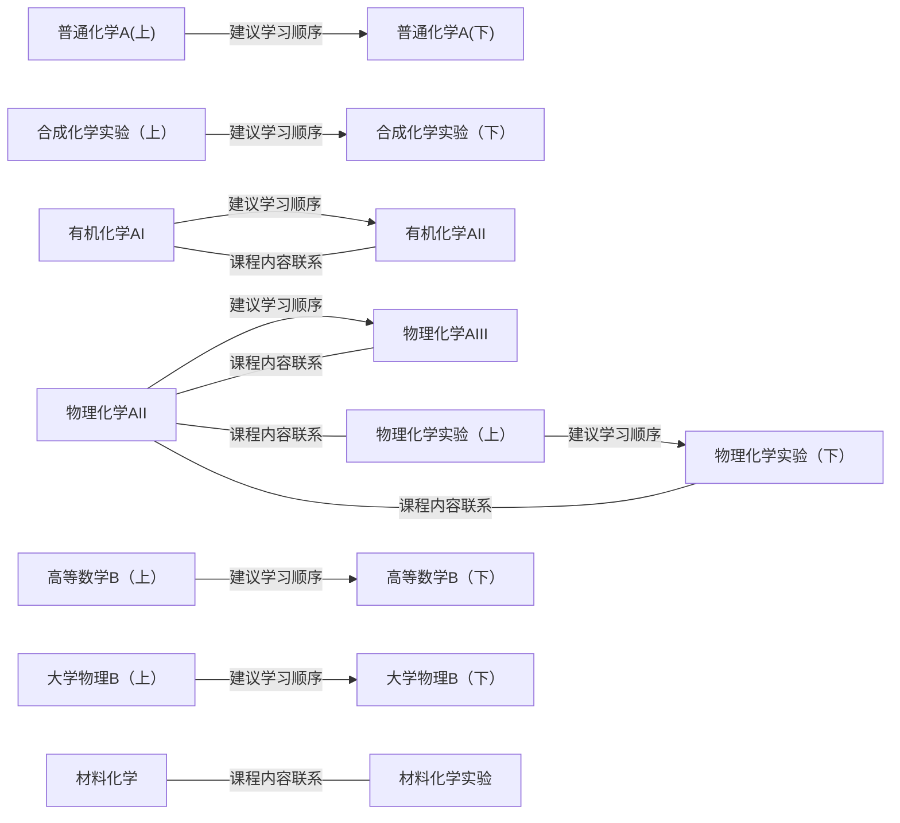

# 材料化学专业“2+X”修读建议

2024 年汇编印刷页 721–722。原表记录 32 个可配对的课程代码。

[本节原页](plan-718.pdf#page=4) · [逐行数据](plan-718.json) · [院系目录](README.md)

## 课程关系图

图中展示最多 20 条关系。下表列出本节全部关系。建议学习顺序供规划课程使用，正式选课资格以教务规定为准。

| 课程 | 关联课程 | 关系 | 依据 |
| --- | --- | --- | --- |
| 普通化学A(上)（CHEM120005） | 普通化学A(下)（CHEM120006） | 建议学习顺序 | 同节课程题名标明连续分册或序号。 |
| 合成化学实验（上）（CHEM130010） | 合成化学实验（下）（CHEM130011） | 建议学习顺序 | 同节课程题名标明连续分册或序号。 |
| 物理化学AII（CHEM130013） | 物理化学AIII（CHEM130014） | 建议学习顺序 | 同节课程题名标明连续分册或序号。 |
| 有机化学AI（CHEM130067） | 有机化学AII（CHEM130068） | 建议学习顺序 | 同节课程题名标明连续分册或序号。 |
| 物理化学实验（上）（CHEM130104） | 物理化学实验（下）（CHEM130105） | 建议学习顺序 | 同节课程题名标明连续分册或序号。 |
| 高等数学B（上）（MATH120003） | 高等数学B（下）（MATH120004） | 建议学习顺序 | 同节课程题名标明连续分册或序号。 |
| 大学物理B（上）（PHYS120013） | 大学物理B（下）（PHYS120014） | 建议学习顺序 | 同节课程题名标明连续分册或序号。 |
| 物理化学AII（CHEM130013） | 物理化学AIII（CHEM130014） | 课程内容联系 | 本方案两门课程的题名均含“物理化学”，可据此对照这一主题。 |
| 物理化学AII（CHEM130013） | 物理化学实验（上）（CHEM130104） | 课程内容联系 | 本方案两门课程的题名均含“物理化学”，可据此对照这一主题。 |
| 物理化学AII（CHEM130013） | 物理化学实验（下）（CHEM130105） | 课程内容联系 | 本方案两门课程的题名均含“物理化学”，可据此对照这一主题。 |
| 有机化学AI（CHEM130067） | 有机化学AII（CHEM130068） | 课程内容联系 | 本方案两门课程的题名均含“有机化学”，可据此对照这一主题。 |
| 材料化学（MATE130005） | 材料化学实验（MATE130070） | 课程内容联系 | 同节同题名的课程与实验、实习或实践。 |

## 课程

| 课程代码 | 名称 | 开课学期原文 | 来源（PDF 页） |
| --- | --- | --- | --- |
| BIOL120002 | 现代生物科学导论A |  | 735 |
| CHEM120005 | 普通化学A(上) |  | 735 |
| CHEM120006 | 普通化学A(下) |  | 735 |
| CHEM120009 | 普通化学实验I |  | 735 |
| CHEM130010 | 合成化学实验（上） |  | 735 |
| CHEM130011 | 合成化学实验（下） |  | 736 |
| CHEM130013 | 物理化学AII |  | 735 |
| CHEM130014 | 物理化学AIII |  | 736 |
| CHEM130067 | 有机化学AI |  | 735 |
| CHEM130068 | 有机化学AII |  | 735 |
| CHEM130104 | 物理化学实验（上） |  | 736 |
| CHEM130105 | 物理化学实验（下） |  | 736 |
| MATE130005 | 材料化学 |  | 736 |
| MATE130008 | 生产实习 |  | 736 |
| MATE130009 | 毕业论文 |  | 736 |
| MATE130034 | 材料科学导论 |  | 735 |
| MATE130061 | 材料制备与加工 |  | 736 |
| MATE130062 | 材料分析 |  | 736 |
| MATE130064 | 材料综合实验 |  | 736 |
| MATE130070 | 材料化学实验 |  | 736 |
| MATE130092 | 材料结构与性能 |  | 736 |
| MATH120003 | 高等数学B（上） |  | 735 |
| MATH120004 | 高等数学B（下） |  | 735 |
| MATH120020 | 线性代数 |  | 735 |
| PHYS120013 | 大学物理B（上） |  | 735 |
| PHYS120014 | 大学物理B（下） |  | 735 |
| PHYS120015 | 基础物理实验 |  | 735 |
| PTSS110082 | 毛泽东思想和中国特色社会主义理论体系概论 |  | 735 |
| PTSS110087 | 马克思主义基本原理 |  | 735 |
| PTSS110088 | 中国近现代史纲要 |  | 735 |
| PTSS110089 | 思想道德与法治 |  | 735 |
| PTSS110090 | 习近平新时代中国特色社会主义思想概论 |  | 735 |
