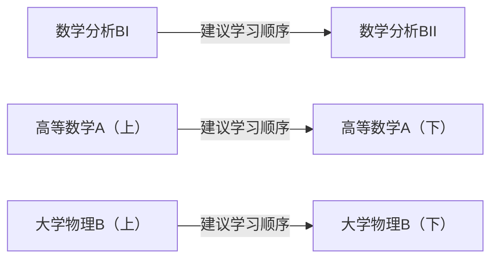

# 电子科学与技术专业“2+X”修读建议

2024 年汇编印刷页 729–730。原表记录 31 个可配对的课程代码。

[本节原页](plan-725.pdf#page=5) · [逐行数据](plan-725.json) · [院系目录](README.md)

## 课程关系图

图中展示最多 20 条关系。下表列出本节全部关系。建议学习顺序供规划课程使用，正式选课资格以教务规定为准。

| 课程 | 关联课程 | 关系 | 依据 |
| --- | --- | --- | --- |
| 数学分析BI（MATH120016） | 数学分析BII（MATH120017） | 建议学习顺序 | 同节课程题名标明连续分册或序号。 |
| 高等数学A（上）（MATH120021） | 高等数学A（下）（MATH120022） | 建议学习顺序 | 同节课程题名标明连续分册或序号。 |
| 大学物理B（上）（PHYS120013） | 大学物理B（下）（PHYS120014） | 建议学习顺序 | 同节课程题名标明连续分册或序号。 |

## 课程

| 课程代码 | 名称 | 开课学期原文 | 来源（PDF 页） |
| --- | --- | --- | --- |
| CHEM120009 | 普通化学实验Ⅰ |  | 743 |
| COMP120006 | 程序设计 |  | 743 |
| INFO120011 | 电子系统导论 |  | 743 |
| MATE130008 | 生产实习 |  | 744 |
| MATE130009 | 毕业论文 |  | 744 |
| MATE130034 | 材料科学导论 |  | 743 |
| MATE130050 | 数学物理方法 |  | 743 |
| MATE130058 | 模拟与数字电子线路 |  | 744 |
| MATE130059 | 物理化学B |  | 744 |
| MATE130061 | 材料制备与加工 |  | 744 |
| MATE130062 | 材料分析 |  | 744 |
| MATE130063 | 固体物理导论 |  | 744 |
| MATE130064 | 材料综合实验 |  | 744 |
| MATE130091 | 普通化学 |  | 743 |
| MATE130092 | 材料结构与性能 |  | 744 |
| MATH120016 | 数学分析BI |  | 743 |
| MATH120017 | 数学分析BII |  | 743 |
| MATH120020 | 线性代数 |  | 743 |
| MATH120021 | 高等数学A（上） |  | 743 |
| MATH120022 | 高等数学A（下） |  | 743 |
| PHYS120013 | 大学物理B（上） |  | 743 |
| PHYS120014 | 大学物理B（下） |  | 743 |
| PHYS120015 | 基础物理实验 |  | 743 |
| PHYS130055 | 近代物理A |  | 743 |
| PHYS130056 | 近代物理实验A |  | 744 |
| PHYS130057 | 经典物理A |  | 744 |
| PTSS110082 | 毛泽东思想和中国特色社会主义理论体系概论 |  | 743 |
| PTSS110087 | 马克思主义基本原理 |  | 743 |
| PTSS110088 | 中国近现代史纲要 |  | 743 |
| PTSS110089 | 思想道德与法治 |  | 743 |
| PTSS110090 | 习近平新时代中国特色社会主义思想概论 |  | 743 |
