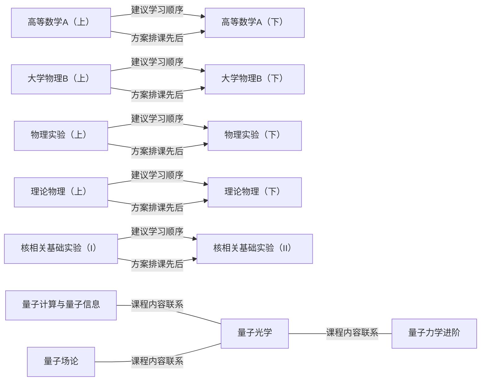

# 核工程与核技术专业（核技术吴征铠班）“2+X”教学培养方案

2024 年汇编印刷页 931–934。原表记录 66 个可配对的课程代码。

[本节原页](plan-931.pdf#page=1) · [逐行数据](plan-931.json) · [院系目录](README.md)

## 课程关系图

图中展示最多 20 条关系。下表列出本节全部关系。建议学习顺序供规划课程使用，正式选课资格以教务规定为准。

| 课程 | 关联课程 | 关系 | 依据 |
| --- | --- | --- | --- |
| 高等数学A（上）（MATH120021） | 高等数学A（下）（MATH120022） | 建议学习顺序 | 同节课程题名标明连续分册或序号。 |
| 大学物理B（上）（PHYS120013） | 大学物理B（下）（PHYS120014） | 建议学习顺序 | 同节课程题名标明连续分册或序号。 |
| 物理实验（上）（PHYS130004） | 物理实验（下）（PHYS130005） | 建议学习顺序 | 同节课程题名标明连续分册或序号。 |
| 理论物理（上）（TCPH130027） | 理论物理（下）（TCPH130028） | 建议学习顺序 | 同节课程题名标明连续分册或序号。 |
| 核相关基础实验（I）（TCPH130048） | 核相关基础实验（II）（TCPH130049） | 建议学习顺序 | 同节课程题名标明连续分册或序号。 |
| 量子计算与量子信息（PHYS130067） | 量子光学（PHYS130089） | 课程内容联系 | 本方案两门课程的题名均含“量子”，可据此对照这一主题。 |
| 量子场论（PHYS130069） | 量子光学（PHYS130089） | 课程内容联系 | 本方案两门课程的题名均含“量子”，可据此对照这一主题。 |
| 量子光学（PHYS130089） | 量子力学进阶（TCPH130057） | 课程内容联系 | 本方案两门课程的题名均含“量子”，可据此对照这一主题。 |
| 高等数学A（上）（MATH120021） | 高等数学A（下）（MATH120022） | 方案排课先后 | 本节原表所列全部明确学期均早于后者。 |
| 大学物理B（上）（PHYS120013） | 大学物理B（下）（PHYS120014） | 方案排课先后 | 本节原表所列全部明确学期均早于后者。 |
| 物理实验（上）（PHYS130004） | 物理实验（下）（PHYS130005） | 方案排课先后 | 本节原表所列全部明确学期均早于后者。 |
| 理论物理（上）（TCPH130027） | 理论物理（下）（TCPH130028） | 方案排课先后 | 本节原表所列全部明确学期均早于后者。 |
| 核相关基础实验（I）（TCPH130048） | 核相关基础实验（II）（TCPH130049） | 方案排课先后 | 本节原表所列全部明确学期均早于后者。 |

## 课程

| 课程代码 | 名称 | 开课学期原文 | 来源（PDF 页） |
| --- | --- | --- | --- |
| BIOL120002 | 现代生物科学导论A | 春，秋 | 947 |
| COMP120006 | 程序设计 | 1 | 945 |
| COMP130032 | 数字图象处理 | 春 | 947 |
| INFO120002 | 模拟电子学基础 | 4 | 945 |
| INFO130044 | 激光原理与技术 | 秋 | 947 |
| INFO130331 | 数字逻辑基础 | 3 | 946 |
| INFO130342 | 机器学习 | 秋 | 947 |
| MATE130010 | 材料物理 | 秋 | 947 |
| MATH120021 | 高等数学A（上） | 1 | 945 |
| MATH120022 | 高等数学A（下） | 2 | 945 |
| MECH130009 | 流体力学I | 秋 | 947 |
| MECH130100 | 金工实习 | 5 | 946 |
| MED130262 | 医学基础I | 春，秋 | 947 |
| PHYS120013 | 大学物理B（上） | 1 | 945 |
| PHYS120014 | 大学物理B（下） | 2 | 945 |
| PHYS120015 | 基础物理实验 | 1 | 945 |
| PHYS130004 | 物理实验（上） | 3 | 946 |
| PHYS130005 | 物理实验（下） | 4 | 946 |
| PHYS130006 | 数学物理方法A | 4 | 946 |
| PHYS130010 | 固体物理 | 春 | 947 |
| PHYS130067 | 量子计算与量子信息 | 秋 | 947 |
| PHYS130068 | 群论 | 秋 | 947 |
| PHYS130069 | 量子场论 | 春 | 947 |
| PHYS130088 | 医学物理实验 | 秋 | 947 |
| PHYS130089 | 量子光学 | 秋 | 947 |
| TCPH115001 | 核事业与行业发展 | 秋 | 947 |
| TCPH130001 | 核物理 | 4 | 946 |
| TCPH130002 | 辐射防护 | 5 | 946 |
| TCPH130003 | 核辐射探测与测量方法 | 5 | 946 |
| TCPH130004 | 核电子学 | 4 | 946 |
| TCPH130005 | 核技术概论 | 5 | 946 |
| TCPH130007 | 加速器原理 | 6 | 946 |
| TCPH130008 | 核技术综合实验 | 7 | 946 |
| TCPH130010 | 毕业论文 | 8 | 946 |
| TCPH130012 | 核分析技术 | 7 | 948 |
| TCPH130014 | 原子物理学 | 3 | 946 |
| TCPH130016 | 误差分析和数据处理 | 3 | 946 |
| TCPH130017 | 薄膜物理与技术 | 秋 | 947 |
| TCPH130019 | 医学影像技术 | 6 | 947 |
| TCPH130022 | 生命科学中的微量元素 | 秋 | 947 |
| TCPH130023 | 科技英语写作 | 春，秋 | 947 |
| TCPH130026 | 工程数学A | 2 | 946 |
| TCPH130027 | 理论物理（上） | 4 | 946 |
| TCPH130028 | 理论物理（下） | 5 | 946 |
| TCPH130030 | 专业实践 | 7 | 946 |
| TCPH130034 | 信号处理与总线 | 秋 | 947 |
| TCPH130035 | 计算物理基础 | 秋 | 946 |
| TCPH130040 | 核科学前沿讲座 | 1-7 | 946 |
| TCPH130041 | 生物医学核技术 | 6 | 947 |
| TCPH130043 | 放疗物理学 | 7 | 947 |
| TCPH130044 | 粒子物理学 | 秋 | 947 |
| TCPH130045 | 核反应堆物理 | 6 | 948 |
| TCPH130046 | 核反应堆热工水力学 | 7 | 948 |
| TCPH130047 | 核电厂运行与安全 | 7 | 948 |
| TCPH130048 | 核相关基础实验（I） | 5 | 946 |
| TCPH130049 | 核相关基础实验（II） | 6 | 946 |
| TCPH130050 | 现代核科学与技术VR仿真实验 | 秋 | 947 |
| TCPH130051 | 同位素分离与应用 | 7 | 948 |
| TCPH130052 | 实验谱学 | 春 | 947 |
| TCPH130053 | 聚变等离子体物理 | 秋 | 947 |
| TCPH130054 | 工程图学基础 | 3 | 946 |
| TCPH130056 | 粒子探测 | 秋 | 947 |
| TCPH130057 | 量子力学进阶 | 春 | 947 |
| TCPH130058 | 热力学与统计物理进阶 | 春 | 947 |
| TCPH130059 | 理论物理专题 | 春 | 947 |
| TCPH130060 | 原子物理专题 | 春 | 947 |
