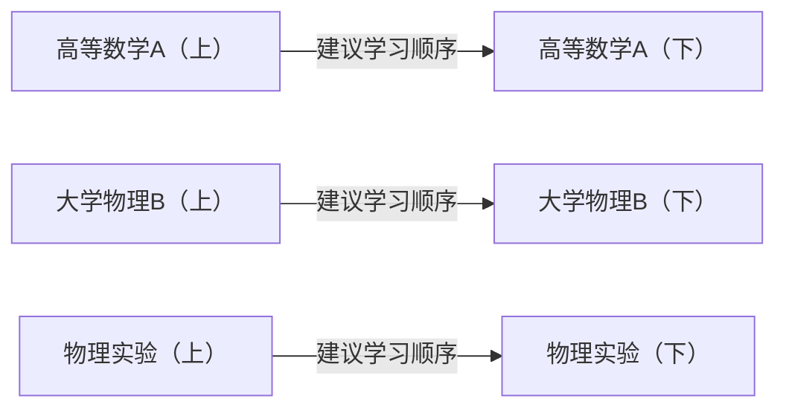

# 核工程与核技术专业（核技术吴征铠班）“2+X”修读建议

2024 年汇编印刷页 935–936。原表记录 30 个可配对的课程代码。

[本节原页](plan-931.pdf#page=5) · [逐行数据](plan-931.json) · [院系目录](README.md)

## 课程关系图

图中展示最多 20 条关系。下表列出本节全部关系。建议学习顺序供规划课程使用，正式选课资格以教务规定为准。

| 课程 | 关联课程 | 关系 | 依据 |
| --- | --- | --- | --- |
| 高等数学A（上）（MATH120021） | 高等数学A（下）（MATH120022） | 建议学习顺序 | 同节课程题名标明连续分册或序号。 |
| 大学物理B（上）（PHYS120013） | 大学物理B（下）（PHYS120014） | 建议学习顺序 | 同节课程题名标明连续分册或序号。 |
| 物理实验（上）（PHYS130004） | 物理实验（下）（PHYS130005） | 建议学习顺序 | 同节课程题名标明连续分册或序号。 |

## 课程

| 课程代码 | 名称 | 开课学期原文 | 来源（PDF 页） |
| --- | --- | --- | --- |
| COMP120006 | 程序设计 |  | 949 |
| INFO120002 | 模拟电子学基础 |  | 949 |
| INFO130331 | 数字逻辑基础 |  | 949 |
| MATH120021 | 高等数学A（上） |  | 949 |
| MATH120022 | 高等数学A（下） |  | 949 |
| MECH130100 | 金工实习 |  | 950 |
| PHYS120013 | 大学物理B（上） |  | 949 |
| PHYS120014 | 大学物理B（下） |  | 949 |
| PHYS120015 | 基础物理实验 |  | 949 |
| PHYS130004 | 物理实验（上） |  | 949 |
| PHYS130005 | 物理实验（下） |  | 949 |
| PHYS130006 | 数学物理方法A |  | 949 |
| PTSS110082 | 毛泽东思想和中国特色社会主义理论体系概论 |  | 949 |
| PTSS110087 | 马克思主义基本原理 |  | 949 |
| PTSS110088 | 中国近现代史纲要 |  | 949 |
| PTSS110089 | 思想道德与法治 |  | 949 |
| PTSS110090 | 习近平新时代中国特色社会主义思想概论 |  | 949 |
| TCPH130001 | 核物理 |  | 949 |
| TCPH130002 | 辐射防护 |  | 950 |
| TCPH130004 | 核电子学 |  | 949 |
| TCPH130005 | 核技术概论 |  | 950 |
| TCPH130010 | 毕业论文 |  | 950 |
| TCPH130014 | 原子物理学 |  | 949 |
| TCPH130016 | 误差分析和数据处理 |  | 949 |
| TCPH130026 | 工程数学A |  | 949 |
| TCPH130027 | 理论物理（上） |  | 950 |
| TCPH130030 | 专业实践 |  | 950 |
| TCPH130040 | 核科学前沿讲座 |  | 950 |
| TCPH130048 | 核相关基础实验（I） |  | 950 |
| TCPH130054 | 工程图学基础 |  | 949 |
