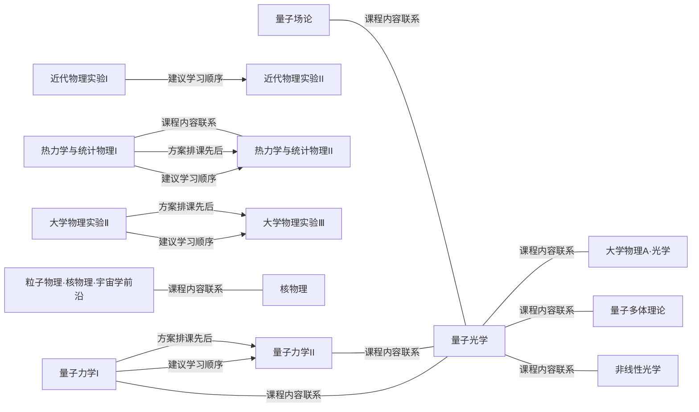

# 物理学专业“2+X”本科教学培养方案

2024 年汇编印刷页 578–581。原表记录 70 个可配对的课程代码。

[本节原页](plan-578.pdf#page=1) · [逐行数据](plan-578.json) · [院系目录](README.md)

## 课程导读

想了解物理理论与实验的课程安排，可以在原表中找到《量子力学I》（`PHYS130008`）、《经典力学》（`PHYS130003`）、《电动力学》（`PHYS130114`）。 [原书 PDF 第 592 页](plan-578.pdf#page=1) · [原书 PDF 第 593 页](plan-578.pdf#page=2)

图中连接《热力学与统计物理II》（`PHYS130035`）和《热力学与统计物理I》（`PHYS130113`），两门课都从课程题名标出的“统计物理”切入，可沿这一主题对照阅读。 [原书 PDF 第 592 页](plan-578.pdf#page=1) · [原书 PDF 第 593 页](plan-578.pdf#page=2)

## 课程关系图

图中展示最多 20 条关系。下表列出本节全部关系。建议学习顺序供规划课程使用，正式选课资格以教务规定为准。

| 课程 | 关联课程 | 关系 | 依据 |
| --- | --- | --- | --- |
| 量子力学I（PHYS130008） | 量子力学II（PHYS130036） | 建议学习顺序 | 同节课程题名标明连续分册或序号。 |
| 近代物理实验I（PHYS130058） | 近代物理实验II（PHYS130061） | 建议学习顺序 | 同节课程题名标明连续分册或序号。 |
| 热力学与统计物理I（PHYS130113） | 热力学与统计物理II（PHYS130035） | 建议学习顺序 | 同节课程题名标明连续分册或序号。 |
| 大学物理实验Ⅱ（PHYS130125） | 大学物理实验Ⅲ（PHYS130126） | 建议学习顺序 | 同节课程题名标明连续分册或序号。 |
| 量子力学I（PHYS130008） | 量子光学（PHYS130089） | 课程内容联系 | 本方案两门课程的题名均含“量子”，可据此对照这一主题。 |
| 热力学与统计物理II（PHYS130035） | 热力学与统计物理I（PHYS130113） | 课程内容联系 | 本方案两门课程的题名均含“统计物理”，可据此对照这一主题。 |
| 量子力学II（PHYS130036） | 量子光学（PHYS130089） | 课程内容联系 | 本方案两门课程的题名均含“量子”，可据此对照这一主题。 |
| 粒子物理、核物理、宇宙学前沿（PHYS130038） | 核物理（TCPH130001） | 课程内容联系 | 本方案两门课程的题名均含“核物理”，可据此对照这一主题。 |
| 量子场论（PHYS130069） | 量子光学（PHYS130089） | 课程内容联系 | 本方案两门课程的题名均含“量子”，可据此对照这一主题。 |
| 量子光学（PHYS130089） | 大学物理A：光学（PHYS130092） | 课程内容联系 | 本方案两门课程的题名均含“光学”，可据此对照这一主题。 |
| 量子光学（PHYS130089） | 量子多体理论（PHYS130123） | 课程内容联系 | 本方案两门课程的题名均含“量子”，可据此对照这一主题。 |
| 量子光学（PHYS130089） | 非线性光学（PHYS130124） | 课程内容联系 | 本方案两门课程的题名均含“光学”，可据此对照这一主题。 |
| 量子力学I（PHYS130008） | 量子力学II（PHYS130036） | 方案排课先后 | 本节原表所列全部明确学期均早于后者。 |
| 热力学与统计物理I（PHYS130113） | 热力学与统计物理II（PHYS130035） | 方案排课先后 | 本节原表所列全部明确学期均早于后者。 |
| 大学物理实验Ⅱ（PHYS130125） | 大学物理实验Ⅲ（PHYS130126） | 方案排课先后 | 本节原表所列全部明确学期均早于后者。 |

## 课程

| 课程代码 | 名称 | 开课学期原文 | 来源（PDF 页） |
| --- | --- | --- | --- |
| AIS310013 | 机器学习在物理实验中的应用 | 春，秋 | 593 |
| AIS531004 | AI物理 | 春，秋 | 593 |
| INFO120002 | 模拟电子学基础 | 春 | 593 |
| INFO130331 | 数字逻辑基础 | 秋 | 594 |
| MECH110013 | 设计与制造 | 春，秋 | 594 |
| PHYS110007 | 医学物理学 | 春，秋 | 595 |
| PHYS110018 | 科学写作 | 春，秋 | 593 |
| PHYS130003 | 经典力学 | 3 | 592 |
| PHYS130006 | 数学物理方法A | 4 | 592 |
| PHYS130008 | 量子力学I | 5 | 592 |
| PHYS130010 | 固体物理 | 6 | 593 |
| PHYS130013 | 毕业论文 | 8 | 593 |
| PHYS130016 | 现代物理讲座 | 4 | 594 |
| PHYS130017 | 半导体物理A | 6 | 593 |
| PHYS130018 | 激光物理 | 6 | 594 |
| PHYS130019 | 表面物理 | 7 | 593 |
| PHYS130020 | 低温和超导物理 | 7 | 594 |
| PHYS130021 | 粒子物理 | 春 | 594 |
| PHYS130023 | 物理CAI课件设计I | 春，秋 | 594 |
| PHYS130025 | 自学物理实验A | 3 | 594 |
| PHYS130028 | 铁磁学 | 春 | 594 |
| PHYS130035 | 热力学与统计物理II | 7 | 593 |
| PHYS130036 | 量子力学II | 6 | 593 |
| PHYS130038 | 粒子物理、核物理、宇宙学前沿 | 春，秋 | 594 |
| PHYS130046 | 广义相对论 | 春 | 594 |
| PHYS130058 | 近代物理实验I | 6 | 593 |
| PHYS130061 | 近代物理实验II | 春，秋 | 594 |
| PHYS130062 | 科研实践 | 4,5,6 | 593 |
| PHYS130067 | 量子计算与量子信息 | 7 | 594 |
| PHYS130068 | 群论 | 7 | 593 |
| PHYS130069 | 量子场论 | 8 | 593 |
| PHYS130075 | 计算物理基础 | 5 | 593 |
| PHYS130076 | 经济物理 | 春，秋 | 595 |
| PHYS130077 | 设计性研究性物理实验 | 5,6 | 594 |
| PHYS130078 | 物理生物学 | 春，秋 | 595 |
| PHYS130079 | 物理演示实验拓展 | 春，秋 | 594 |
| PHYS130080 | 高等电动力学 | 春，秋 | 593 |
| PHYS130081 | 固体电子结构 | 春，秋 | 594 |
| PHYS130088 | 医学物理实验 | 春，秋 | 595 |
| PHYS130089 | 量子光学 | 春，秋 | 594 |
| PHYS130090 | 软凝聚态物理导论 | 秋 | 595 |
| PHYS130091 | 纳米物理学 | 春，秋 | 594 |
| PHYS130092 | 大学物理A：光学 | 3 | 592 |
| PHYS130093 | 大学物理A：原子物理 | 4 | 592 |
| PHYS130096 | 医学影像物理基础 | 春，秋 | 595 |
| PHYS130098 | 计算物理模拟实验 | 春，秋 | 594 |
| PHYS130100 | 固体理论 | 春，秋 | 593 |
| PHYS130101 | 宇宙学导论 | 春，秋 | 594 |
| PHYS130104 | 天体物理学导论 | 春，秋 | 594 |
| PHYS130105 | 基础物理建模 | 春，秋 | 593 |
| PHYS130106 | 规范场理论 | 春，秋 | 594 |
| PHYS130109 | 实验物理方法和技术 | 春，秋 | 594 |
| PHYS130111 | 共形场论 | 春，秋 | 594 |
| PHYS130113 | 热力学与统计物理I | 4 | 592 |
| PHYS130114 | 电动力学 | 5 | 593 |
| PHYS130115 | 微分几何初步（物理学） | 春，秋 | 593 |
| PHYS130117 | 散射物理 | 春，秋 | 594 |
| PHYS130118 | 生物医学光子学 | 春，秋 | 594 |
| PHYS130119 | 概率论与数理统计 | 3 | 592 |
| PHYS130120 | 线性代数 | 3 | 592 |
| PHYS130121 | 计算物理A | 春，秋 | 594 |
| PHYS130122 | 电子结构理论与计算 | 春，秋 | 594 |
| PHYS130123 | 量子多体理论 | 春，秋 | 594 |
| PHYS130124 | 非线性光学 | 春 | 593 |
| PHYS130125 | 大学物理实验Ⅱ | 3 | 592 |
| PHYS130126 | 大学物理实验Ⅲ | 4 | 592 |
| PHYS130127 | 物理前沿导论 | 2 | 593 |
| TCPH130001 | 核物理 | 4 | 594 |
| TCPH130017 | 薄膜物理与技术 | 秋 | 594 |
| TCPH130021 | 真空技术 | 5 | 594 |
