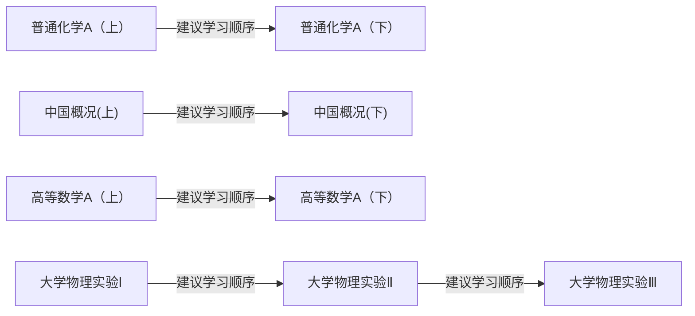

# 物理学专业“2+X”修读建议（留学生适用）

2024 年汇编印刷页 584–585。原表记录 27 个可配对的课程代码。

[本节原页](plan-578.pdf#page=7) · [逐行数据](plan-578.json) · [院系目录](README.md)

## 课程导读

想了解物理理论与实验的课程安排，可以在原表中找到《量子力学I》（`PHYS130008`）、《经典力学》（`PHYS130003`）、《电动力学》（`PHYS130114`）。 [原书 PDF 第 598 页](plan-578.pdf#page=7) · [原书 PDF 第 599 页](plan-578.pdf#page=8)

《大学物理实验Ⅰ》（`PHYS120019`）和《大学物理实验Ⅱ》（`PHYS130125`）是同一系列，图中的箭头按题名标出的分册顺序排列。 [原书 PDF 第 598 页](plan-578.pdf#page=7)

## 课程关系图

图中展示最多 20 条关系。下表列出本节全部关系。建议学习顺序供规划课程使用，正式选课资格以教务规定为准。

| 课程 | 关联课程 | 关系 | 依据 |
| --- | --- | --- | --- |
| 普通化学A（上）（CHEM120005） | 普通化学A（下）（CHEM120006） | 建议学习顺序 | 同节课程题名标明连续分册或序号。 |
| 中国概况(上)（ICES110012） | 中国概况(下)（ICES110013） | 建议学习顺序 | 同节课程题名标明连续分册或序号。 |
| 高等数学A（上）（MATH120021） | 高等数学A（下）（MATH120022） | 建议学习顺序 | 同节课程题名标明连续分册或序号。 |
| 大学物理实验Ⅰ（PHYS120019） | 大学物理实验Ⅱ（PHYS130125） | 建议学习顺序 | 同节课程题名标明连续分册或序号。 |
| 大学物理实验Ⅱ（PHYS130125） | 大学物理实验Ⅲ（PHYS130126） | 建议学习顺序 | 同节课程题名标明连续分册或序号。 |

## 课程

| 课程代码 | 名称 | 开课学期原文 | 来源（PDF 页） |
| --- | --- | --- | --- |
| BIOL120002 | 现代生物科学导论A |  | 598 |
| BIOL120005 | 现代生物科学实验 |  | 598 |
| CHEM120005 | 普通化学A（上） |  | 598 |
| CHEM120006 | 普通化学A（下） |  | 598 |
| CHEM120009 | 普通化学实验I |  | 598 |
| ICES110012 | 中国概况(上) |  | 598 |
| ICES110013 | 中国概况(下) |  | 598 |
| MATH120021 | 高等数学A（上） |  | 598 |
| MATH120022 | 高等数学A（下） |  | 598 |
| PHYS120016 | 大学物理A：力学 |  | 598 |
| PHYS120017 | 大学物理A：热学 |  | 598 |
| PHYS120018 | 大学物理A：电磁学 |  | 598 |
| PHYS120019 | 大学物理实验Ⅰ |  | 598 |
| PHYS130003 | 经典力学 |  | 598 |
| PHYS130006 | 数学物理方法A |  | 598 |
| PHYS130008 | 量子力学I |  | 599 |
| PHYS130010 | 固体物理 |  | 599 |
| PHYS130013 | 毕业论文 |  | 599 |
| PHYS130058 | 近代物理实验I |  | 599 |
| PHYS130092 | 大学物理A：光学 |  | 598 |
| PHYS130093 | 大学物理A：原子物理 |  | 598 |
| PHYS130113 | 热力学与统计物理I |  | 599 |
| PHYS130114 | 电动力学 |  | 599 |
| PHYS130119 | 概率论与数理统计 |  | 598 |
| PHYS130120 | 线性代数 |  | 598 |
| PHYS130125 | 大学物理实验Ⅱ |  | 598 |
| PHYS130126 | 大学物理实验Ⅲ |  | 599 |
