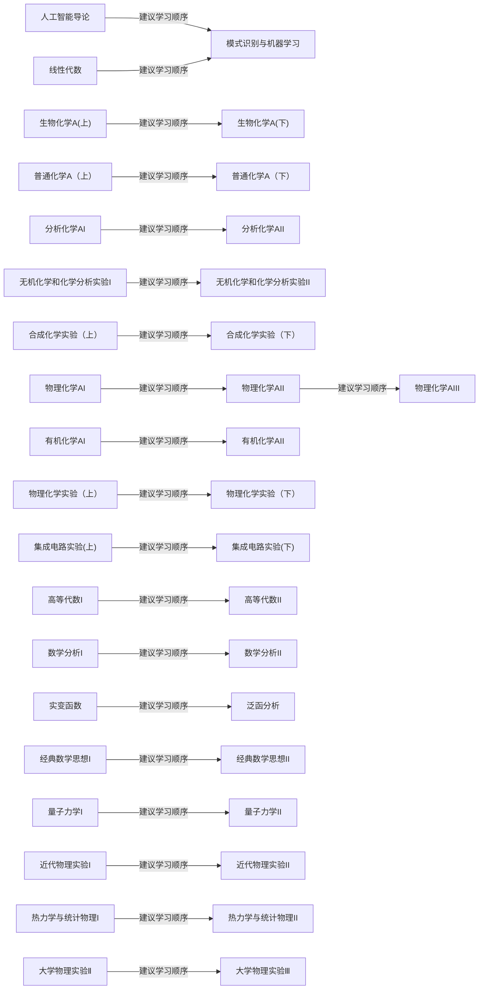

# 物理学专业教学培养方案（相辉计划适用）

2024 年汇编印刷页 751–757。原表记录 154 个可配对的课程代码。

[本节原页](plan-751.pdf#page=1) · [逐行数据](plan-751.json) · [院系目录](README.md)

## 课程导读

想了解物理理论与实验的课程安排，可以在原表中找到《量子力学I》（`PHYS130008`）、《经典力学》（`PHYS130003`）、《电动力学》（`PHYS130114`）。 [原书 PDF 第 765 页](plan-751.pdf#page=1)

《量子力学I》（`PHYS130008`）和《量子力学II》（`PHYS130036`）是同一系列，图中的箭头按题名标出的分册顺序排列。原表分别排在第 5 学期和第 6 学期。 [原书 PDF 第 765 页](plan-751.pdf#page=1) · [原书 PDF 第 766 页](plan-751.pdf#page=2)

## 课程关系图

图中展示最多 20 条关系。下表列出本节全部关系。建议学习顺序供规划课程使用，正式选课资格以教务规定为准。

| 课程 | 关联课程 | 关系 | 依据 |
| --- | --- | --- | --- |
| 人工智能导论（AIE310005） | 模式识别与机器学习（AIE410001） | 建议学习顺序 | 人工智能问题与模型类别可为学习模式识别作准备。 |
| 生物化学A(上)（BIOL130005） | 生物化学A(下)（BIOL130188） | 建议学习顺序 | 同节课程题名标明连续分册或序号。 |
| 普通化学A（上）（CHEM120005） | 普通化学A（下）（CHEM120006） | 建议学习顺序 | 同节课程题名标明连续分册或序号。 |
| 分析化学AI（CHEM130001） | 分析化学AII（CHEM130002） | 建议学习顺序 | 同节课程题名标明连续分册或序号。 |
| 无机化学和化学分析实验I（CHEM130003） | 无机化学和化学分析实验II（CHEM130004） | 建议学习顺序 | 同节课程题名标明连续分册或序号。 |
| 合成化学实验（上）（CHEM130010） | 合成化学实验（下）（CHEM130011） | 建议学习顺序 | 同节课程题名标明连续分册或序号。 |
| 物理化学AI（CHEM130012） | 物理化学AII（CHEM130013） | 建议学习顺序 | 同节课程题名标明连续分册或序号。 |
| 物理化学AII（CHEM130013） | 物理化学AIII（CHEM130014） | 建议学习顺序 | 同节课程题名标明连续分册或序号。 |
| 有机化学AI（CHEM130067） | 有机化学AII（CHEM130068） | 建议学习顺序 | 同节课程题名标明连续分册或序号。 |
| 物理化学实验（上）（CHEM130104） | 物理化学实验（下）（CHEM130105） | 建议学习顺序 | 同节课程题名标明连续分册或序号。 |
| 集成电路实验(上)（INFO130027） | 集成电路实验(下)（INFO130028） | 建议学习顺序 | 同节课程题名标明连续分册或序号。 |
| 高等代数I（MATH120011） | 高等代数II（MATH130002） | 建议学习顺序 | 同节课程题名标明连续分册或序号。 |
| 数学分析I（MATH130154） | 数学分析II（MATH130155） | 建议学习顺序 | 同节课程题名标明连续分册或序号。 |
| 实变函数（MATH130186） | 泛函分析（MATH130011） | 建议学习顺序 | 测度与积分有助于理解函数空间。 |
| 经典数学思想I（MATH130190） | 经典数学思想II（MATH130191） | 建议学习顺序 | 同节课程题名标明连续分册或序号。 |
| 量子力学I（PHYS130008） | 量子力学II（PHYS130036） | 建议学习顺序 | 同节课程题名标明连续分册或序号。 |
| 近代物理实验I（PHYS130058） | 近代物理实验II（PHYS130061） | 建议学习顺序 | 同节课程题名标明连续分册或序号。 |
| 热力学与统计物理I（PHYS130113） | 热力学与统计物理II（PHYS130035） | 建议学习顺序 | 同节课程题名标明连续分册或序号。 |
| 线性代数（PHYS130120） | 模式识别与机器学习（AIE410001） | 建议学习顺序 | 向量表示和矩阵运算支持理解分类、回归等模型。 |
| 大学物理实验Ⅱ（PHYS130125） | 大学物理实验Ⅲ（PHYS130126） | 建议学习顺序 | 同节课程题名标明连续分册或序号。 |
| 人工智能导论（AIE310005） | 人工智能安全（AIE831001） | 课程内容联系 | 本方案两门课程的题名均含“人工智能”，可据此对照这一主题。 |
| 人工智能的编程基础（AIE310006） | 人工智能安全（AIE831001） | 课程内容联系 | 本方案两门课程的题名均含“人工智能”，可据此对照这一主题。 |
| 人工智能的数学基础（AIE310009） | 模式识别与机器学习（AIE410001） | 课程内容联系 | 数学表达与学习模型的统计、优化工具可对照。 |
| 人工智能的数学基础（AIE310009） | 人工智能安全（AIE831001） | 课程内容联系 | 本方案两门课程的题名均含“人工智能”，可据此对照这一主题。 |
| 模式识别与机器学习（AIE410001） | 机器学习在物理实验中的应用（AIS310013） | 课程内容联系 | 本方案两门课程的题名均含“机器学习”，可据此对照这一主题。 |
| 人工智能安全（AIE831001） | 人工智能生物学（AIS310017） | 课程内容联系 | 本方案两门课程的题名均含“人工智能”，可据此对照这一主题。 |
| 生物化学A(上)（BIOL130005） | 生物化学实验（BIOL130007） | 课程内容联系 | 本方案两门课程的题名均含“生物化学”，可据此对照这一主题。 |
| 生物化学实验（BIOL130007） | 生物化学A(下)（BIOL130188） | 课程内容联系 | 本方案两门课程的题名均含“生物化学”，可据此对照这一主题。 |
| 细胞生物学（BIOL130008） | 细胞生物学实验（BIOL130009） | 课程内容联系 | 同节同题名的课程与实验、实习或实践。 |
| 微生物学（BIOL130010） | 微生物学实验（BIOL130011） | 课程内容联系 | 同节同题名的课程与实验、实习或实践。 |
| 遗传学（BIOL130012） | 遗传学实验（BIOL130013） | 课程内容联系 | 同节同题名的课程与实验、实习或实践。 |
| 生理学（BIOL130014） | 生理学实验（BIOL130187） | 课程内容联系 | 同节同题名的课程与实验、实习或实践。 |
| 分析化学AI（CHEM130001） | 分析化学（CHEM130071） | 课程内容联系 | 本方案两门课程的题名均含“分析化学”，可据此对照这一主题。 |
| 分析化学AII（CHEM130002） | 分析化学（CHEM130071） | 课程内容联系 | 本方案两门课程的题名均含“分析化学”，可据此对照这一主题。 |
| 无机化学和化学分析实验I（CHEM130003） | 无机化学（CHEM130016） | 课程内容联系 | 本方案两门课程的题名均含“无机化学”，可据此对照这一主题。 |
| 无机化学和化学分析实验II（CHEM130004） | 无机化学（CHEM130016） | 课程内容联系 | 本方案两门课程的题名均含“无机化学”，可据此对照这一主题。 |
| 物理化学AI（CHEM130012） | 物理化学AII（CHEM130013） | 课程内容联系 | 本方案两门课程的题名均含“物理化学”，可据此对照这一主题。 |
| 物理化学AI（CHEM130012） | 物理化学AIII（CHEM130014） | 课程内容联系 | 本方案两门课程的题名均含“物理化学”，可据此对照这一主题。 |
| 物理化学AI（CHEM130012） | 物理化学实验（上）（CHEM130104） | 课程内容联系 | 本方案两门课程的题名均含“物理化学”，可据此对照这一主题。 |
| 物理化学AI（CHEM130012） | 物理化学实验（下）（CHEM130105） | 课程内容联系 | 本方案两门课程的题名均含“物理化学”，可据此对照这一主题。 |
| 有机化学（CHEM130049） | 有机化学实验（CHEM130050） | 课程内容联系 | 同节同题名的课程与实验、实习或实践。 |
| 有机化学（CHEM130049） | 有机化学AI（CHEM130067） | 课程内容联系 | 本方案两门课程的题名均含“有机化学”，可据此对照这一主题。 |
| 有机化学（CHEM130049） | 有机化学AII（CHEM130068） | 课程内容联系 | 本方案两门课程的题名均含“有机化学”，可据此对照这一主题。 |
| 分析化学（CHEM130071） | 分析化学实验（CHEM130072） | 课程内容联系 | 同节同题名的课程与实验、实习或实践。 |
| 集成电路实验(上)（INFO130027） | 集成电路工艺原理（MICR130007） | 课程内容联系 | 本方案两门课程的题名均含“集成电路”，可据此对照这一主题。 |
| 集成电路实验(下)（INFO130028） | 集成电路工艺原理（MICR130007） | 课程内容联系 | 本方案两门课程的题名均含“集成电路”，可据此对照这一主题。 |
| 专用集成电路设计方法（INFO130094） | 集成电路工艺原理（MICR130007） | 课程内容联系 | 本方案两门课程的题名均含“集成电路”，可据此对照这一主题。 |
| 半导体物理（MICR130005） | 半导体器件原理（MICR130028） | 课程内容联系 | 本方案两门课程的题名均含“半导体”，可据此对照这一主题。 |
| 半导体物理（MICR130005） | 半导体物理A（PHYS130017） | 课程内容联系 | 本方案两门课程的题名均含“半导体”，可据此对照这一主题。 |
| 集成电路工艺原理（MICR130007） | 数字集成电路设计原理（MICR130029） | 课程内容联系 | 本方案两门课程的题名均含“集成电路”，可据此对照这一主题。 |
| 量子力学I（PHYS130008） | 量子光学（PHYS130089） | 课程内容联系 | 本方案两门课程的题名均含“量子”，可据此对照这一主题。 |
| 热力学与统计物理II（PHYS130035） | 热力学与统计物理I（PHYS130113） | 课程内容联系 | 本方案两门课程的题名均含“统计物理”，可据此对照这一主题。 |
| 量子力学II（PHYS130036） | 量子光学（PHYS130089） | 课程内容联系 | 本方案两门课程的题名均含“量子”，可据此对照这一主题。 |
| 粒子物理、核物理、宇宙学前沿（PHYS130038） | 核物理（TCPH130001） | 课程内容联系 | 本方案两门课程的题名均含“核物理”，可据此对照这一主题。 |
| 量子场论（PHYS130069） | 量子光学（PHYS130089） | 课程内容联系 | 本方案两门课程的题名均含“量子”，可据此对照这一主题。 |
| 量子光学（PHYS130089） | 大学物理A：光学（PHYS130092） | 课程内容联系 | 本方案两门课程的题名均含“光学”，可据此对照这一主题。 |
| 量子光学（PHYS130089） | 量子多体理论（PHYS130123） | 课程内容联系 | 本方案两门课程的题名均含“量子”，可据此对照这一主题。 |
| 量子光学（PHYS130089） | 非线性光学（PHYS130124） | 课程内容联系 | 本方案两门课程的题名均含“光学”，可据此对照这一主题。 |
| 生物化学A(上)（BIOL130005） | 生物化学A(下)（BIOL130188） | 方案排课先后 | 本节原表所列全部明确学期均早于后者。 |
| 普通化学A（上）（CHEM120005） | 普通化学A（下）（CHEM120006） | 方案排课先后 | 本节原表所列全部明确学期均早于后者。 |
| 分析化学AI（CHEM130001） | 分析化学AII（CHEM130002） | 方案排课先后 | 本节原表所列全部明确学期均早于后者。 |
| 合成化学实验（上）（CHEM130010） | 合成化学实验（下）（CHEM130011） | 方案排课先后 | 本节原表所列全部明确学期均早于后者。 |
| 物理化学AI（CHEM130012） | 物理化学AII（CHEM130013） | 方案排课先后 | 本节原表所列全部明确学期均早于后者。 |
| 物理化学AII（CHEM130013） | 物理化学AIII（CHEM130014） | 方案排课先后 | 本节原表所列全部明确学期均早于后者。 |
| 有机化学AI（CHEM130067） | 有机化学AII（CHEM130068） | 方案排课先后 | 本节原表所列全部明确学期均早于后者。 |
| 集成电路实验(上)（INFO130027） | 集成电路实验(下)（INFO130028） | 方案排课先后 | 本节原表所列全部明确学期均早于后者。 |
| 高等代数I（MATH120011） | 高等代数II（MATH130002） | 方案排课先后 | 本节原表所列全部明确学期均早于后者。 |
| 数学分析I（MATH130154） | 数学分析II（MATH130155） | 方案排课先后 | 本节原表所列全部明确学期均早于后者。 |
| 经典数学思想I（MATH130190） | 经典数学思想II（MATH130191） | 方案排课先后 | 本节原表所列全部明确学期均早于后者。 |
| 量子力学I（PHYS130008） | 量子力学II（PHYS130036） | 方案排课先后 | 本节原表所列全部明确学期均早于后者。 |
| 热力学与统计物理I（PHYS130113） | 热力学与统计物理II（PHYS130035） | 方案排课先后 | 本节原表所列全部明确学期均早于后者。 |
| 大学物理实验Ⅱ（PHYS130125） | 大学物理实验Ⅲ（PHYS130126） | 方案排课先后 | 本节原表所列全部明确学期均早于后者。 |

## 课程

| 课程代码 | 名称 | 开课学期原文 | 来源（PDF 页） |
| --- | --- | --- | --- |
| AIE210006 | 计算机系统基础 | 秋 | 770 |
| AIE310004 | 计算机视觉 | 秋 | 770 |
| AIE310005 | 人工智能导论 | 秋 | 770 |
| AIE310006 | 人工智能的编程基础 | 秋 | 770 |
| AIE310007 | 数据结构 | 秋 | 770 |
| AIE310008 | 人工智能的软件基础 | 秋 | 770 |
| AIE310009 | 人工智能的数学基础 | 秋 | 770 |
| AIE410001 | 模式识别与机器学习 | 秋 | 770 |
| AIE410002 | 自然语言处理和大语言模型 | 秋 | 770 |
| AIE531001 | 人工智能前沿探索实践 | 秋 | 770 |
| AIE831001 | 人工智能安全 | 秋 | 770 |
| AIS310013 | 机器学习在物理实验中的应用 | 春，秋 | 766 |
| AIS310014 | 人工智能在化学中的应用 |  | 769 |
| AIS310017 | 人工智能生物学 | 秋 | 770 |
| AIS410006 | 人工智能结构生物学 | 秋 | 770 |
| AIS410014 | AI在生物分子结构中的研究及应用 | 秋 | 770 |
| AIS531004 | AI物理 | 春，秋 | 766 |
| AIS531005 | 人工智能化学计算模拟 |  | 769 |
| AIS631003 | 数据科学中的逼近论基础 | 春，秋 | 768 |
| AIS631004 | 新型算法 | 春，秋 | 768 |
| BIOL120002 | 现代生物科学导论A | 春，秋 | 766 |
| BIOL120005 | 现代生物科学实验 | 1 | 767 |
| BIOL130005 | 生物化学A(上) | 4 | 769 |
| BIOL130007 | 生物化学实验 | 4 | 769 |
| BIOL130008 | 细胞生物学 | 4 | 769 |
| BIOL130009 | 细胞生物学实验 | 4 | 769 |
| BIOL130010 | 微生物学 | 5 | 769 |
| BIOL130011 | 微生物学实验 | 5 | 770 |
| BIOL130012 | 遗传学 | 5 | 770 |
| BIOL130013 | 遗传学实验 | 5 | 770 |
| BIOL130014 | 生理学 | 4 | 769 |
| BIOL130065 | 分子生物学 | 5 | 770 |
| BIOL130184 | 普通生物学 | 3 | 769 |
| BIOL130185 | 普通生物学实验-动物 | 3 | 769 |
| BIOL130186 | 普通生物学实验-植物 | 3 | 769 |
| BIOL130187 | 生理学实验 | 4 | 769 |
| BIOL130188 | 生物化学A(下) | 5 | 769 |
| CHEM120005 | 普通化学A（上） | 1 | 766 |
| CHEM120006 | 普通化学A（下） | 2 | 766 |
| CHEM120009 | 普通化学实验I | 1 | 766 |
| CHEM130001 | 分析化学AI | 3 | 769 |
| CHEM130002 | 分析化学AII | 4 | 769 |
| CHEM130003 | 无机化学和化学分析实验I | 3 | 769 |
| CHEM130004 | 无机化学和化学分析实验II | 3 | 769 |
| CHEM130010 | 合成化学实验（上） | 4 | 769 |
| CHEM130011 | 合成化学实验（下） | 5 | 769 |
| CHEM130012 | 物理化学AI | 3 | 769 |
| CHEM130013 | 物理化学AII | 4 | 769 |
| CHEM130014 | 物理化学AIII | 5 | 769 |
| CHEM130016 | 无机化学 | 5、6 | 769 |
| CHEM130049 | 有机化学 | 3 | 769 |
| CHEM130050 | 有机化学实验 | 3 | 769 |
| CHEM130067 | 有机化学AI | 3 | 769 |
| CHEM130068 | 有机化学AII | 4 | 769 |
| CHEM130071 | 分析化学 | 3 | 769 |
| CHEM130072 | 分析化学实验 | 3 | 769 |
| CHEM130104 | 物理化学实验（上） | 5 | 769 |
| CHEM130105 | 物理化学实验（下） | 4 | 769 |
| CHEM130107 | 仪器分析实验 | 4 | 769 |
| INFO120002 | 模拟电子学基础 | 春 | 766 |
| INFO130027 | 集成电路实验(上) | 7 | 770 |
| INFO130028 | 集成电路实验(下) | 8 | 770 |
| INFO130094 | 专用集成电路设计方法 | 6 | 770 |
| INFO130331 | 数字逻辑基础 | 秋 | 767 |
| MACR130009 | 高分子化学B | 5 | 769 |
| MATH120011 | 高等代数I | 1 | 768 |
| MATH130002 | 高等代数II | 2 | 768 |
| MATH130011 | 泛函分析 | 5 | 768 |
| MATH130154 | 数学分析I | 1 | 768 |
| MATH130155 | 数学分析II | 2 | 768 |
| MATH130182 | 解析几何 | 5 | 768 |
| MATH130183 | 常微分方程 |  | 768 |
| MATH130184 | 抽象代数 | 3 | 768 |
| MATH130185 | 复变函数 | 4 | 768 |
| MATH130186 | 实变函数 |  | 768 |
| MATH130187 | 拓扑学 | 4 | 768 |
| MATH130189 | 几何拓扑选讲 |  | 768 |
| MATH130190 | 经典数学思想I | 1 | 768 |
| MATH130191 | 经典数学思想II | 2 | 768 |
| MECH110013 | 设计与制造 | 春，秋 | 767 |
| MICR130002 | 模拟电子线路 | 3 | 770 |
| MICR130003 | 数字逻辑基础 | 3 | 770 |
| MICR130004 | 信号与系统概论 | 4 | 770 |
| MICR130005 | 半导体物理 | 4 | 770 |
| MICR130006 | 嵌入式处理器与芯片系统设计 | 4 | 770 |
| MICR130007 | 集成电路工艺原理 | 6 | 770 |
| MICR130028 | 半导体器件原理 | 5 | 770 |
| MICR130029 | 数字集成电路设计原理 | 5 | 770 |
| MICR130030 | 模拟集成电路设计原理 | 6 | 770 |
| PHYS110007 | 医学物理学 | 春，秋 | 768 |
| PHYS110018 | 科学写作 | 春，秋 | 766 |
| PHYS130003 | 经典力学 | 3 | 765 |
| PHYS130006 | 数学物理方法A | 4 | 765 |
| PHYS130008 | 量子力学I | 5 | 765 |
| PHYS130010 | 固体物理 | 6 | 766 |
| PHYS130013 | 毕业论文 | 8 | 766 |
| PHYS130016 | 现代物理讲座 | 4 | 767 |
| PHYS130017 | 半导体物理A | 6 | 766 |
| PHYS130018 | 激光物理 | 6 | 768 |
| PHYS130019 | 表面物理 | 7 | 766 |
| PHYS130020 | 低温和超导物理 | 7 | 767 |
| PHYS130021 | 粒子物理 | 春 | 767 |
| PHYS130023 | 物理CAI课件设计I | 春，秋 | 767 |
| PHYS130025 | 自学物理实验A | 3 | 767 |
| PHYS130028 | 铁磁学 | 春 | 767 |
| PHYS130035 | 热力学与统计物理II | 7 | 766 |
| PHYS130036 | 量子力学II | 6 | 766 |
| PHYS130038 | 粒子物理、核物理、宇宙学前沿 | 春，秋 | 767 |
| PHYS130046 | 广义相对论 | 春 | 767 |
| PHYS130058 | 近代物理实验I | 6 | 766 |
| PHYS130061 | 近代物理实验II | 春，秋 | 767 |
| PHYS130062 | 科研实践 | 5 | 766 |
| PHYS130067 | 量子计算与量子信息 | 7 | 767 |
| PHYS130068 | 群论 | 7 | 766 |
| PHYS130069 | 量子场论 | 8 | 766 |
| PHYS130075 | 计算物理基础 | 5 | 766 |
| PHYS130076 | 经济物理 | 春，秋 | 768 |
| PHYS130077 | 设计性研究性物理实验 | 5,6 | 767 |
| PHYS130078 | 物理生物学 | 春，秋 | 768 |
| PHYS130079 | 物理演示实验拓展 | 春，秋 | 767 |
| PHYS130080 | 高等电动力学 | 春，秋 | 766 |
| PHYS130081 | 固体电子结构 | 春，秋 | 767 |
| PHYS130088 | 医学物理实验 | 春，秋 | 768 |
| PHYS130089 | 量子光学 | 春，秋 | 768 |
| PHYS130090 | 软凝聚态物理导论 | 秋 | 768 |
| PHYS130091 | 纳米物理学 | 春，秋 | 767 |
| PHYS130092 | 大学物理A：光学 | 3 | 765 |
| PHYS130093 | 大学物理A：原子物理 | 4 | 765 |
| PHYS130096 | 医学影像物理基础 | 春，秋 | 768 |
| PHYS130098 | 计算物理模拟实验 | 春，秋 | 767 |
| PHYS130100 | 固体理论 | 春，秋 | 766 |
| PHYS130101 | 宇宙学导论 | 春，秋 | 767 |
| PHYS130104 | 天体物理学导论 | 春，秋 | 767 |
| PHYS130105 | 基础物理建模 | 春，秋 | 766 |
| PHYS130106 | 规范场理论 | 春，秋 | 767 |
| PHYS130109 | 实验物理方法和技术 | 春，秋 | 767 |
| PHYS130111 | 共形场论 | 春，秋 | 767 |
| PHYS130113 | 热力学与统计物理I | 4 | 765 |
| PHYS130114 | 电动力学 | 5 | 765 |
| PHYS130115 | 微分几何初步（物理学） | 春，秋 | 766 |
| PHYS130117 | 散射物理 | 春，秋 | 767 |
| PHYS130118 | 生物医学光子学 | 春，秋 | 768 |
| PHYS130119 | 概率论与数理统计 | 3 | 765 |
| PHYS130120 | 线性代数 | 1 | 765 |
| PHYS130121 | 计算物理A | 春，秋 | 767 |
| PHYS130122 | 电子结构理论与计算 | 春，秋 | 767 |
| PHYS130123 | 量子多体理论 | 春，秋 | 767 |
| PHYS130124 | 非线性光学 | 春 | 766 |
| PHYS130125 | 大学物理实验Ⅱ | 3 | 765 |
| PHYS130126 | 大学物理实验Ⅲ | 4 | 765 |
| PHYS130127 | 物理前沿导论 | 2 | 766 |
| TCPH130001 | 核物理 | 4 | 767 |
| TCPH130017 | 薄膜物理与技术 | 秋 | 767 |
| TCPH130021 | 真空技术 | 5 | 767 |
