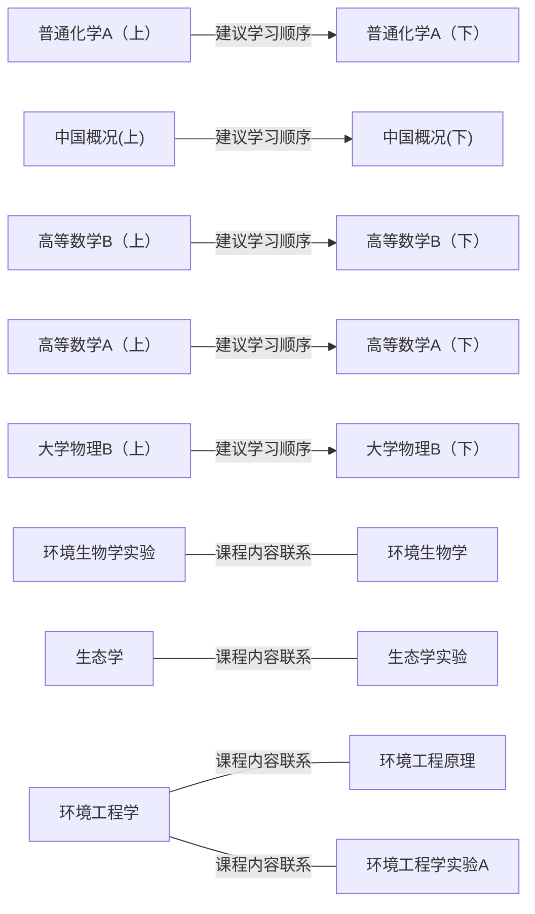

# 环境科学专业“2+X”修读建议（留学生适用）

2024 年汇编印刷页 673–674。原表记录 31 个可配对的课程代码。

[本节原页](plan-666.pdf#page=8) · [逐行数据](plan-666.json) · [院系目录](README.md)

## 课程导读

想了解环境科学的课程安排，可以在原表中找到《环境分析化学》（`ENVI130065`）、《生态学》（`ENVI130003`）、《环境工程原理》（`ENVI130091`）。 [原书 PDF 第 687 页](plan-666.pdf#page=8)

图中把《生态学》（`ENVI130003`）和《生态学实验》（`ENVI130004`）列作内容联系。同节同题名的课程与实验、实习或实践。 [原书 PDF 第 687 页](plan-666.pdf#page=8)

## 课程关系图

图中展示最多 20 条关系。下表列出本节全部关系。建议学习顺序供规划课程使用，正式选课资格以教务规定为准。

| 课程 | 关联课程 | 关系 | 依据 |
| --- | --- | --- | --- |
| 普通化学A（上）（CHEM120005） | 普通化学A（下）（CHEM120006） | 建议学习顺序 | 同节课程题名标明连续分册或序号。 |
| 中国概况(上)（ICES110012） | 中国概况(下)（ICES110013） | 建议学习顺序 | 同节课程题名标明连续分册或序号。 |
| 高等数学B（上）（MATH120003） | 高等数学B（下）（MATH120004） | 建议学习顺序 | 同节课程题名标明连续分册或序号。 |
| 高等数学A（上）（MATH120021） | 高等数学A（下）（MATH120022） | 建议学习顺序 | 同节课程题名标明连续分册或序号。 |
| 大学物理B（上）（PHYS120013） | 大学物理B（下）（PHYS120014） | 建议学习顺序 | 同节课程题名标明连续分册或序号。 |
| 环境生物学实验（BIOL130062） | 环境生物学（ENVI130005） | 课程内容联系 | 同节同题名的课程与实验、实习或实践。 |
| 生态学（ENVI130003） | 生态学实验（ENVI130004） | 课程内容联系 | 同节同题名的课程与实验、实习或实践。 |
| 环境工程学（ENVI130008） | 环境工程原理（ENVI130091） | 课程内容联系 | 本方案两门课程的题名均含“环境工程”，可据此对照这一主题。 |
| 环境工程学（ENVI130008） | 环境工程学实验A（ENVI130105） | 课程内容联系 | 本方案两门课程的题名均含“环境工程”，可据此对照这一主题。 |

## 课程

| 课程代码 | 名称 | 开课学期原文 | 来源（PDF 页） |
| --- | --- | --- | --- |
| BIOL120002 | 现代生物科学导论A |  | 687 |
| BIOL120005 | 现代生物科学实验 |  | 687 |
| BIOL130062 | 环境生物学实验 |  | 687 |
| CHEM120005 | 普通化学A（上） |  | 687 |
| CHEM120006 | 普通化学A（下） |  | 687 |
| CHEM120009 | 普通化学实验I |  | 687 |
| ENVI130003 | 生态学 |  | 687 |
| ENVI130004 | 生态学实验 |  | 687 |
| ENVI130005 | 环境生物学 |  | 687 |
| ENVI130006 | 环境监测A |  | 687 |
| ENVI130008 | 环境工程学 |  | 687 |
| ENVI130011 | 环境化学A |  | 687 |
| ENVI130016 | 生产实习 |  | 688 |
| ENVI130017 | 毕业论文 |  | 688 |
| ENVI130030 | 环境地学基础 |  | 688 |
| ENVI130042 | 环境经济学 |  | 687 |
| ENVI130065 | 环境分析化学 |  | 687 |
| ENVI130067 | 环境管理 |  | 687 |
| ENVI130069 | 野外实习 |  | 688 |
| ENVI130091 | 环境工程原理 |  | 687 |
| ENVI130092 | 环境监测实验 |  | 687 |
| ENVI130105 | 环境工程学实验A |  | 688 |
| ICES110012 | 中国概况(上) |  | 687 |
| ICES110013 | 中国概况(下) |  | 687 |
| MATH120003 | 高等数学B（上） |  | 687 |
| MATH120004 | 高等数学B（下） |  | 687 |
| MATH120021 | 高等数学A（上） |  | 687 |
| MATH120022 | 高等数学A（下） |  | 687 |
| PHYS120013 | 大学物理B（上） |  | 687 |
| PHYS120014 | 大学物理B（下） |  | 687 |
| PHYS120015 | 基础物理实验 |  | 687 |
