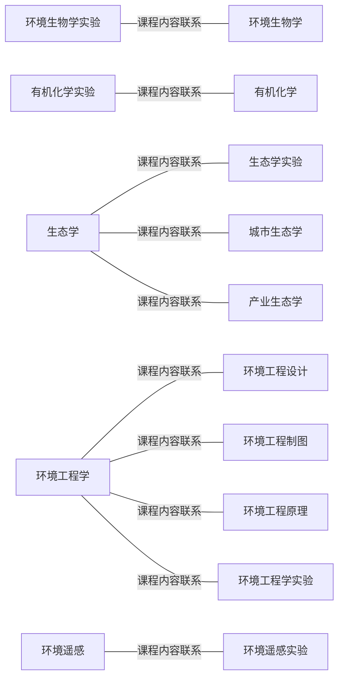

# 环境科学（环境管理方向）专业“2+X”教学培养方案

2024 年汇编印刷页 683–686。原表记录 59 个可配对的课程代码。

[本节原页](plan-683.pdf#page=1) · [逐行数据](plan-683.json) · [院系目录](README.md)

## 课程导读

想了解环境管理与评价的课程安排，可以在原表中找到《环境管理》（`ENVI130067`）、《环境经济学》（`ENVI130042`）、《环境规划原理》（`ENVI130073`）。 [原书 PDF 第 697 页](plan-683.pdf#page=1) · [原书 PDF 第 698 页](plan-683.pdf#page=2)

图中把《环境生物学实验》（`BIOL130062`）和《环境生物学》（`ENVI130005`）列作内容联系。同节同题名的课程与实验、实习或实践。 [原书 PDF 第 697 页](plan-683.pdf#page=1)

## 课程关系图

图中展示最多 20 条关系。下表列出本节全部关系。建议学习顺序供规划课程使用，正式选课资格以教务规定为准。

| 课程 | 关联课程 | 关系 | 依据 |
| --- | --- | --- | --- |
| 环境生物学实验（BIOL130062） | 环境生物学（ENVI130005） | 课程内容联系 | 同节同题名的课程与实验、实习或实践。 |
| 有机化学实验（CHEM130050） | 有机化学（ENVI130112） | 课程内容联系 | 同节同题名的课程与实验、实习或实践。 |
| 生态学（ENVI130003） | 生态学实验（ENVI130004） | 课程内容联系 | 同节同题名的课程与实验、实习或实践。 |
| 生态学（ENVI130003） | 城市生态学（ENVI130049） | 课程内容联系 | 本方案两门课程的题名均含“生态学”，可据此对照这一主题。 |
| 生态学（ENVI130003） | 产业生态学（ENVI130100） | 课程内容联系 | 本方案两门课程的题名均含“生态学”，可据此对照这一主题。 |
| 环境工程学（ENVI130008） | 环境工程设计（ENVI130080） | 课程内容联系 | 本方案两门课程的题名均含“环境工程”，可据此对照这一主题。 |
| 环境工程学（ENVI130008） | 环境工程制图（ENVI130081） | 课程内容联系 | 本方案两门课程的题名均含“环境工程”，可据此对照这一主题。 |
| 环境工程学（ENVI130008） | 环境工程原理（ENVI130091） | 课程内容联系 | 本方案两门课程的题名均含“环境工程”，可据此对照这一主题。 |
| 环境工程学（ENVI130008） | 环境工程学实验（ENVI130105） | 课程内容联系 | 同节同题名的课程与实验、实习或实践。 |
| 环境遥感（ENVI130058） | 环境遥感实验（ENVI130085） | 课程内容联系 | 同节同题名的课程与实验、实习或实践。 |

## 课程

| 课程代码 | 名称 | 开课学期原文 | 来源（PDF 页） |
| --- | --- | --- | --- |
| BIOL130062 | 环境生物学实验 | 4 | 697 |
| CHEM130050 | 有机化学实验 | 5 | 699 |
| ENVI130003 | 生态学 | 3 | 697 |
| ENVI130004 | 生态学实验 | 4 | 697 |
| ENVI130005 | 环境生物学 | 3 | 697 |
| ENVI130006 | 环境监测A | 4 | 697 |
| ENVI130008 | 环境工程学 | 5 | 698 |
| ENVI130011 | 环境化学A | 5 | 697 |
| ENVI130013 | 环境信息系统 | 6 | 698 |
| ENVI130016 | 生产实习 | 暑期 | 698 |
| ENVI130017 | 毕业论文 | 8 | 698 |
| ENVI130030 | 环境地学基础 | 5 | 698 |
| ENVI130031 | 专业文献查阅 | 7 | 699 |
| ENVI130038 | 环境物理化学 | 4 | 699 |
| ENVI130040 | 环境与贸易 | 5 | 698 |
| ENVI130041 | 环境设备基础 | 6 | 699 |
| ENVI130042 | 环境经济学 | 4 | 697 |
| ENVI130044 | 全球环境变化 | 7 | 698 |
| ENVI130046 | 生物地球化学 | 6 | 699 |
| ENVI130047 | 城市规划原理 | 5 | 698 |
| ENVI130049 | 城市生态学 | 7 | 698 |
| ENVI130051 | 自然资源经济学 | 5 | 698 |
| ENVI130052 | 田野调查方法 | 5 | 698 |
| ENVI130056 | 环境法 | 5 | 698 |
| ENVI130057 | 环境核算与审计 | 7 | 698 |
| ENVI130058 | 环境遥感 | 6 | 698, 699 |
| ENVI130060 | 生态工程 | 7 | 699 |
| ENVI130063 | 环境水文学基础 | 7 | 699 |
| ENVI130065 | 环境分析化学 | 3 | 697 |
| ENVI130066 | 环境信息技术实验 | 6 | 698 |
| ENVI130067 | 环境管理 | 3 | 697 |
| ENVI130069 | 野外实习 | 5 | 698 |
| ENVI130071 | 仪器分析 | 5 | 699 |
| ENVI130073 | 环境规划原理 | 7 | 698 |
| ENVI130075 | 环境评价 | 7 | 698 |
| ENVI130076 | 环境毒理学原理 | 7 | 699 |
| ENVI130078 | 环境流体力学 | 4 | 699 |
| ENVI130080 | 环境工程设计 | 7 | 699 |
| ENVI130081 | 环境工程制图 | 6 | 699 |
| ENVI130082 | 环境纳米技术 | 7 | 699 |
| ENVI130085 | 环境遥感实验 | 6 | 699 |
| ENVI130086 | 环境科学与工程虚拟仿真实验 | 5 | 698 |
| ENVI130087 | 环境物理学导论 | 5 | 699 |
| ENVI130091 | 环境工程原理 | 3 | 697 |
| ENVI130092 | 环境监测实验 | 4 | 697 |
| ENVI130094 | 大气化学 | 6 | 699 |
| ENVI130096 | 水环境化学 | 6 | 699 |
| ENVI130097 | 污染控制化学 | 6 | 699 |
| ENVI130098 | 固体废物处理与资源化 | 5 | 699 |
| ENVI130100 | 产业生态学 | 5 | 698 |
| ENVI130101 | 空气污染气象学 | 3 | 699 |
| ENVI130102 | 环境政策与时事评述 | 7 | 698 |
| ENVI130103 | 大气气溶胶与全球环境效应 | 6 | 699 |
| ENVI130104 | 土壤环境化学 | 6 | 699 |
| ENVI130105 | 环境工程学实验 | 6 | 698 |
| ENVI130109 | 城市气候导论 | 6 | 699 |
| ENVI130110 | 碳中和技术概论 | 6 | 699 |
| ENVI130112 | 有机化学 | 5 | 699 |
| SOCI130184 | 社会统计与软件应用Ⅰ | 3 | 698 |
