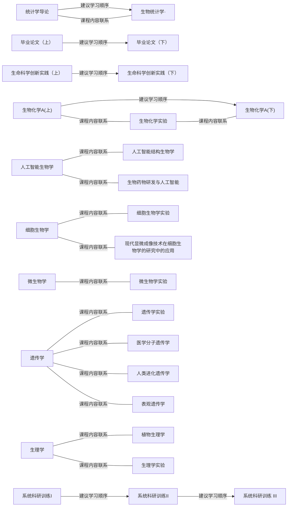

# 生物科学专业“2+X”教学培养方案

2024 年汇编印刷页 619–623。原表记录 84 个可配对的课程代码。

[本节原页](plan-619.pdf#page=1) · [逐行数据](plan-619.json) · [院系目录](README.md)

## 课程关系图

图中展示最多 20 条关系。下表列出本节全部关系。建议学习顺序供规划课程使用，正式选课资格以教务规定为准。

| 课程 | 关联课程 | 关系 | 依据 |
| --- | --- | --- | --- |
| 生物化学A(上)（BIOL130005） | 生物化学A(下)（BIOL130188） | 建议学习顺序 | 同节课程题名标明连续分册或序号。 |
| 统计学导论（BIOL130113） | 生物统计学*（BIOL130024） | 建议学习顺序 | “统计学导论”题名标明基础层次，前置阅读可帮助了解“生物统计学*”中的统计学主题。 |
| 毕业论文（上）（BIOL130138） | 毕业论文（下）（BIOL130139） | 建议学习顺序 | 同节课程题名标明连续分册或序号。 |
| 生命科学创新实践（上）（BIOL130157） | 生命科学创新实践（下）（BIOL130158） | 建议学习顺序 | 同节课程题名标明连续分册或序号。 |
| 系统科研训练I（BIOL130196） | 系统科研训练II（BIOL130197） | 建议学习顺序 | 同节课程题名标明连续分册或序号。 |
| 系统科研训练II（BIOL130197） | 系统科研训练 III（BIOL130198） | 建议学习顺序 | 同节课程题名标明连续分册或序号。 |
| 人工智能生物学（AIS310017） | 人工智能结构生物学（AIS410006） | 课程内容联系 | 本方案两门课程的题名均含“人工智能”，可据此对照这一主题。 |
| 人工智能生物学（AIS310017） | 生物药物研发与人工智能（AIT631015） | 课程内容联系 | 本方案两门课程的题名均含“人工智能”，可据此对照这一主题。 |
| 生物化学A(上)（BIOL130005） | 生物化学实验（BIOL130007） | 课程内容联系 | 本方案两门课程的题名均含“生物化学”，可据此对照这一主题。 |
| 生物化学实验（BIOL130007） | 生物化学A(下)（BIOL130188） | 课程内容联系 | 本方案两门课程的题名均含“生物化学”，可据此对照这一主题。 |
| 细胞生物学（BIOL130008） | 细胞生物学实验（BIOL130009） | 课程内容联系 | 同节同题名的课程与实验、实习或实践。 |
| 细胞生物学（BIOL130008） | 现代显微成像技术在细胞生物学的研究中的应用（BIOL130154） | 课程内容联系 | 本方案两门课程的题名均含“细胞生物学”，可据此对照这一主题。 |
| 微生物学（BIOL130010） | 微生物学实验（BIOL130011） | 课程内容联系 | 同节同题名的课程与实验、实习或实践。 |
| 遗传学（BIOL130012） | 遗传学实验（BIOL130013） | 课程内容联系 | 同节同题名的课程与实验、实习或实践。 |
| 遗传学（BIOL130012） | 医学分子遗传学（BIOL130029） | 课程内容联系 | 本方案两门课程的题名均含“遗传学”，可据此对照这一主题。 |
| 遗传学（BIOL130012） | 人类进化遗传学（BIOL130073） | 课程内容联系 | 本方案两门课程的题名均含“遗传学”，可据此对照这一主题。 |
| 遗传学（BIOL130012） | 表观遗传学（BIOL130080） | 课程内容联系 | 本方案两门课程的题名均含“遗传学”，可据此对照这一主题。 |
| 生理学（BIOL130014） | 植物生理学（BIOL130087） | 课程内容联系 | 本方案两门课程的题名均含“生理学”，可据此对照这一主题。 |
| 生理学（BIOL130014） | 生理学实验（BIOL130187） | 课程内容联系 | 同节同题名的课程与实验、实习或实践。 |
| 生物统计学*（BIOL130024） | 统计学导论（BIOL130113） | 课程内容联系 | 本方案两门课程的题名均含“统计学”，可据此对照这一主题。 |
| 生物信息学*（BIOL130046） | 生物信息学实验（BIOL130195） | 课程内容联系 | 本方案两门课程的题名均含“生物信息学”，可据此对照这一主题。 |
| 种群生态学（BIOL130123） | 群落生态学（BIOL130124） | 课程内容联系 | 本方案两门课程的题名均含“生态学”，可据此对照这一主题。 |
| 种群生态学（BIOL130123） | 生态系统生态学（BIOL130128） | 课程内容联系 | 本方案两门课程的题名均含“生态学”，可据此对照这一主题。 |
| 种群生态学（BIOL130123） | 微生物分子生态学（BIOL130176） | 课程内容联系 | 本方案两门课程的题名均含“生态学”，可据此对照这一主题。 |
| 有机化学（CHEM130049） | 有机化学实验（CHEM130050） | 课程内容联系 | 同节同题名的课程与实验、实习或实践。 |
| 分析化学（CHEM130071） | 分析化学实验（CHEM130072） | 课程内容联系 | 同节同题名的课程与实验、实习或实践。 |
| 生物化学A(上)（BIOL130005） | 生物化学A(下)（BIOL130188） | 方案排课先后 | 本节原表所列全部明确学期均早于后者。 |
| 毕业论文（上）（BIOL130138） | 毕业论文（下）（BIOL130139） | 方案排课先后 | 本节原表所列全部明确学期均早于后者。 |

## 课程

| 课程代码 | 名称 | 开课学期原文 | 来源（PDF 页） |
| --- | --- | --- | --- |
| AIS310017 | 人工智能生物学 | 秋 | 635 |
| AIS410006 | 人工智能结构生物学 | 秋 | 635 |
| AIT531022 | 组学数据分析和AI应用 | 秋 | 636 |
| AIT631015 | 生物药物研发与人工智能 | 春 | 635 |
| BIOL130005 | 生物化学A(上) | 4 | 633 |
| BIOL130007 | 生物化学实验 | 4 | 633 |
| BIOL130008 | 细胞生物学 | 4 | 634 |
| BIOL130009 | 细胞生物学实验 | 4 | 634 |
| BIOL130010 | 微生物学 | 5 | 634 |
| BIOL130011 | 微生物学实验 | 5 | 634 |
| BIOL130012 | 遗传学 | 5 | 634 |
| BIOL130013 | 遗传学实验 | 5 | 634 |
| BIOL130014 | 生理学 | 4 | 634 |
| BIOL130016 | 高级生化技术 | 暑期 | 636 |
| BIOL130017 | 基因工程实验 | 秋 | 636 |
| BIOL130024 | 生物统计学* | 秋 | 634 |
| BIOL130026 | 免疫学* | 秋 | 634 |
| BIOL130029 | 医学分子遗传学 | 秋 | 636 |
| BIOL130031 | 病毒学 | 秋 | 636 |
| BIOL130033 | 蛋白质与蛋白质工程 | 春 | 635 |
| BIOL130035 | 核酸的化学与生物学 | 春 | 635 |
| BIOL130037 | 基因组学* | 秋 | 634 |
| BIOL130038 | 生物物理学 | 秋 | 635 |
| BIOL130039 | 神经生物学概论 | 秋 | 634 |
| BIOL130046 | 生物信息学* | 春，秋 | 634 |
| BIOL130047 | 生物学野外实习 | 暑期 | 635 |
| BIOL130051 | 科学研究方法与论文写作* | 春 | 634 |
| BIOL130055 | 蛋白质组学 | 春 | 635 |
| BIOL130057 | 遗传分析原理 | 秋 | 635 |
| BIOL130065 | 分子生物学 | 5 | 634 |
| BIOL130067 | 生命科学科研伦理和规范* | 春，秋 | 634 |
| BIOL130073 | 人类进化遗传学 | 春 | 636 |
| BIOL130074 | 进化生物学* | 春 | 634 |
| BIOL130080 | 表观遗传学 | 秋 | 635 |
| BIOL130081 | 物种起源导论 | 秋 | 635 |
| BIOL130083 | 生命科学交叉前沿专题 | 春 | 635 |
| BIOL130087 | 植物生理学 | 秋 | 635 |
| BIOL130091 | 精神卫生学概论 | 春 | 636 |
| BIOL130093 | 生物热力学 | 春 | 636 |
| BIOL130110 | 艺术、科学研究与创新思维 | 春 | 635 |
| BIOL130111 | 植物细胞与发育生物学 | 秋 | 634 |
| BIOL130113 | 统计学导论 | 秋 | 636 |
| BIOL130115 | 微阵列芯片和高通量测序数据分析与应用 | 秋 | 636 |
| BIOL130116 | 线性统计分析 | 春 | 636 |
| BIOL130122 | 生物多样性科学导论 | 秋 | 635 |
| BIOL130123 | 种群生态学 | 4 | 636 |
| BIOL130124 | 群落生态学 | 4 | 636 |
| BIOL130128 | 生态系统生态学 | 5 | 636 |
| BIOL130138 | 毕业论文（上） | 7 | 634 |
| BIOL130139 | 毕业论文（下） | 8 | 634 |
| BIOL130148 | 发育与代谢 | 秋 | 635 |
| BIOL130154 | 现代显微成像技术在细胞生物学的研究中的应用 | 暑 | 635 |
| BIOL130157 | 生命科学创新实践（上） | 暑 | 635 |
| BIOL130158 | 生命科学创新实践（下） | 秋 | 635 |
| BIOL130167 | 定量生物物理学前沿导论 | 秋 | 635 |
| BIOL130168 | 发育生物学* | 秋 | 634 |
| BIOL130169 | 干细胞与细胞命运决定 | 春 | 634 |
| BIOL130170 | 细胞器生物学 | 秋 | 635 |
| BIOL130171 | 癌生物学 | 春 | 635 |
| BIOL130172 | 结构生物学 | 春 | 635 |
| BIOL130174 | R语言与统计计算 | 春 | 636 |
| BIOL130175 | 微生物分子遗传与代谢 | 秋 | 636 |
| BIOL130176 | 微生物分子生态学 | 春 | 636 |
| BIOL130177 | 病原生物学基础 | 春 | 635 |
| BIOL130178 | 遗传操作原理与应用 | 秋 | 636 |
| BIOL130179 | 基因检测技术 | 秋 | 636 |
| BIOL130180 | 人类表型组学 | 秋 | 636 |
| BIOL130182 | 脑认知与信息处理 | 秋 | 635 |
| BIOL130184 | 普通生物学 | 3 | 633 |
| BIOL130187 | 生理学实验 | 4 | 634 |
| BIOL130188 | 生物化学A(下) | 5 | 633 |
| BIOL130190 | RNA生物学 | 春 | 636 |
| BIOL130191 | 功能解剖学和组织学 | 秋 | 634 |
| BIOL130193 | 代谢生物学 | 秋 | 634 |
| BIOL130194 | 大数据与精准医学 | 秋 | 636 |
| BIOL130195 | 生物信息学实验 | 秋 | 635 |
| BIOL130196 | 系统科研训练I | 4 | 635 |
| BIOL130197 | 系统科研训练II | 暑期 | 636 |
| BIOL130198 | 系统科研训练 III | 5 | 636 |
| BIOL130199 | 普通生物学专业实验 | 3 | 633 |
| CHEM130049 | 有机化学 | 3 | 633 |
| CHEM130050 | 有机化学实验 | 3 | 633 |
| CHEM130071 | 分析化学 | 3 | 633 |
| CHEM130072 | 分析化学实验 | 3 | 633 |
