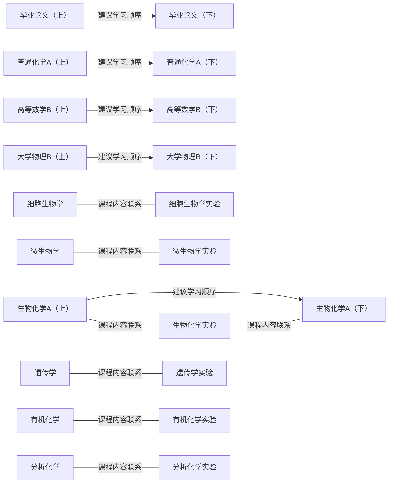

# 生物技术专业“2+X”修读建议

2024 年汇编印刷页 642–643。原表记录 36 个可配对的课程代码。

[本节原页](plan-637.pdf#page=6) · [逐行数据](plan-637.json) · [院系目录](README.md)

## 课程导读

想了解生物学与实验技术的课程安排，可以在原表中找到《细胞生物学》（`BIOL130008`）、《遗传学》（`BIOL130012`）、《细胞生物学实验》（`BIOL130009`）。 [原书 PDF 第 656 页](plan-637.pdf#page=6) · [原书 PDF 第 657 页](plan-637.pdf#page=7)

图中把《细胞生物学》（`BIOL130008`）和《细胞生物学实验》（`BIOL130009`）列作内容联系。同节同题名的课程与实验、实习或实践。 [原书 PDF 第 656 页](plan-637.pdf#page=6) · [原书 PDF 第 657 页](plan-637.pdf#page=7)

## 课程关系图

图中展示最多 20 条关系。下表列出本节全部关系。建议学习顺序供规划课程使用，正式选课资格以教务规定为准。

| 课程 | 关联课程 | 关系 | 依据 |
| --- | --- | --- | --- |
| 生物化学A（上）（BIOL130005） | 生物化学A（下）（BIOL130188） | 建议学习顺序 | 同节课程题名标明连续分册或序号。 |
| 毕业论文（上）（BIOL130138） | 毕业论文（下）（BIOL130139） | 建议学习顺序 | 同节课程题名标明连续分册或序号。 |
| 普通化学A（上）（CHEM120005） | 普通化学A（下）（CHEM120006） | 建议学习顺序 | 同节课程题名标明连续分册或序号。 |
| 高等数学B（上）（MATH120003） | 高等数学B（下）（MATH120004） | 建议学习顺序 | 同节课程题名标明连续分册或序号。 |
| 大学物理B（上）（PHYS120013） | 大学物理B（下）（PHYS120014） | 建议学习顺序 | 同节课程题名标明连续分册或序号。 |
| 生物化学A（上）（BIOL130005） | 生物化学实验（BIOL130007） | 课程内容联系 | 本方案两门课程的题名均含“生物化学”，可据此对照这一主题。 |
| 生物化学实验（BIOL130007） | 生物化学A（下）（BIOL130188） | 课程内容联系 | 本方案两门课程的题名均含“生物化学”，可据此对照这一主题。 |
| 细胞生物学（BIOL130008） | 细胞生物学实验（BIOL130009） | 课程内容联系 | 同节同题名的课程与实验、实习或实践。 |
| 微生物学（BIOL130010） | 微生物学实验（BIOL130011） | 课程内容联系 | 同节同题名的课程与实验、实习或实践。 |
| 遗传学（BIOL130012） | 遗传学实验（BIOL130013） | 课程内容联系 | 同节同题名的课程与实验、实习或实践。 |
| 有机化学（CHEM130049） | 有机化学实验（CHEM130050） | 课程内容联系 | 同节同题名的课程与实验、实习或实践。 |
| 分析化学（CHEM130071） | 分析化学实验（CHEM130072） | 课程内容联系 | 同节同题名的课程与实验、实习或实践。 |

## 课程

| 课程代码 | 名称 | 开课学期原文 | 来源（PDF 页） |
| --- | --- | --- | --- |
| BIOL120002 | 现代生物科学导论A |  | 656 |
| BIOL120005 | 现代生物科学实验 |  | 656 |
| BIOL130005 | 生物化学A（上） |  | 656 |
| BIOL130007 | 生物化学实验 |  | 656 |
| BIOL130008 | 细胞生物学 |  | 656 |
| BIOL130009 | 细胞生物学实验 |  | 657 |
| BIOL130010 | 微生物学 |  | 657 |
| BIOL130011 | 微生物学实验 |  | 657 |
| BIOL130012 | 遗传学 |  | 657 |
| BIOL130013 | 遗传学实验 |  | 657 |
| BIOL130019 | 现代生物学基础实验 |  | 656 |
| BIOL130103 | 物理化学 |  | 657 |
| BIOL130119 | 实习实训 |  | 657 |
| BIOL130138 | 毕业论文（上） |  | 657 |
| BIOL130139 | 毕业论文（下） |  | 657 |
| BIOL130188 | 生物化学A（下） |  | 656 |
| CHEM120005 | 普通化学A（上） |  | 656 |
| CHEM120006 | 普通化学A（下） |  | 656 |
| CHEM120009 | 普通化学实验I |  | 656 |
| CHEM130049 | 有机化学 |  | 656 |
| CHEM130050 | 有机化学实验 |  | 656 |
| CHEM130071 | 分析化学 |  | 656 |
| CHEM130072 | 分析化学实验 |  | 656 |
| MATH120003 | 高等数学B（上） |  | 656 |
| MATH120004 | 高等数学B（下） |  | 656 |
| PHAR130112 | 医学基础 |  | 657 |
| PHAR130113 | 药理学概论 |  | 657 |
| PHAR130115 | 药剂学概论 |  | 657 |
| PHYS120013 | 大学物理B（上） |  | 656 |
| PHYS120014 | 大学物理B（下） |  | 656 |
| PHYS120015 | 基础物理实验 |  | 656 |
| PTSS110082 | 毛泽东思想和中国特色社会主义理论体系概论 |  | 656 |
| PTSS110087 | 马克思主义基本原理 |  | 656 |
| PTSS110088 | 中国近现代史纲要 |  | 656 |
| PTSS110089 | 思想道德与法治 |  | 656 |
| PTSS110090 | 习近平新时代中国特色社会主义思想概论 |  | 656 |
