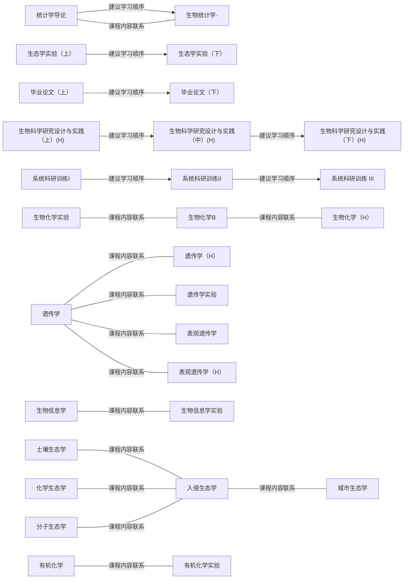

# 生态学专业培养方案（强基班适用）

2024 年汇编印刷页 650–653。原表记录 71 个可配对的课程代码。

[本节原页](plan-650.pdf#page=1) · [逐行数据](plan-650.json) · [院系目录](README.md)

## 课程关系图

图中展示最多 20 条关系。下表列出本节全部关系。建议学习顺序供规划课程使用，正式选课资格以教务规定为准。

| 课程 | 关联课程 | 关系 | 依据 |
| --- | --- | --- | --- |
| 统计学导论（BIOL130113） | 生物统计学*（BIOL130024） | 建议学习顺序 | “统计学导论”题名标明基础层次，前置阅读可帮助了解“生物统计学*”中的统计学主题。 |
| 生态学实验（上）（BIOL130126） | 生态学实验（下）（BIOL130127） | 建议学习顺序 | 同节课程题名标明连续分册或序号。 |
| 毕业论文（上）（BIOL130138） | 毕业论文（下）（BIOL130139） | 建议学习顺序 | 同节课程题名标明连续分册或序号。 |
| 生物科学研究设计与实践（上）(H)（BIOL130159h） | 生物科学研究设计与实践（中）(H)（BIOL130160h） | 建议学习顺序 | 同节课程题名标明连续分册或序号。 |
| 生物科学研究设计与实践（中）(H)（BIOL130160h） | 生物科学研究设计与实践（下）(H)（BIOL130161h） | 建议学习顺序 | 同节课程题名标明连续分册或序号。 |
| 系统科研训练I（BIOL130196） | 系统科研训练II（BIOL130197） | 建议学习顺序 | 同节课程题名标明连续分册或序号。 |
| 系统科研训练II（BIOL130197） | 系统科研训练 III（BIOL130198） | 建议学习顺序 | 同节课程题名标明连续分册或序号。 |
| 生物化学实验（BIOL130007） | 生物化学B（BIOL130063） | 课程内容联系 | 本方案两门课程的题名均含“生物化学”，可据此对照这一主题。 |
| 遗传学（BIOL130012） | 遗传学（H）（BIOL130012h） | 课程内容联系 | 本方案两门课程的题名均含“遗传学”，可据此对照这一主题。 |
| 遗传学（BIOL130012） | 遗传学实验（BIOL130013） | 课程内容联系 | 同节同题名的课程与实验、实习或实践。 |
| 遗传学（BIOL130012） | 表观遗传学（BIOL130080） | 课程内容联系 | 本方案两门课程的题名均含“遗传学”，可据此对照这一主题。 |
| 遗传学（BIOL130012） | 表观遗传学（H）（BIOL130080h） | 课程内容联系 | 本方案两门课程的题名均含“遗传学”，可据此对照这一主题。 |
| 生物统计学*（BIOL130024） | 统计学导论（BIOL130113） | 课程内容联系 | 本方案两门课程的题名均含“统计学”，可据此对照这一主题。 |
| 生物信息学（BIOL130046） | 生物信息学实验（BIOL130195） | 课程内容联系 | 同节同题名的课程与实验、实习或实践。 |
| 生物化学B（BIOL130063） | 生物化学（H）（BIOL130162h） | 课程内容联系 | 本方案两门课程的题名均含“生物化学”，可据此对照这一主题。 |
| 土壤生态学（BIOL130131） | 入侵生态学（BIOL130137） | 课程内容联系 | 本方案两门课程的题名均含“生态学”，可据此对照这一主题。 |
| 化学生态学（BIOL130132） | 入侵生态学（BIOL130137） | 课程内容联系 | 本方案两门课程的题名均含“生态学”，可据此对照这一主题。 |
| 分子生态学（BIOL130134） | 入侵生态学（BIOL130137） | 课程内容联系 | 本方案两门课程的题名均含“生态学”，可据此对照这一主题。 |
| 入侵生态学（BIOL130137） | 城市生态学（ENVI130049） | 课程内容联系 | 本方案两门课程的题名均含“生态学”，可据此对照这一主题。 |
| 有机化学（CHEM130049） | 有机化学实验（CHEM130050） | 课程内容联系 | 同节同题名的课程与实验、实习或实践。 |
| 生态学实验（上）（BIOL130126） | 生态学实验（下）（BIOL130127） | 方案排课先后 | 本节原表所列全部明确学期均早于后者。 |
| 毕业论文（上）（BIOL130138） | 毕业论文（下）（BIOL130139） | 方案排课先后 | 本节原表所列全部明确学期均早于后者。 |
| 生物科学研究设计与实践（上）(H)（BIOL130159h） | 生物科学研究设计与实践（中）(H)（BIOL130160h） | 方案排课先后 | 本节原表所列全部明确学期均早于后者。 |
| 生物科学研究设计与实践（中）(H)（BIOL130160h） | 生物科学研究设计与实践（下）(H)（BIOL130161h） | 方案排课先后 | 本节原表所列全部明确学期均早于后者。 |

## 课程

| 课程代码 | 名称 | 开课学期原文 | 来源（PDF 页） |
| --- | --- | --- | --- |
| AIS310017 | 人工智能生物学 | 秋 | 665 |
| AIT531022 | 组学数据分析和AI应用 | 秋 | 667 |
| BIOL130002 | 植物学实验 | 4 | 665 |
| BIOL130004 | 动物学实验 | 3 | 665 |
| BIOL130007 | 生物化学实验 | 4 | 665 |
| BIOL130010 | 微生物学 | 5 | 665 |
| BIOL130012 | 遗传学 | 5 | 665 |
| BIOL130012h | 遗传学（H） | 5 | 665 |
| BIOL130013 | 遗传学实验 | 5 | 665 |
| BIOL130024 | 生物统计学* | 春,秋 | 665 |
| BIOL130037 | 基因组学 | 秋 | 666 |
| BIOL130046 | 生物信息学 | 春 | 666 |
| BIOL130047 | 生物学野外实习 | 暑期 | 665 |
| BIOL130051 | 科学研究方法与论文写作* | 春 | 665 |
| BIOL130057 | 遗传分析原理 | 秋 | 666 |
| BIOL130057h | 遗传分析（H） | 秋 | 666 |
| BIOL130059 | 行为生态学 | 秋 | 666 |
| BIOL130063 | 生物化学B | 4 | 665 |
| BIOL130067 | 生命科学科研伦理和规范 | 春,秋 | 666 |
| BIOL130069 | 生物地理学 | 秋 | 666 |
| BIOL130074 | 进化生物学 | 春 | 666 |
| BIOL130080 | 表观遗传学 | 春 | 667 |
| BIOL130080h | 表观遗传学（H） | 秋 | 667 |
| BIOL130081 | 物种起源导论 | 春 | 666 |
| BIOL130087 | 植物生理学 | 秋 | 666 |
| BIOL130092 | 全球变化生物学 | 秋 | 666 |
| BIOL130096 | 生物安全导论 | 春 | 666 |
| BIOL130097 | 水环境多样性与环境评价 | 暑期 | 666 |
| BIOL130110 | 艺术、科学研究与创新思维 | 春 | 667 |
| BIOL130111 | 植物细胞与发育生物学 | 春 | 667 |
| BIOL130113 | 统计学导论 | 秋 | 667 |
| BIOL130116 | 线性统计分析 | 春 | 667 |
| BIOL130118 | 植物多样性与进化 | 秋 | 666 |
| BIOL130120 | 动物生物学 | 3 | 665 |
| BIOL130121 | 植物生物学 | 4 | 665 |
| BIOL130122h | 生物多样性科学导论（H） | 3 | 665 |
| BIOL130123 | 种群生态学 | 4 | 665 |
| BIOL130124 | 群落生态学 | 4 | 665 |
| BIOL130125 | 自然地理学 | 秋 | 666 |
| BIOL130126 | 生态学实验（上） | 5 | 665 |
| BIOL130127 | 生态学实验（下） | 6 | 665 |
| BIOL130128 | 生态系统生态学 | 5 | 665 |
| BIOL130130 | 景观生态学 | 春 | 666 |
| BIOL130131 | 土壤生态学 | 秋 | 666 |
| BIOL130132 | 化学生态学 | 秋 | 666 |
| BIOL130133 | 湿地生态学 | 秋 | 666 |
| BIOL130134 | 分子生态学 | 秋 | 666 |
| BIOL130135 | 保护生物学 | 秋 | 666 |
| BIOL130136 | 生态与社会 | 春 | 666 |
| BIOL130137 | 入侵生态学 | 秋 | 666 |
| BIOL130138 | 毕业论文（上） | 7 | 665 |
| BIOL130139 | 毕业论文（下） | 8 | 665 |
| BIOL130153 | 生态学野外实习 | 暑期 | 665 |
| BIOL130155 | 水环境多样性与环境评价II | 暑期 | 666 |
| BIOL130159h | 生物科学研究设计与实践（上）(H) | 3 | 666 |
| BIOL130160h | 生物科学研究设计与实践（中）(H) | 5 | 666 |
| BIOL130161h | 生物科学研究设计与实践（下）(H) | 7 | 667 |
| BIOL130162h | 生物化学（H） | 4 | 665 |
| BIOL130174 | R语言与统计计算 | 春 | 667 |
| BIOL130176 | 微生物分子生态学 | 春 | 667 |
| BIOL130189 | 生态遥感 | 春 | 666 |
| BIOL130195 | 生物信息学实验 | 秋 | 667 |
| BIOL130196 | 系统科研训练I | 4 | 666 |
| BIOL130197 | 系统科研训练II | 暑期 | 667 |
| BIOL130198 | 系统科研训练 III | 5 | 667 |
| CHEM130049 | 有机化学 | 3 | 665 |
| CHEM130050 | 有机化学实验 | 3 | 665 |
| ENVI130049 | 城市生态学 | 秋 | 667 |
| ENVI130060 | 生态工程 | 秋 | 667 |
| ENVI130077 | 生态经济学 | 春 | 667 |
| LAWS130026 | 自然资源和环境保护法 | 春 | 667 |
