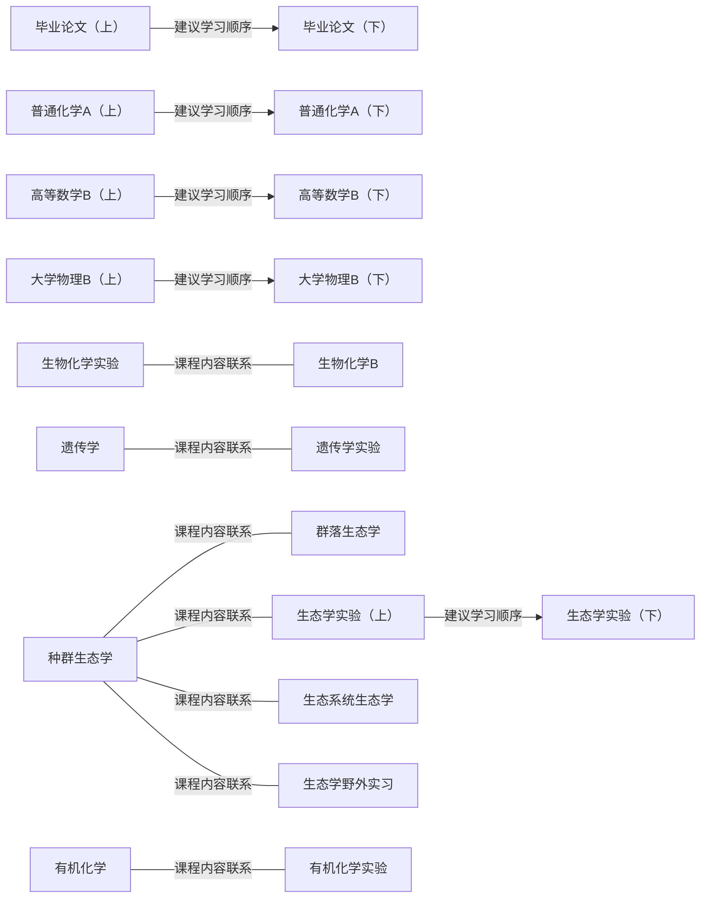

# 生态学专业“2+X”修读建议

2024 年汇编印刷页 654–655。原表记录 36 个可配对的课程代码。

[本节原页](plan-650.pdf#page=5) · [逐行数据](plan-650.json) · [院系目录](README.md)

## 课程导读

想了解生态与环境的课程安排，可以在原表中找到《种群生态学》（`BIOL130123`）、《植物生物学》（`BIOL130121`）、《群落生态学》（`BIOL130124`）。 [原书 PDF 第 668 页](plan-650.pdf#page=5) · [原书 PDF 第 669 页](plan-650.pdf#page=6)

图中连接《种群生态学》（`BIOL130123`）和《群落生态学》（`BIOL130124`），两门课都从课程题名标出的“生态学”切入，可沿这一主题对照阅读。 [原书 PDF 第 669 页](plan-650.pdf#page=6)

## 课程关系图

图中展示最多 20 条关系。下表列出本节全部关系。建议学习顺序供规划课程使用，正式选课资格以教务规定为准。

| 课程 | 关联课程 | 关系 | 依据 |
| --- | --- | --- | --- |
| 生态学实验（上）（BIOL130126） | 生态学实验（下）（BIOL130127） | 建议学习顺序 | 同节课程题名标明连续分册或序号。 |
| 毕业论文（上）（BIOL130138） | 毕业论文（下）（BIOL130139） | 建议学习顺序 | 同节课程题名标明连续分册或序号。 |
| 普通化学A（上）（CHEM120005） | 普通化学A（下）（CHEM120006） | 建议学习顺序 | 同节课程题名标明连续分册或序号。 |
| 高等数学B（上）（MATH120003） | 高等数学B（下）（MATH120004） | 建议学习顺序 | 同节课程题名标明连续分册或序号。 |
| 大学物理B（上）（PHYS120013） | 大学物理B（下）（PHYS120014） | 建议学习顺序 | 同节课程题名标明连续分册或序号。 |
| 生物化学实验（BIOL130007） | 生物化学B（BIOL130063） | 课程内容联系 | 本方案两门课程的题名均含“生物化学”，可据此对照这一主题。 |
| 遗传学（BIOL130012） | 遗传学实验（BIOL130013） | 课程内容联系 | 同节同题名的课程与实验、实习或实践。 |
| 种群生态学（BIOL130123） | 群落生态学（BIOL130124） | 课程内容联系 | 本方案两门课程的题名均含“生态学”，可据此对照这一主题。 |
| 种群生态学（BIOL130123） | 生态学实验（上）（BIOL130126） | 课程内容联系 | 本方案两门课程的题名均含“生态学”，可据此对照这一主题。 |
| 种群生态学（BIOL130123） | 生态系统生态学（BIOL130128） | 课程内容联系 | 本方案两门课程的题名均含“生态学”，可据此对照这一主题。 |
| 种群生态学（BIOL130123） | 生态学野外实习（BIOL130153） | 课程内容联系 | 本方案两门课程的题名均含“生态学”，可据此对照这一主题。 |
| 有机化学（CHEM130049） | 有机化学实验（CHEM130050） | 课程内容联系 | 同节同题名的课程与实验、实习或实践。 |

## 课程

| 课程代码 | 名称 | 开课学期原文 | 来源（PDF 页） |
| --- | --- | --- | --- |
| BIOL120002 | 现代生物科学导论A |  | 668 |
| BIOL120005 | 现代生物科学实验 |  | 668 |
| BIOL130002 | 植物学实验 |  | 668 |
| BIOL130004 | 动物学实验 |  | 668 |
| BIOL130007 | 生物化学实验 |  | 668 |
| BIOL130010 | 微生物学 |  | 669 |
| BIOL130012 | 遗传学 |  | 669 |
| BIOL130013 | 遗传学实验 |  | 669 |
| BIOL130047 | 生物学野外实习 |  | 669 |
| BIOL130063 | 生物化学B |  | 668 |
| BIOL130120 | 动物生物学 |  | 668 |
| BIOL130121 | 植物生物学 |  | 668 |
| BIOL130122 | 生物多样性科学导论 |  | 669 |
| BIOL130123 | 种群生态学 |  | 669 |
| BIOL130124 | 群落生态学 |  | 669 |
| BIOL130126 | 生态学实验（上） |  | 669 |
| BIOL130127 | 生态学实验（下） |  | 669 |
| BIOL130128 | 生态系统生态学 |  | 669 |
| BIOL130138 | 毕业论文（上） |  | 669 |
| BIOL130139 | 毕业论文（下） |  | 669 |
| BIOL130153 | 生态学野外实习 |  | 669 |
| CHEM120005 | 普通化学A（上） |  | 668 |
| CHEM120006 | 普通化学A（下） |  | 668 |
| CHEM120009 | 普通化学实验I |  | 668 |
| CHEM130049 | 有机化学 |  | 668 |
| CHEM130050 | 有机化学实验 |  | 668 |
| MATH120003 | 高等数学B（上） |  | 668 |
| MATH120004 | 高等数学B（下） |  | 668 |
| PHYS120013 | 大学物理B（上） |  | 668 |
| PHYS120014 | 大学物理B（下） |  | 668 |
| PHYS120015 | 基础物理实验 |  | 668 |
| PTSS110082 | 毛泽东思想和中国特色社会主义理论体系概论 |  | 668 |
| PTSS110087 | 马克思主义基本原理 |  | 668 |
| PTSS110088 | 中国近现代史纲要 |  | 668 |
| PTSS110089 | 思想道德与法治 |  | 668 |
| PTSS110090 | 习近平新时代中国特色社会主义思想概论 |  | 668 |
