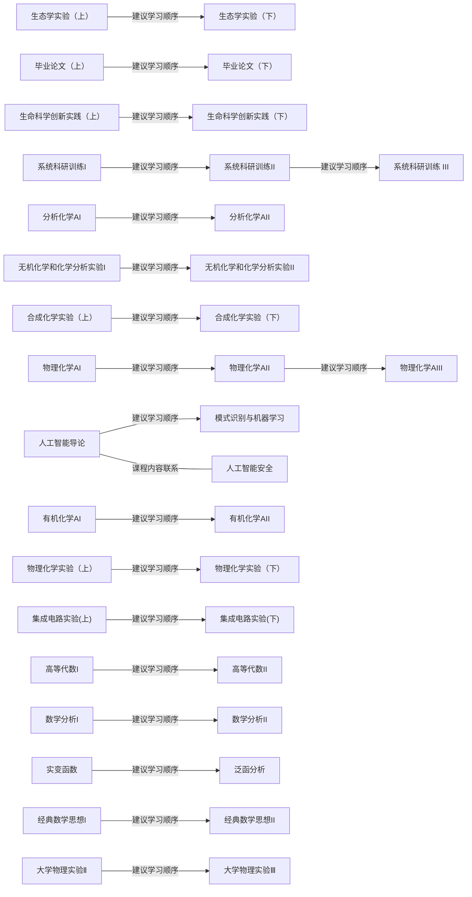

# 生态学专业教学培养方案（相辉计划适用）

2024 年汇编印刷页 788–794。原表记录 150 个可配对的课程代码。

[本节原页](plan-788.pdf#page=1) · [逐行数据](plan-788.json) · [院系目录](README.md)

## 课程导读

想了解生态与环境的课程安排，可以在原表中找到《种群生态学》（`BIOL130123`）、《植物生物学》（`BIOL130121`）、《群落生态学》（`BIOL130124`）。 [原书 PDF 第 802 页](plan-788.pdf#page=1)

《生态学实验（上）》（`BIOL130126`）和《生态学实验（下）》（`BIOL130127`）是同一系列，图中的箭头按题名标出的分册顺序排列。原表分别排在第 5 学期和第 6 学期。 [原书 PDF 第 803 页](plan-788.pdf#page=2)

## 课程关系图

图中展示最多 20 条关系。下表列出本节全部关系。建议学习顺序供规划课程使用，正式选课资格以教务规定为准。

| 课程 | 关联课程 | 关系 | 依据 |
| --- | --- | --- | --- |
| 人工智能导论（AIE310005） | 模式识别与机器学习（AIE410001） | 建议学习顺序 | 人工智能问题与模型类别可为学习模式识别作准备。 |
| 生态学实验（上）（BIOL130126） | 生态学实验（下）（BIOL130127） | 建议学习顺序 | 同节课程题名标明连续分册或序号。 |
| 毕业论文（上）（BIOL130138） | 毕业论文（下）（BIOL130139） | 建议学习顺序 | 同节课程题名标明连续分册或序号。 |
| 生命科学创新实践（上）（BIOL130157） | 生命科学创新实践（下）（BIOL130158） | 建议学习顺序 | 同节课程题名标明连续分册或序号。 |
| 系统科研训练I（BIOL130196） | 系统科研训练II（BIOL130197） | 建议学习顺序 | 同节课程题名标明连续分册或序号。 |
| 系统科研训练II（BIOL130197） | 系统科研训练 III（BIOL130198） | 建议学习顺序 | 同节课程题名标明连续分册或序号。 |
| 分析化学AI（CHEM130001） | 分析化学AII（CHEM130002） | 建议学习顺序 | 同节课程题名标明连续分册或序号。 |
| 无机化学和化学分析实验I（CHEM130003） | 无机化学和化学分析实验II（CHEM130004） | 建议学习顺序 | 同节课程题名标明连续分册或序号。 |
| 合成化学实验（上）（CHEM130010） | 合成化学实验（下）（CHEM130011） | 建议学习顺序 | 同节课程题名标明连续分册或序号。 |
| 物理化学AI（CHEM130012） | 物理化学AII（CHEM130013） | 建议学习顺序 | 同节课程题名标明连续分册或序号。 |
| 物理化学AII（CHEM130013） | 物理化学AIII（CHEM130014） | 建议学习顺序 | 同节课程题名标明连续分册或序号。 |
| 有机化学AI（CHEM130067） | 有机化学AII（CHEM130068） | 建议学习顺序 | 同节课程题名标明连续分册或序号。 |
| 物理化学实验（上）（CHEM130104） | 物理化学实验（下）（CHEM130105） | 建议学习顺序 | 同节课程题名标明连续分册或序号。 |
| 集成电路实验(上)（INFO130027） | 集成电路实验(下)（INFO130028） | 建议学习顺序 | 同节课程题名标明连续分册或序号。 |
| 高等代数I（MATH120011） | 高等代数II（MATH130002） | 建议学习顺序 | 同节课程题名标明连续分册或序号。 |
| 数学分析I（MATH130154） | 数学分析II（MATH130155） | 建议学习顺序 | 同节课程题名标明连续分册或序号。 |
| 实变函数（MATH130186） | 泛函分析（MATH130011） | 建议学习顺序 | 测度与积分有助于理解函数空间。 |
| 经典数学思想I（MATH130190） | 经典数学思想II（MATH130191） | 建议学习顺序 | 同节课程题名标明连续分册或序号。 |
| 大学物理实验Ⅱ（PHYS130125） | 大学物理实验Ⅲ（PHYS130126） | 建议学习顺序 | 同节课程题名标明连续分册或序号。 |
| 人工智能导论（AIE310005） | 人工智能安全（AIE831001） | 课程内容联系 | 本方案两门课程的题名均含“人工智能”，可据此对照这一主题。 |
| 人工智能的编程基础（AIE310006） | 人工智能安全（AIE831001） | 课程内容联系 | 本方案两门课程的题名均含“人工智能”，可据此对照这一主题。 |
| 人工智能的数学基础（AIE310009） | 模式识别与机器学习（AIE410001） | 课程内容联系 | 数学表达与学习模型的统计、优化工具可对照。 |
| 人工智能的数学基础（AIE310009） | 人工智能安全（AIE831001） | 课程内容联系 | 本方案两门课程的题名均含“人工智能”，可据此对照这一主题。 |
| 模式识别与机器学习（AIE410001） | 机器学习在物理实验中的应用（AIS310013） | 课程内容联系 | 本方案两门课程的题名均含“机器学习”，可据此对照这一主题。 |
| 人工智能安全（AIE831001） | 人工智能生物学（AIS310017） | 课程内容联系 | 本方案两门课程的题名均含“人工智能”，可据此对照这一主题。 |
| 人工智能在分析化学中的应用（AIT310024） | 分析化学AI（CHEM130001） | 课程内容联系 | 本方案两门课程的题名均含“分析化学”，可据此对照这一主题。 |
| 生物化学实验（BIOL130007） | 生物化学B（BIOL130063） | 课程内容联系 | 本方案两门课程的题名均含“生物化学”，可据此对照这一主题。 |
| 遗传学（BIOL130012） | 遗传学实验（BIOL130013） | 课程内容联系 | 同节同题名的课程与实验、实习或实践。 |
| 遗传学（BIOL130012） | 表观遗传学（BIOL130080） | 课程内容联系 | 本方案两门课程的题名均含“遗传学”，可据此对照这一主题。 |
| 生物信息学（BIOL130046） | 生物信息学实验（BIOL130195） | 课程内容联系 | 同节同题名的课程与实验、实习或实践。 |
| 景观生态学（BIOL130130） | 入侵生态学（BIOL130137） | 课程内容联系 | 本方案两门课程的题名均含“生态学”，可据此对照这一主题。 |
| 土壤生态学（BIOL130131） | 入侵生态学（BIOL130137） | 课程内容联系 | 本方案两门课程的题名均含“生态学”，可据此对照这一主题。 |
| 化学生态学（BIOL130132） | 入侵生态学（BIOL130137） | 课程内容联系 | 本方案两门课程的题名均含“生态学”，可据此对照这一主题。 |
| 分子生态学（BIOL130134） | 入侵生态学（BIOL130137） | 课程内容联系 | 本方案两门课程的题名均含“生态学”，可据此对照这一主题。 |
| 分析化学AI（CHEM130001） | 分析化学AII（CHEM130002） | 课程内容联系 | 本方案两门课程的题名均含“分析化学”，可据此对照这一主题。 |
| 无机化学和化学分析实验I（CHEM130003） | 无机化学（CHEM130016） | 课程内容联系 | 本方案两门课程的题名均含“无机化学”，可据此对照这一主题。 |
| 无机化学和化学分析实验II（CHEM130004） | 无机化学（CHEM130016） | 课程内容联系 | 本方案两门课程的题名均含“无机化学”，可据此对照这一主题。 |
| 物理化学AI（CHEM130012） | 物理化学AII（CHEM130013） | 课程内容联系 | 本方案两门课程的题名均含“物理化学”，可据此对照这一主题。 |
| 物理化学AI（CHEM130012） | 物理化学AIII（CHEM130014） | 课程内容联系 | 本方案两门课程的题名均含“物理化学”，可据此对照这一主题。 |
| 物理化学AI（CHEM130012） | 物理化学实验（上）（CHEM130104） | 课程内容联系 | 本方案两门课程的题名均含“物理化学”，可据此对照这一主题。 |
| 物理化学AI（CHEM130012） | 物理化学实验（下）（CHEM130105） | 课程内容联系 | 本方案两门课程的题名均含“物理化学”，可据此对照这一主题。 |
| 有机化学（CHEM130049） | 有机化学实验（CHEM130050） | 课程内容联系 | 同节同题名的课程与实验、实习或实践。 |
| 有机化学（CHEM130049） | 有机化学AI（CHEM130067） | 课程内容联系 | 本方案两门课程的题名均含“有机化学”，可据此对照这一主题。 |
| 有机化学（CHEM130049） | 有机化学AII（CHEM130068） | 课程内容联系 | 本方案两门课程的题名均含“有机化学”，可据此对照这一主题。 |
| 集成电路实验(上)（INFO130027） | 集成电路工艺原理（MICR130007） | 课程内容联系 | 本方案两门课程的题名均含“集成电路”，可据此对照这一主题。 |
| 集成电路实验(下)（INFO130028） | 集成电路工艺原理（MICR130007） | 课程内容联系 | 本方案两门课程的题名均含“集成电路”，可据此对照这一主题。 |
| 专用集成电路设计方法（INFO130094） | 集成电路工艺原理（MICR130007） | 课程内容联系 | 本方案两门课程的题名均含“集成电路”，可据此对照这一主题。 |
| 半导体物理（MICR130005） | 半导体器件原理（MICR130028） | 课程内容联系 | 本方案两门课程的题名均含“半导体”，可据此对照这一主题。 |
| 集成电路工艺原理（MICR130007） | 数字集成电路设计原理（MICR130029） | 课程内容联系 | 本方案两门课程的题名均含“集成电路”，可据此对照这一主题。 |
| 生态学实验（上）（BIOL130126） | 生态学实验（下）（BIOL130127） | 方案排课先后 | 本节原表所列全部明确学期均早于后者。 |
| 毕业论文（上）（BIOL130138） | 毕业论文（下）（BIOL130139） | 方案排课先后 | 本节原表所列全部明确学期均早于后者。 |
| 分析化学AI（CHEM130001） | 分析化学AII（CHEM130002） | 方案排课先后 | 本节原表所列全部明确学期均早于后者。 |
| 合成化学实验（上）（CHEM130010） | 合成化学实验（下）（CHEM130011） | 方案排课先后 | 本节原表所列全部明确学期均早于后者。 |
| 物理化学AI（CHEM130012） | 物理化学AII（CHEM130013） | 方案排课先后 | 本节原表所列全部明确学期均早于后者。 |
| 物理化学AII（CHEM130013） | 物理化学AIII（CHEM130014） | 方案排课先后 | 本节原表所列全部明确学期均早于后者。 |
| 有机化学AI（CHEM130067） | 有机化学AII（CHEM130068） | 方案排课先后 | 本节原表所列全部明确学期均早于后者。 |
| 物理化学实验（上）（CHEM130104） | 物理化学实验（下）（CHEM130105） | 方案排课先后 | 本节原表所列全部明确学期均早于后者。 |
| 集成电路实验(上)（INFO130027） | 集成电路实验(下)（INFO130028） | 方案排课先后 | 本节原表所列全部明确学期均早于后者。 |
| 高等代数I（MATH120011） | 高等代数II（MATH130002） | 方案排课先后 | 本节原表所列全部明确学期均早于后者。 |
| 数学分析I（MATH130154） | 数学分析II（MATH130155） | 方案排课先后 | 本节原表所列全部明确学期均早于后者。 |
| 实变函数（MATH130186） | 泛函分析（MATH130011） | 方案排课先后 | 本节原表所列全部明确学期均早于后者。 |
| 经典数学思想I（MATH130190） | 经典数学思想II（MATH130191） | 方案排课先后 | 本节原表所列全部明确学期均早于后者。 |
| 大学物理实验Ⅱ（PHYS130125） | 大学物理实验Ⅲ（PHYS130126） | 方案排课先后 | 本节原表所列全部明确学期均早于后者。 |

## 课程

| 课程代码 | 名称 | 开课学期原文 | 来源（PDF 页） |
| --- | --- | --- | --- |
| AIE210006 | 计算机系统基础 | 秋 | 807 |
| AIE310004 | 计算机视觉 | 秋 | 807 |
| AIE310005 | 人工智能导论 | 秋 | 807 |
| AIE310006 | 人工智能的编程基础 | 秋 | 807 |
| AIE310007 | 数据结构 | 秋 | 807 |
| AIE310008 | 人工智能的软件基础 | 秋 | 807 |
| AIE310009 | 人工智能的数学基础 | 秋 | 807 |
| AIE410001 | 模式识别与机器学习 | 秋 | 807 |
| AIE410002 | 自然语言处理与大语言模型 | 秋 | 807 |
| AIE531001 | 人工智能前沿探索实践 | 秋 | 807 |
| AIE831001 | 人工智能安全 | 秋 | 807 |
| AIS310013 | 机器学习在物理实验中的应用 | 春 | 806 |
| AIS310014 | 人工智能在化学中的应用 | 秋 | 807 |
| AIS310017 | 人工智能生物学 | 秋 | 805 |
| AIS410006 | 人工智能结构生物学 | 秋 | 805 |
| AIS531004 | AI物理 | 春 | 806 |
| AIS531005 | 人工智能化学计算模拟 | 春 | 807 |
| AIS631003 | 数据科学中的逼近论基础 | 秋 | 806 |
| AIS631004 | 新型算法 | 秋 | 806 |
| AIT310024 | 人工智能在分析化学中的应用 | 秋 | 807 |
| AIT531022 | 组学数据分析和AI应用 | 秋 | 805 |
| AIT631015 | 生物药物研发与人工智能 | 春 | 805 |
| BIOL130007 | 生物化学实验 | 4 | 802 |
| BIOL130010 | 微生物学 | 5 | 803 |
| BIOL130012 | 遗传学 | 5 | 803 |
| BIOL130013 | 遗传学实验 | 5 | 803 |
| BIOL130016 | 高级生化技术 | 暑期 | 804 |
| BIOL130017 | 基因工程实验 | 秋 | 804 |
| BIOL130024 | 生物统计学 | 秋 | 803 |
| BIOL130026 | 免疫学 | 秋 | 803 |
| BIOL130031 | 病毒学 | 秋 | 803 |
| BIOL130033 | 蛋白质与蛋白质工程 | 春 | 803 |
| BIOL130035 | 核酸的化学与生物学 | 春 | 803 |
| BIOL130037 | 基因组学 | 秋 | 803 |
| BIOL130039 | 神经生物学概论 | 秋 | 803 |
| BIOL130046 | 生物信息学 | 春 | 803 |
| BIOL130047 | 生物学野外实习 | 暑期 | 803, 804 |
| BIOL130051 | 科学研究方法与论文写作 | 春 | 805 |
| BIOL130057 | 遗传分析原理 | 秋 | 803 |
| BIOL130059 | 行为生态学 | 秋 | 804 |
| BIOL130063 | 生物化学B | 4 | 802 |
| BIOL130065 | 分子生物学 | 秋 | 804 |
| BIOL130067 | 生命科学科研伦理和规范 | 春，秋 | 805 |
| BIOL130069 | 生物地理学 | 秋 | 804 |
| BIOL130074 | 进化生物学 | 春 | 804 |
| BIOL130080 | 表观遗传学 | 秋 | 804 |
| BIOL130083 | 生命科学交叉前沿专题 | 2 | 803 |
| BIOL130087 | 植物生理学 | 秋 | 803 |
| BIOL130092 | 全球变化生物学 | 秋 | 804 |
| BIOL130096 | 生物安全导论 | 春 | 804 |
| BIOL130102 | 工业酶与生物催化 | 秋 | 803 |
| BIOL130111 | 植物细胞与发育生物学 | 秋 | 803 |
| BIOL130118 | 植物多样性与进化 | 秋 | 804 |
| BIOL130120 | 动物生物学 | 3 | 802 |
| BIOL130121 | 植物生物学 | 3 | 802 |
| BIOL130122 | 生物多样性科学导论 | 3、秋 | 802, 804 |
| BIOL130123 | 种群生态学 | 4 | 802 |
| BIOL130124 | 群落生态学 | 4 | 802 |
| BIOL130125 | 自然地理学 | 秋 | 804 |
| BIOL130126 | 生态学实验（上） | 5 | 803 |
| BIOL130127 | 生态学实验（下） | 6 | 803 |
| BIOL130128 | 生态系统生态学 | 5 | 803 |
| BIOL130130 | 景观生态学 | 春 | 804 |
| BIOL130131 | 土壤生态学 | 秋 | 804 |
| BIOL130132 | 化学生态学 | 秋 | 804 |
| BIOL130133 | 湿地生态学 | 秋 | 804 |
| BIOL130134 | 分子生态学 | 秋 | 804 |
| BIOL130135 | 保护生物学 | 秋 | 804 |
| BIOL130136 | 生态与社会 | 春 | 804 |
| BIOL130137 | 入侵生态学 | 秋 | 804 |
| BIOL130138 | 毕业论文（上） | 7 | 803 |
| BIOL130139 | 毕业论文（下） | 8 | 803 |
| BIOL130153 | 生态学野外实习 | 暑期 | 803 |
| BIOL130157 | 生命科学创新实践（上） | 暑 | 805 |
| BIOL130158 | 生命科学创新实践（下） | 秋 | 805 |
| BIOL130168 | 发育生物学 | 秋 | 803 |
| BIOL130169 | 干细胞与细胞命运决定 | 春 | 804 |
| BIOL130171 | 癌生物学 | 春 | 804 |
| BIOL130172 | 结构生物学 | 春 | 804 |
| BIOL130177 | 病原生物学基础 | 春 | 804 |
| BIOL130178 | 遗传操作原理与应用 | 秋 | 804 |
| BIOL130185 | 普通生物学实验-动物 | 3 | 802 |
| BIOL130186 | 普通生物学实验-植物 | 3 | 802 |
| BIOL130189 | 生态遥感 | 春 | 804 |
| BIOL130191 | 功能解剖学和组织学 | 秋 | 804 |
| BIOL130193 | 代谢生物学 | 秋 | 804 |
| BIOL130195 | 生物信息学实验 | 秋 | 804 |
| BIOL130196 | 系统科研训练I | 4 | 805 |
| BIOL130197 | 系统科研训练II | 暑期 | 805 |
| BIOL130198 | 系统科研训练 III | 5 | 805 |
| CHEM130001 | 分析化学AI | 3 | 806 |
| CHEM130002 | 分析化学AII | 4 | 806 |
| CHEM130003 | 无机化学和化学分析实验I | 3 | 806 |
| CHEM130004 | 无机化学和化学分析实验II | 3 | 806 |
| CHEM130010 | 合成化学实验（上） | 4 | 806 |
| CHEM130011 | 合成化学实验（下） | 5 | 806 |
| CHEM130012 | 物理化学AI | 3 | 806 |
| CHEM130013 | 物理化学AII | 4 | 806 |
| CHEM130014 | 物理化学AIII | 5 | 806 |
| CHEM130016 | 无机化学 | 5、6 | 806 |
| CHEM130049 | 有机化学 | 3 | 802 |
| CHEM130050 | 有机化学实验 | 3 | 802 |
| CHEM130067 | 有机化学AI | 3 | 806 |
| CHEM130068 | 有机化学AII | 4 | 806 |
| CHEM130104 | 物理化学实验（上） | 5 | 806 |
| CHEM130105 | 物理化学实验（下） | 6 | 806 |
| CHEM130107 | 仪器分析实验 | 4 | 806 |
| INFO130027 | 集成电路实验(上) | 7 | 807 |
| INFO130028 | 集成电路实验(下) | 8 | 807 |
| INFO130094 | 专用集成电路设计方法 | 6 | 807 |
| MACR130009 | 高分子化学B | 5 | 806 |
| MATH120011 | 高等代数I | 1 | 805 |
| MATH120020 | 线性代数（理工类） | 春，秋 | 805 |
| MATH130002 | 高等代数II | 2 | 805 |
| MATH130011 | 泛函分析 | 5 | 805 |
| MATH130154 | 数学分析I | 1 | 805 |
| MATH130155 | 数学分析II | 2 | 805 |
| MATH130182 | 解析几何 | 5 | 805 |
| MATH130183 | 常微分方程 | 3 | 805 |
| MATH130184 | 抽象代数 | 3 | 805 |
| MATH130185 | 复变函数 | 4 | 805 |
| MATH130186 | 实变函数 | 4 | 805 |
| MATH130187 | 拓扑学 | 4 | 805 |
| MATH130189 | 几何拓扑选讲 | 春，秋 | 805 |
| MATH130190 | 经典数学思想I | 1 | 805 |
| MATH130191 | 经典数学思想II | 2 | 805 |
| MICR130002 | 模拟电子线路 | 3 | 807 |
| MICR130003 | 数字逻辑基础 | 3 | 807 |
| MICR130004 | 信号与系统概论 | 4 | 807 |
| MICR130005 | 半导体物理 | 4 | 807 |
| MICR130006 | 嵌入式处理器与芯片系统设计 | 4 | 807 |
| MICR130007 | 集成电路工艺原理 | 6 | 807 |
| MICR130028 | 半导体器件原理 | 5 | 807 |
| MICR130029 | 数字集成电路设计原理 | 5 | 807 |
| MICR130030 | 模拟集成电路设计原理 | 6 | 807 |
| PHAR130011 | 药物设计学 | 春 | 804 |
| PHAR130114 | 药物化学概论 | 春 | 804 |
| PHAR130127 | 生物药剂学与药物动力学 | 秋 | 804 |
| PHYS130003 | 经典力学 | 3 | 806 |
| PHYS130006 | 数学物理方法A | 4 | 806 |
| PHYS130008 | 量子力学I | 5 | 806 |
| PHYS130010 | 固体物理 | 6 | 806 |
| PHYS130058 | 近代物理实验I | 6 | 806 |
| PHYS130092 | 大学物理A：光学 | 3 | 806 |
| PHYS130093 | 大学物理A：原子物理 | 4 | 806 |
| PHYS130113 | 热力学与统计物理I | 4 | 806 |
| PHYS130114 | 电动力学 | 5 | 806 |
| PHYS130119 | 概率论与数理统计 | 3 | 806 |
| PHYS130125 | 大学物理实验Ⅱ | 3 | 806 |
| PHYS130126 | 大学物理实验Ⅲ | 4 | 806 |
