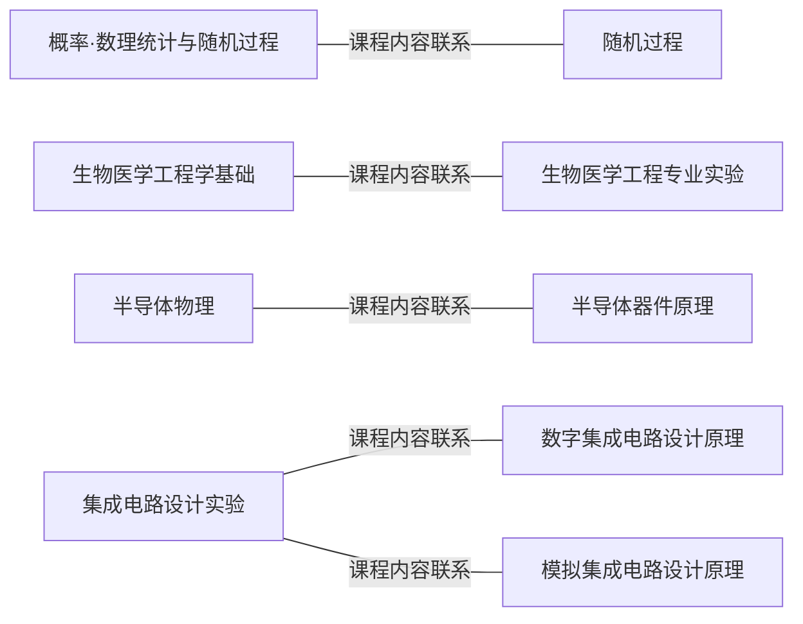

# 生物医学工程（智慧医药与芯片领军人才班）专业教学培养方案（香农计划适用）

2024 年汇编印刷页 798–800。原表记录 35 个可配对的课程代码。

[本节原页](plan-798.pdf#page=1) · [逐行数据](plan-798.json) · [院系目录](README.md)

## 课程关系图

图中展示最多 20 条关系。下表列出本节全部关系。建议学习顺序供规划课程使用，正式选课资格以教务规定为准。

| 课程 | 关联课程 | 关系 | 依据 |
| --- | --- | --- | --- |
| 概率、数理统计与随机过程（INFO130001） | 随机过程（INFO130399） | 课程内容联系 | 本方案两门课程的题名均含“随机过程”，可据此对照这一主题。 |
| 生物医学工程学基础（INFO130020） | 生物医学工程专业实验（INFO130390） | 课程内容联系 | 本方案两门课程的题名均含“生物医学工程”，可据此对照这一主题。 |
| 半导体物理（MICR130005） | 半导体器件原理（MICR130028） | 课程内容联系 | 本方案两门课程的题名均含“半导体”，可据此对照这一主题。 |
| 集成电路设计实验（MICR130011） | 数字集成电路设计原理（MICR130029） | 课程内容联系 | 本方案两门课程的题名均含“集成电路”，可据此对照这一主题。 |
| 集成电路设计实验（MICR130011） | 模拟集成电路设计原理（MICR130030） | 课程内容联系 | 本方案两门课程的题名均含“集成电路”，可据此对照这一主题。 |

## 课程

| 课程代码 | 名称 | 开课学期原文 | 来源（PDF 页） |
| --- | --- | --- | --- |
| AIS410014 | AI在生物分子结构中的研究及应用 | 秋 | 813 |
| BIOL130008 | 细胞生物学 | 4 | 812 |
| BIOL130024 | 生物统计学 | 秋 | 813 |
| BIOL130037 | 基因组学 | 秋 | 813, 814 |
| BIOL130039 | 神经生物学概论 | 秋 | 814 |
| CHEM130073 | 药物化学 | 5 | 813 |
| DATA130011 | 神经网络与深度学习 | 春 | 813 |
| INFO130001 | 概率、数理统计与随机过程 | 3 | 812 |
| INFO130010 | 数字信号处理A | 5 | 813 |
| INFO130016 | 毕业论文 | 8 | 813 |
| INFO130020 | 生物医学工程学基础 | 3 | 812 |
| INFO130090 | 医学成像技术 | 秋 | 813 |
| INFO130091 | 医学传感器 | 秋 | 814 |
| INFO130135 | 数字图像处理B | 春，秋 | 813 |
| INFO130145 | 光生物医学 | 秋 | 813 |
| INFO130236 | 前沿讲座 | 4 | 812 |
| INFO130305 | 数据结构与算法设计 | 秋 | 813 |
| INFO130306 | 信号与系统 | 4 | 812 |
| INFO130329 | 信息论基础 | 春 | 813 |
| INFO130331 | 数字逻辑基础 | 3 | 812 |
| INFO130342 | 机器学习 | 秋 | 813 |
| INFO130347 | 模拟电子学基础 | 3 | 812 |
| INFO130348 | 模拟与数字电路实验 | 4 | 812 |
| INFO130390 | 生物医学工程专业实验 | 5 | 812 |
| INFO130399 | 随机过程 | 秋 | 813 |
| INFO130426 | 生物芯片导论 | 5 | 812 |
| INFO130427 | 精准医疗概论 | 春 | 813 |
| INFO130430 | 脑机接口 | 春，秋 | 814 |
| INNO115011 | 创新创业大讲堂 | 春，秋 | 813, 814 |
| MICR130005 | 半导体物理 | 春 | 814 |
| MICR130006 | 嵌入式处理器与芯片系统设计 | 春 | 813, 814 |
| MICR130011 | 集成电路设计实验 | 秋 | 813 |
| MICR130028 | 半导体器件原理 | 秋 | 814 |
| MICR130029 | 数字集成电路设计原理 | 秋 | 813 |
| MICR130030 | 模拟集成电路设计原理 | 春 | 813 |
